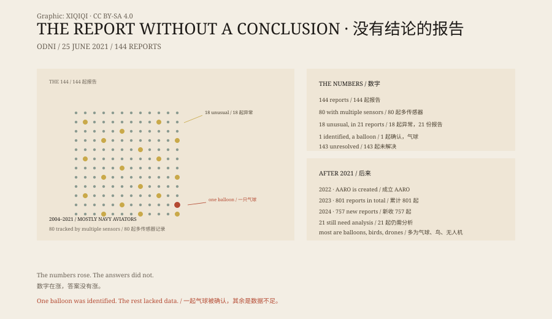

## 1. 25 June 2021

Washington. The Office of the Director of National Intelligence published a nine-page report.

The title was dry: *Preliminary Assessment: Unidentified Aerial Phenomena*.

It did not say aliens. It said: we have 144 reports.

## 2. 144

The reports ran from 2004 to 2021, mostly from Navy aviators.

Eighty were registered across multiple sensors: radar, infrared, electro-optical systems, and the human eye.

Eighteen incidents, described in 21 reports, involved unusual movement: holding position in the wind, moving against the wind, turning abruptly, with no visible means of propulsion. In a few cases, military aircraft systems picked up radio-frequency energy.

## 3. One Balloon

Of the 144, exactly one could be identified.

A deflating balloon.

The rest, the report said, lacked sufficient data. Not "unexplained". "Unresolvable".

## 4. Not Aliens

The report found no clear evidence that the phenomena were extraterrestrial.

It also found no evidence that they were advanced technology from a foreign adversary.

Most were probably physical objects: balloons, drones, birds, weather, sensor error, spoofing, misperception.

The report was more concerned with flight safety and military security. Aviators were seeing things and did not know whether to avoid them.

## 5. Afterwards

In 2022 the Pentagon established the All-domain Anomaly Resolution Office, or AARO.

Its 2023 annual report put the cumulative total at 801 reports. Most were classified as balloons, birds, drones or aircraft.

The 2024 report said 757 new reports had come in, and 21 still required further analysis.

The numbers rose. The answers did not.

## 6. The Report

The most important sentence in the report is not "unidentified". It is "insufficient data".

The most powerful military in the world, with radar, satellites and infrared pods, still could not account for 143 incidents.

It was not a cover-up. The sensors did not talk to each other, the reporting channels were poor, and aviators feared ridicule.

After 2021 the channels opened and the numbers grew. The sky did not become clearer.

Of the 144, one was a balloon. The rest are still in the folder.

*Original schematic: the 144 reports in the 2021 assessment, the 18 unusual incidents and the 2023–2024 totals. Not a photograph of a site. Oddity Archive, CC BY-SA 4.0.*

---

**Sources and licenses**: the factual sources are listed in the source ledger S1–S3 at the bottom of this entry. Text and original diagrams are licensed under CC BY-SA 4.0. This article separates the official statistics, the one identified case and the unresolved cases; the report confirmed neither extraterrestrial technology nor a foreign advanced aircraft. The illustration is a scene reconstruction, not a photograph of a site.
