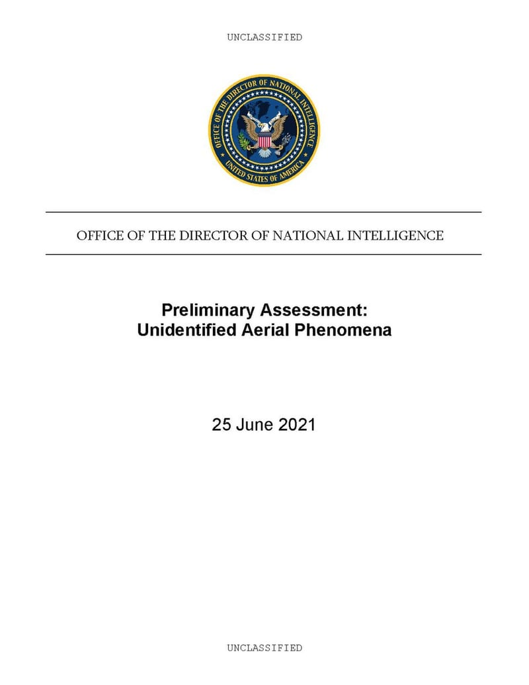
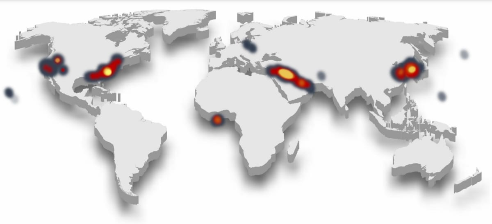
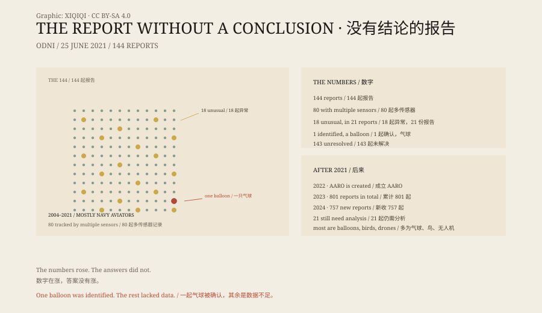

## 1. 25 June 2021

Washington. The Office of the Director of National Intelligence publishes a nine-page report.

The title is dry: Preliminary Assessment: Unidentified Aerial Phenomena.

It is not an investigation. It is a status report required by Congress. The Senate Intelligence Committee inserted a provision into the intelligence authorisation act for fiscal 2021: the Director of National Intelligence, with the Secretary of Defense, was to deliver an assessment of UAP within 180 days. The deadline was 25 June 2021.

The report was drafted by the Unidentified Aerial Phenomena Task Force and the ODNI National Intelligence Manager for Aviation, with input from the Defense Intelligence Agency, the FBI, the National Reconnaissance Office, the National Geospatial-Intelligence Agency, the NSA, the Air Force, the Army, the Navy, DARPA, the FAA, NOAA and others.

It did not say aliens. It said: we have 144 reports.

*Official document cover: Preliminary Assessment: Unidentified Aerial Phenomena, Office of the Director of National Intelligence, 25 June 2021. Public domain (Wikimedia Commons).*

## 2. 144

The data covers November 2004 to March 2021.

The 144 reports came mainly from the U.S. military, especially Navy aviators. The Navy set up a standard reporting mechanism in March 2019, so most of the cases are recent.

Eighty involved observations by multiple sensors: radar, infrared, electro-optical, weapon seekers, visual sighting. Each sensor left something: a track, a video frame, a range. Put together, they still do not make a complete object.

Eighteen incidents, reported in 21 documents, described unusual flight: stationary in winds aloft, moving against the wind, manoeuvring abruptly, or moving at considerable speed without discernible propulsion. In a small number of cases, military aircraft systems processed radio-frequency energy associated with the UAP.

Such behaviour could be sensor error, spoofing or observer misperception, the report says, and needs more rigorous analysis.

*Official chart: UAP reporting hotspots presented by AARO to the NASA independent study team, May 2023. Public domain (Wikimedia Commons). The hotspots cluster around U.S. military training areas and coastal airspace; they do not show where the objects came from.*

## 3. One Balloon

Of the 144, only one could be identified.

A large, deflating balloon.

The balloon's remains were recovered and its track matched. It is the only case in the 144 with an ending.

The other 143, the report says, lack sufficient data. Not "unexplained" — "unable to determine".

The two are not the same. "Unexplained" means someone tried and failed. "Unable to determine" means there was not enough data to try.

## 4. Five Possibilities

The report does not give UAP a single cause. It lists five categories:

1. Airborne clutter: balloons, drones, birds, plastic bags, weather balloons.
2. Atmospheric phenomena: ice crystals, temperature inversions, radar propagation.
3. U.S. secret projects: classified government or industry vehicles.
4. Foreign adversary technology: unknown systems from China, Russia or others.
5. Other: none of the above, requiring further scientific progress.

Most UAP "probably do represent physical objects", the report says, because they were registered across multiple sensors. But it found no clear evidence of extraterrestrial technology, and no evidence of a breakthrough by a foreign adversary.

The report is more concerned with flight safety and military security: a pilot sees something and does not know whether to evade; an unknown object appears in a training range, and the training stops.

*Official logo: U.S. Department of Defense All-domain Anomaly Resolution Office (AARO), 2023. Public domain (Wikimedia Commons). AARO was established in 2022 to take over UAP reporting and analysis.*

## 5. Reactions

After the report, the reaction on Capitol Hill was sharper than the report itself.

Senator Marco Rubio, vice chairman of the Senate Intelligence Committee, said: "There's stuff flying in our airspace and we don't know who it is and it's not ours. So we should know who it is, especially if it's an adversary that's made a technological leap."

Senator Mark Warner, the committee chairman, said the United States must be able to understand and mitigate threats to its pilots, whether from drones, weather balloons or adversary intelligence.

Deputy Secretary of Defense Kathleen Hicks issued a memo ordering all DoD personnel to use established processes for reporting UAP, and to ensure the task force received reports within two weeks of an occurrence.

The report's conclusion was uncertainty. Its side effect was certain: the reporting channels opened.

## 6. Afterwards

In 2022 the Pentagon established the All-domain Anomaly Resolution Office (AARO) to take over UAP reporting, analysis and records.

The 2022 annual report counted 510 cases in total, of which 171 remained uncharacterised.

The 2023 annual report counted 801, with 291 new reports.

The 2024 report, covering May 2023 to June 2024, recorded 757 new reports: 485 incidents in the period, plus 272 from 2021–2022 that had not previously been sent to AARO. As of October 2024 the cumulative total was 1,652. AARO resolved 118 cases, all to prosaic objects such as balloons, birds and drones; another 21 were flagged for further analysis.

Twenty-one. Smaller than 144, larger than zero.

AARO says it has found no evidence of extraterrestrial beings, activity or technology, and no confirmed adversarial breakthrough. But it also concedes that the 21 cases cannot be understood on the present physics and engineering.

## 7. Why the Data Is Thin

The most important sentence in the report is not "unidentified". It is "insufficient data".

The most powerful military, with radar, satellites and infrared pods, still cannot explain 143 cases.

The reasons are not mysterious: sensors operate in separate systems, with incompatible data formats; reporting channels were poor, and pilots feared ridicule; services and agencies did not share information; many incidents were recorded for only a few seconds, with no range, speed or altitude, and no second sensor to cross-check.

After 2021 the channels opened and the numbers rose. The sky did not become clearer.

Of the 144, one was a balloon. The rest are still in the files.

*Original schematic: the 144 reports of 2021, the 18 unusual-flight cases and the 2022–2024 totals. Not a photograph of an event. XIQIQI Editorial, CC BY-SA 4.0.*

---

**Sources and licenses**: sources are listed in the ledger S1–S6 at the foot of this entry. Text and original diagrams are CC BY-SA 4.0. The article keeps apart the official statistics, the identified case, the five possible explanations and the unresolved cases; the report confirmed neither extraterrestrial technology nor a foreign breakthrough. The illustrations are an official document cover, official charts and a schematic, not photographs of an event.
