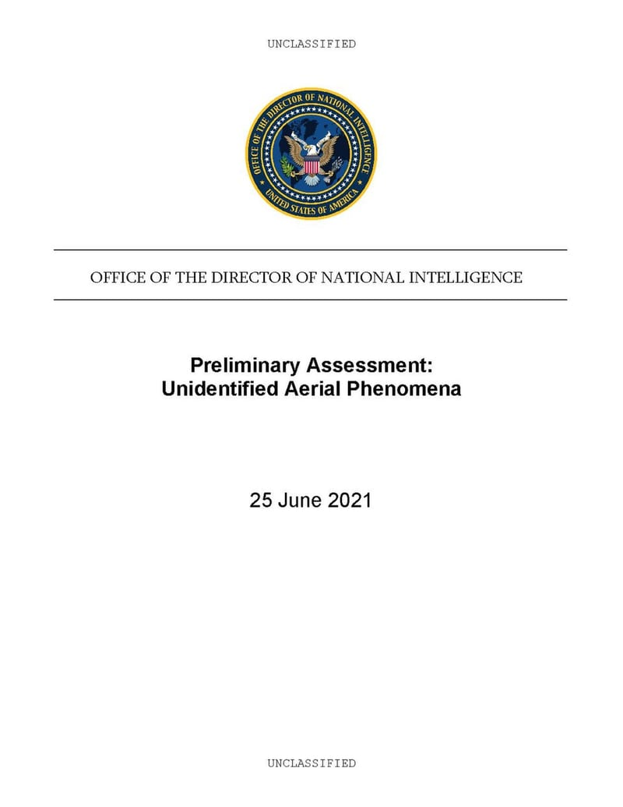
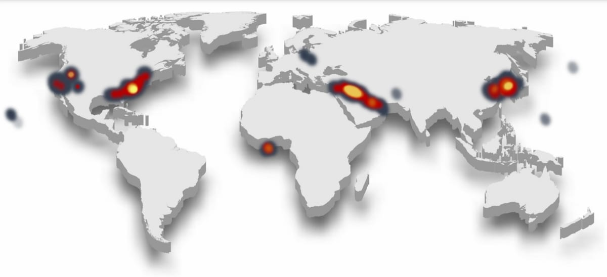
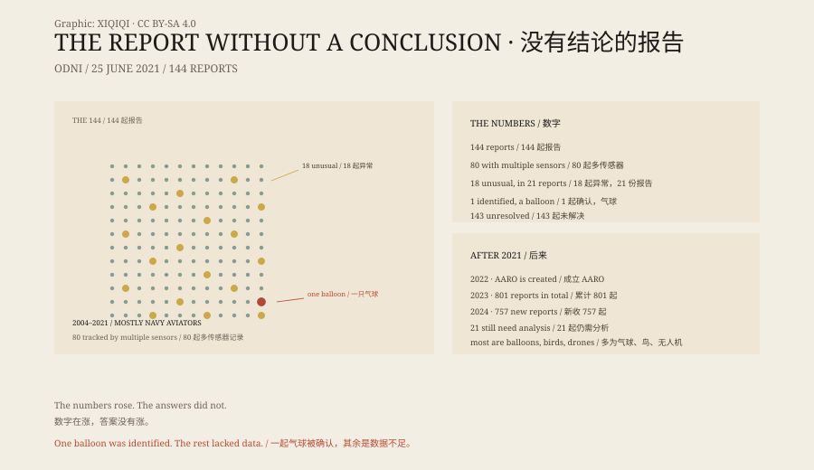

## 一、2021 年 6 月 25 日

华盛顿。国家情报总监办公室发布了一份九页的报告。

标题很干：《不明空中现象初步评估》。

它不是一份调查报告，而是一份应国会要求写的阶段性评估。参议院情报委员会在 2021 财年的情报授权法案里加了一条：国家情报总监要和国防部长合作，在 180 天内提交一份关于 UAP 的报告。截止日期就是 2021 年 6 月 25 日。

报告由不明空中现象任务组（UAPTF）和国家情报总监办公室的航空国家情报经理共同起草，参与机构包括国防情报局、联邦调查局、国家侦察局、国家地理空间情报局、国家安全局、空军、陆军、海军、DARPA、FAA、NOAA 等。

它没有说外星人。它说的是：我们记录到 144 起。

*官方文件封面：《不明空中现象初步评估》，美国国家情报总监办公室，2021 年 6 月 25 日。公有领域（Wikimedia Commons）。*

## 二、144

报告的数据范围是 2004 年 11 月到 2021 年 3 月。

144 起报告主要来自美国军方，尤其是海军飞行员。海军在 2019 年 3 月建立了标准化的报告机制，所以大部分案例发生在最近两年。

80 起被多种传感器记录：雷达、红外、光电、武器寻的器、目视。每个传感器都留下了一点东西：一条轨迹、一段视频、一个距离。把它们放在一起，仍然拼不出一个完整的物体。

18 起事件、21 份报告，描述了不寻常的飞行：在高空风中停着、逆风移动、突然转向、没有可见的推进方式却飞得相当快。少数案例里，军机系统记录到与 UAP 相关的无线电频段能量。

这些现象可能是传感器误差、信号干扰或观察者的错觉，报告说，需要更严格的分析。

*官方图表：AARO 向 NASA 独立研究团队展示的 UAP 报告热点分布，2023 年 5 月。公有领域（Wikimedia Commons）。热点集中在美国军事训练区和沿海空域，不能说明物体来自何处。*

## 三、一个气球

144 起里，只有一起能确认。

一只不断漏气的大气球。

气球的残骸被找到，轨迹也能对上。它是 144 起里唯一一个能写完的故事。

其余的 143 起，报告说，数据不足。不是“无法解释”，是“无法判断”。

这两个词不一样。“无法解释”意味着有人试过，但解释不了；“无法判断”意味着连足够的数据都没有。

## 四、五种可能

报告没有把 UAP 归为单一原因。它列了五类可能的解释：

一、空中杂物：气球、无人机、鸟、塑料袋、气象气球。

二、大气现象：冰晶、温度逆温、雷达折射。

三、美国的秘密项目：政府或工业界的机密飞行器。

四、外国对手的技术：中国、俄罗斯或其他国家的未知系统。

五、其他：以上都不是，需要等科学进步才能判断。

报告说，大多数 UAP“可能确实”是物理对象，因为它们在多种传感器上都有记录。但它没有明确证据表明这些现象来自外星技术，也没有证据表明它们是外国对手的突破性技术。

报告更关心的是飞行安全和军事安全：飞行员看见了东西，不知道该不该躲；训练空域里出现不明物体，训练就得中断。

*官方标志：美国国防部全域异常解决办公室（AARO），2023 年。公有领域（Wikimedia Commons）。AARO 于 2022 年成立，接手 UAP 的报告与分析。*

## 五、反应

报告发布后，国会山的反应比报告本身更激烈。

参议院情报委员会副主席马尔科·鲁比奥（Marco Rubio）说：“我们的领空里有东西在飞，我们不知道是谁的，反正不是我们的。所以我们得知道那是谁，尤其是如果它是对手的技术飞跃。”

委员会主席马克·华纳（Mark Warner）说，美国必须能够理解并减轻对飞行员的威胁，不管那是无人机、气象气球，还是对手的情报能力。

国防部副部长凯瑟琳·希克斯（Kathleen Hicks）发了一份备忘录，要求国防部所有人员使用既定流程报告 UAP，确保任务组在事件发生后两周内收到报告。

报告的结论是“不确定”，但它的副作用是确定的：报告渠道打开了。

## 六、后来

2022 年，五角大楼成立全域异常解决办公室（AARO），接手 UAP 的报告、分析和归档。

2022 年的年度报告说，累计记录达到 510 起，其中 171 起仍未归类。

2023 年的年度报告说，累计达到 801 起，新增 291 起。

2024 年的报告说，从 2023 年 5 月到 2024 年 6 月，新收到 757 起，其中 485 起发生在统计期内，272 起是 2021 到 2022 年的补报。截至 2024 年 10 月，累计 1,652 起。AARO 解决了 118 起，全部是气球、鸟、无人机等普通物体；另有 21 起被列为需要进一步分析。

21 起。这个数字比 144 小，但比 0 大。

AARO 说，没有发现地外生物、活动或技术的证据，也没有确认外国对手的突破性技术。但它也承认，那 21 起案例，以现有的物理学和工程学背景，无法理解。

## 七、为什么数据不够

这份报告最重要的句子，不是“不明”，是“数据不足”。

最强大的军队，有雷达、卫星、红外吊舱，仍然无法说清 143 起事件。

原因不神秘：传感器各自为政，数据格式不统一；报告渠道不畅，飞行员怕被嘲笑；不同军种、不同机构之间，信息不共享；很多事件的记录只有几秒钟，没有距离、速度、高度，也没有第二部传感器交叉验证。

2021 年之后，报告渠道打开了，数字变多了。但天空没有变得更清楚。

144 起里，只有一起是气球。剩下的，还在文件夹里。

*原创示意图：2021 年报告的 144 起分类、18 起异常飞行与 2022–2024 年累计数字。不是现场照片。稀奇奇编辑部，CC BY-SA 4.0。*

---

**来源与许可**：文字与原创示意图采用 CC BY-SA 4.0；第三方图片与资料的许可见文末来源台账。
