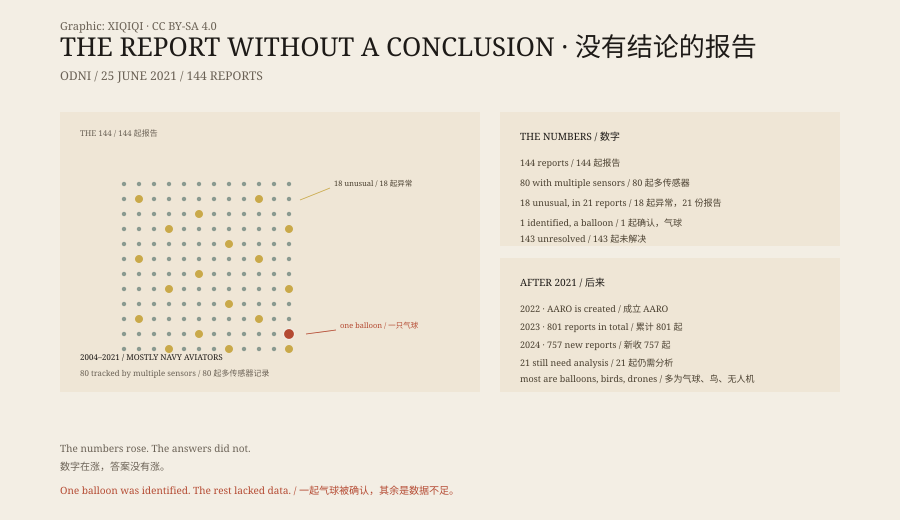

## 一、2021 年 6 月 25 日

华盛顿。国家情报总监办公室发布了一份九页的报告。

标题很干：《不明空中现象初步评估》。

它没有说外星人。它说的是：我们记录到 144 起。

在弗吉尼亚州的一间简报室里，军官们坐在屏幕前。屏幕上是一段模糊的红外影像：一个光点，在风里停着。没有人能立刻说出那是什么。

## 二、144

2004 到 2021 年，主要是海军飞行员的报告。

80 起被多种传感器记录：雷达、红外、光电、目视。

每个传感器都留下了一点东西：一条轨迹、一段视频、一个距离。把它们放在一起，仍然拼不出一个完整的物体。

*场景复原：军官观看不明空中现象传感器影像。不是现场照片。稀奇奇编辑部，CC BY-SA 4.0。*

18 起事件、21 份报告，描述了不寻常的飞行：停在风里、逆风移动、突然转向、没有可见的推进方式。少数案例里，军机系统记录到无线电频段的能量。

## 三、一个气球

144 起里，只有一起能确认。

一只不断漏气的大气球。

气球的残骸被找到，轨迹也能对上。它是 144 起里唯一一个能写完的故事。

其余的，报告说，数据不足。不是“无法解释”，是“无法判断”。

## 四、不是外星人

报告说，没有明确证据表明这些现象来自外星技术。

也没有证据表明它们是外国对手的先进技术。

大多数可能是物理对象：气球、无人机、鸟、天气、传感器误差、欺骗、误判。

报告更关心的是飞行安全和军事安全：飞行员看见了东西，不知道该不该躲。

## 五、后来

2022 年，五角大楼成立全域异常解决办公室，简称 AARO。

2023 年的年度报告说，累计报告达到 801 起；大多数被归类为气球、鸟、无人机、飞机。

2024 年的报告说，新收到 757 起，仍有 21 起需要进一步分析。

数字在涨，答案没有涨。

## 六、报告

这份报告最重要的句子，不是“不明”，是“数据不足”。

最强大的军队，有雷达、卫星、红外吊舱，仍然无法说清 143 起事件。

不是有人在隐瞒，而是传感器各自为政，报告渠道不畅，飞行员怕被嘲笑。

2021 年之后，报告渠道打开了，数字变多了。但天空没有变得更清楚。

144 起里，只有一起是气球。剩下的，还在文件夹里。

*原创示意图：2021 年报告的 144 起分类、18 起异常飞行与 2023–2024 年累计数字。不是现场照片。稀奇奇编辑部，CC BY-SA 4.0。*

---

**来源与许可**：本文的事实来源见条目底部来源台账 S1–S3。文字与原创示意图采用 CC BY-SA 4.0。文中把官方报告的统计、已确认案例与未解释案例分开叙述；报告没有确认外星技术，也没有确认外国先进技术。插图是场景复原，不是现场照片。
