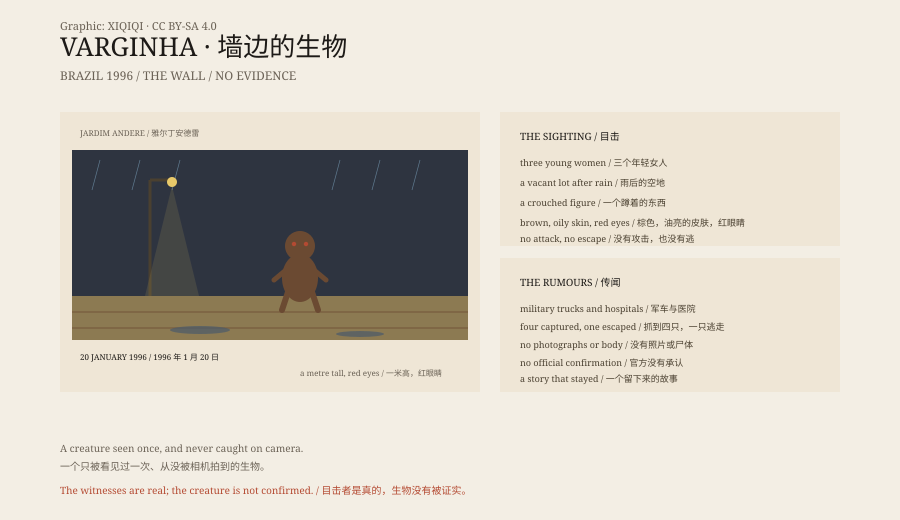

## 1. 20 January 1996

Varginha, Minas Gerais, Brazil, a coffee town of about 120,000 people.

It had rained that afternoon. Three young women cut across a vacant lot.

They saw something crouched by a wall.

## 2. The Creature

It was about a metre tall, brown, with oily skin, a large head and red eyes.

It did not run and it did not attack. It crouched there and made a sound.

The three women ran home and told their families. The news spread quickly.

## 3. The Military

In the following days military trucks, fire engines and people in protective suits appeared in the town.

Rumours said the military had captured creatures, taken them to a hospital, and that someone had died.

Some said four were captured; others said one escaped.

## 4. Versions

There are several versions of the story.

One says the creature was a mentally ill man abandoned in the lot by his family.

One says it was a military operation with nothing to do with UFOs.

Another says it was a survivor from a crashed craft.

## 5. Evidence

There are no photographs, no body and no craft.

There are witness statements, contemporary newspapers, records of military activity and countless later television programmes.

The authorities have not acknowledged an alien creature. The witnesses insist on what they saw.

## 6. The Town

Today Varginha has an alien statue and an "ET Street".

The town is famous for the story. Tourists take photographs; children draw green aliens at school.

The three women rarely gave interviews afterwards. What they saw has never received an explanation that everyone accepts.

*Original schematic: the sighting of 20 January 1996, the military activity and the later layers of rumour. Not a photograph of the site. Oddity Archive, CC BY-SA 4.0.*

---

**Sources and licenses**: the factual sources are listed in the source ledger S1–S3 at the bottom of this entry. Text and original diagrams are licensed under CC BY-SA 4.0. This article separates the three witnesses' accounts, the military and hospital rumours, and the "alien creature" conclusion; there is no public physical evidence, and the authorities have not acknowledged an alien. The illustration is a scene reconstruction, not a photograph of the site.
