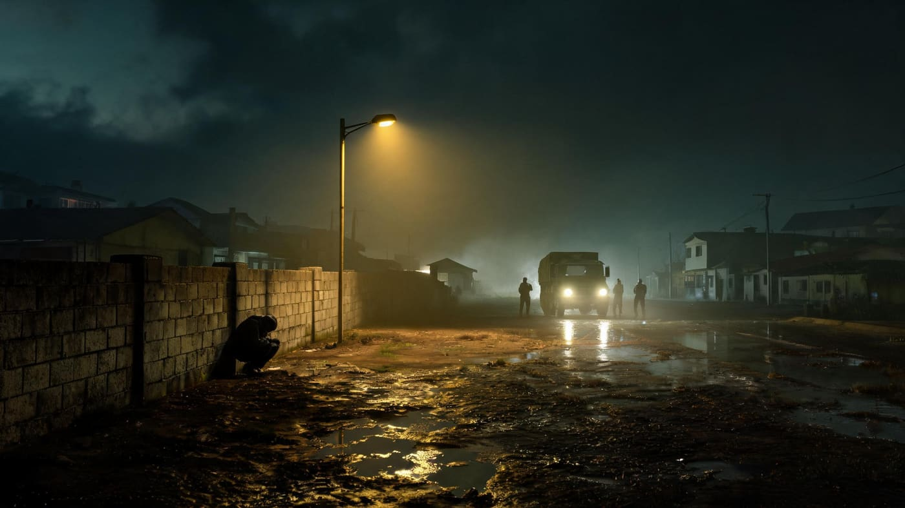
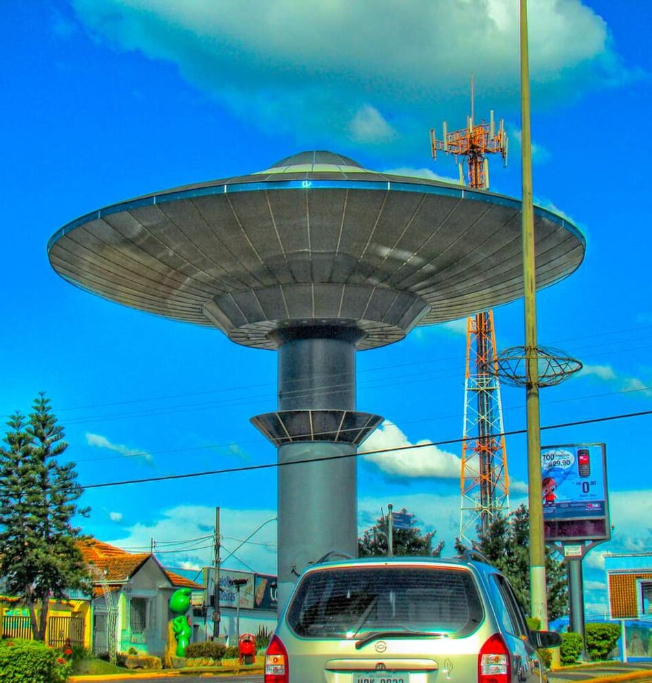
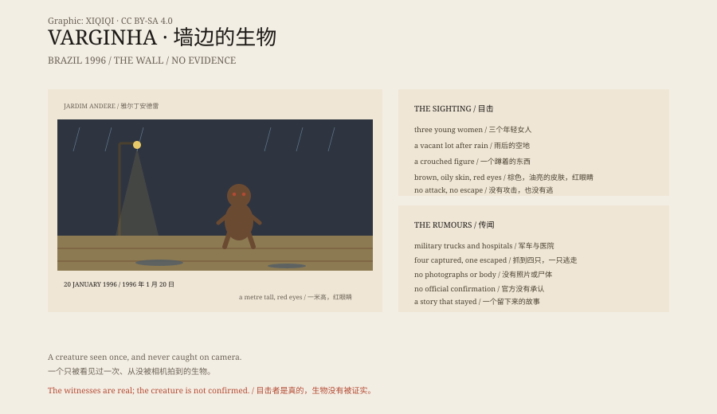

## 1. Half Past Three

Varginha, Minas Gerais, Brazil. A coffee town of about a hundred and twenty thousand people.

Half past three in the afternoon, 20 January 1996. Three young women crossed a vacant lot, taking a path near Rua Dr. Benevenuto Braz Vieira.

It had rained that afternoon. The air smelled of wet earth and coffee husks. They were taking a shortcut, between a wall and the open ground.

They saw something crouched by the wall.

*Reconstruction: the vacant lot and the creature by the wall at Varginha in 1996. Not a site photograph. XIQIQI Editorial, CC BY-SA 4.0.*

## 2. It

The three women were between fourteen and twenty-two years old.

They later told reporters that it was a large-headed biped. Its skin was brown, with "spots like veins" on it. There were three bumps on its head. Its eyes were "two red balls". It was crouched, swaying, as if it had been hurt or was ill.

It did not run. It did not attack. It simply crouched there.

The three ran. They went home and told their mother they had seen the devil.

The news travelled fast.

## 3. The Days After

Over the next few days, military trucks, fire engines and people in protective suits appeared in the town.

The stories layered up. Someone said UFOs had been seen in the sky in the days before. Someone said the army had captured the creature and taken it to the hospital, where a hospital worker had seen it. Someone said several creatures had been caught, and one had escaped. Someone said a police officer had died during the operation. Someone said a tapir, an ocelot and two grey brockets had died one after another at the local zoo, with no cause given.

The claims supported one another, and none of them joined into a chain of evidence. The hospital records, the vehicle movements, the orders that sent the men, were never made public in any form that added up to a whole story.

The army later admitted that its men had been at the scene, but called it a routine operation.

## 4. The Army's Conclusion

The Brazilian Army carried out an investigation. Its conclusion was plain: a local resident had been mistaken for an alien being, and the movement of military personnel in the area had been routine.

That did not convince everyone. It did not explain the specific details the three women reported: the three bumps, the red eyes, the vein-like spots. Nor did it explain why the military vehicles had clustered there in those particular days.

But it offered one possibility: a person crouching by a wall after the rain, seen by three frightened young women, and then distorted, detail by detail, in the retelling.

## 5. Why It Still Travels

The American skeptic Brian Dunning was severe about the case. He called it "the most compelling example of a case where literally nothing at all happened that was remotely unusual, and was magnified into a case considered unassailable proof of alien visitation by many." To those who believed, he suggested "recalibrating where you set the bar for quality of evidence."

Dunning has a position, but he identified one fact: the evidence in this case is mainly testimony. The testimony also varies. Whether it was crouching or standing, the three women did not later describe it in exactly the same way.

There are no photographs, no body, no spacecraft, no published laboratory report. There are witness statements, the newspapers of the time, the record of the army's movements, and an enormous number of television programmes.

When evidence is thin, stories multiply. Every gap is filled: a sick man, a military exercise, a survivor of a crashed ship.

## 6. The Town's Business

Varginha did not hide the story. It turned it into trade.

A flying-saucer-shaped water tower stands in the centre of town, named the Nave Espacial de Varginha, the Varginha spaceship. Bus stops were built in the shape of spaceships. Municipal advertising used grey aliens. Near the site, vendors sell grey alien dolls dressed in football shirts.

Every January someone retells the story of the three women. Tourists come to photograph the sites. Children draw green aliens at school.

The three women later gave very few interviews. What they saw has never received an explanation that everyone accepts.

*Site photograph: the Nave Espacial de Varginha water tower in the town centre, 2008. ubirajararodrigues51, CC BY-SA 2.0 (Wikimedia Commons). The saucer-shaped tank became the town's emblem for the incident.*

## 7. Retold and Refilmed

The story has been turned into books and films again and again.

In 1996 the Brazilian ufologist Vitorio Pacaccini and the writer Maxs Portes published Incidente em Varginha. In 2001 one of the principal investigators published O Caso Varginha. In 2005 the American surgeon and ufologist Roger Leir published UFO Crash in Brazil. Two more Portuguese-language non-fiction books followed in 2015 and 2022.

On screen there was a documentary-style Alien Encounter in 1998, an episode of Chasing UFOs in 2012, the short film 1996 in 2020, James Fox's documentary Moment of Contact in 2022, and a Brazilian documentary, O Mistério de Varginha, in 2025.

Each version adds a little material and a little speculation. The story gets longer; its core remains what three women saw in a wet lot after the rain.

## 8. The Water Tower

Today the first thing a visitor sees in Varginha is the water tower.

A grey saucer on a column, like a ship stopped in mid-air. It was built to hold water. It is now a landmark. At night the saucer is lit from below, and from a distance it really does look as if it is hovering.

Below it is an ordinary square. People walk dogs, sell things, sit on benches. For them the events of 1996 are part of the town's history and part of the tourist trade.

What the three women saw has no name. It is called the Varginha alien, made into dolls, printed on postcards. Its original shape survives only in three memories: by the wall, brown, red-eyed, three bumps on its head.

*Original schematic: the sighting of 20 January 1996, the military operation and the later layers of rumour. Not a site photograph. XIQIQI Editorial, CC BY-SA 4.0.*

---

**Sources and licenses**: for “The Creature by the Wall”, sources are listed in the ledger S1–S4 at the foot of this entry. Text and original diagrams are CC BY-SA 4.0. The article keeps apart the statements of the three witnesses, the hospital and military rumours, the reported deaths at the zoo and the claim of an alien being; no physical evidence has been published, and the Brazilian Army's conclusion was that a local resident had been mistaken for an alien. The illustrations are a reconstruction and a site photograph, not a photograph of the incident.
