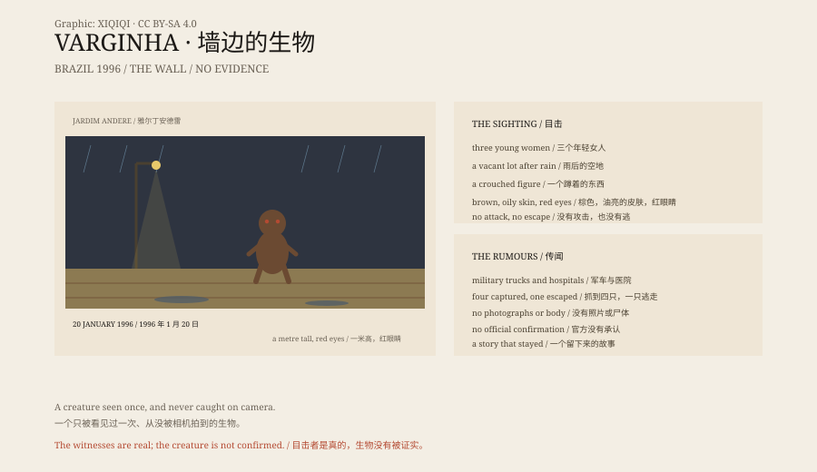

## 一、1996 年 1 月 20 日

巴西，米纳斯吉拉斯州，瓦尔任阿。一个约十二万人的咖啡小镇。

那天下午下过雨。三个年轻女人穿过一片空地。

她们看见墙边蹲着一个东西。

## 二、它

它大约一米高，棕色，皮肤像油，头很大，眼睛是红的。

它没有逃跑，也没有攻击。它只是蹲在那里，发出一种声音。

三个女人跑回家，告诉家人。消息很快传开。

## 三、军方

接下来几天，镇上出现了军车、消防车和穿着防护服的人。

传言说，军方抓到了生物，送到了医院，还有人死了。

有的说，一共抓到了四只；有的说，其中一只逃走了。

## 四、版本

这个故事有几个版本。

一个版本说，那是一个精神病患者，被家人遗弃在空地上。

一个版本说，那是一场军事行动，跟 UFO 无关。

还有一个版本说，那是一艘飞船的幸存者。

## 五、证据

没有照片，没有尸体，没有飞船。

有的只是目击者的证词、当时的报纸、军方的行动记录，以及后来无数次的电视节目。

官方没有承认外星生物。目击者坚持他们看见的东西。

## 六、小镇

今天，瓦尔任阿有一个“外星人”雕像，还有一条“ET 街”。

小镇靠这个故事出名。游客来拍照，孩子在学校里画绿色的外星人。

那三个女人后来很少接受采访。她们看见的东西，一直没有一个所有人都接受的解释。

*原创示意图：1996 年 1 月 20 日的目击、军方行动与后来的传闻分层。不是现场照片。稀奇奇编辑部，CC BY-SA 4.0。*

---

**来源与许可**：本文的事实来源见条目底部来源台账 S1–S3。文字与原创示意图采用 CC BY-SA 4.0。文中把三名目击者的证词、军方与医院的传闻、以及“外星生物”的结论分开叙述；没有公开的实物证据，官方没有承认外星生物。插图是场景复原，不是现场照片。
