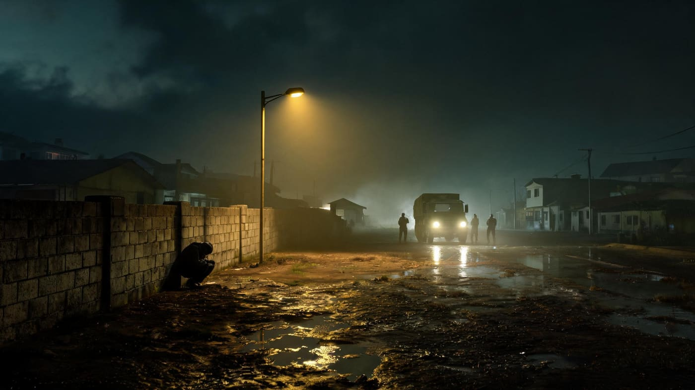
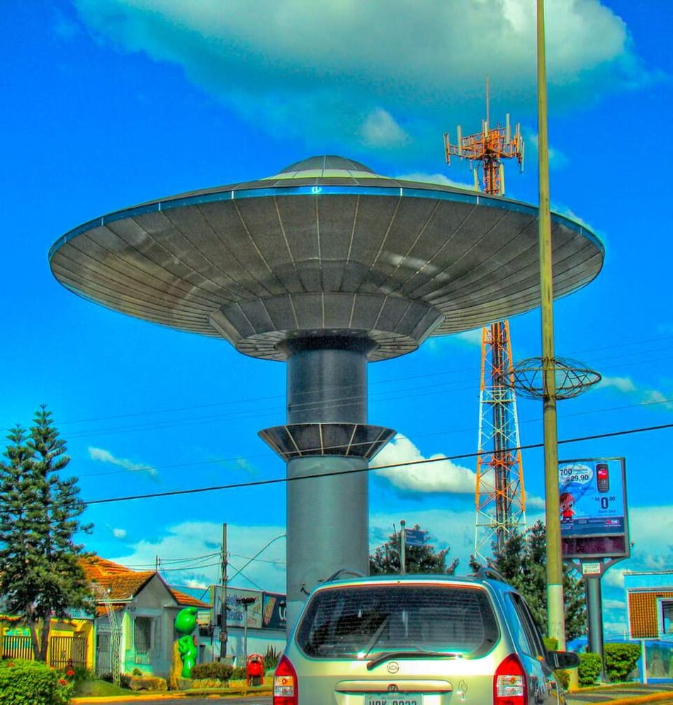
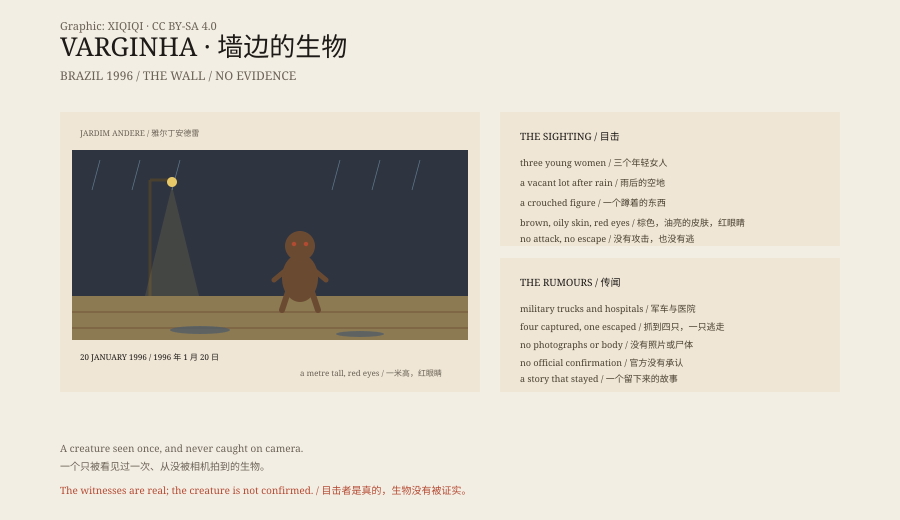

## 一、三点半

巴西，米纳斯吉拉斯州，瓦尔任阿。一个约十二万人的咖啡小镇。

1996 年 1 月 20 日下午三点半。三个年轻女人穿过一片空地，走的是贝内韦努托·布拉兹·维埃拉医生街（Rua Dr. Benevenuto Braz Vieira）附近的一条小路。

那天下午下过雨。空气里都是湿土和咖啡壳的味道。她们抄近路，从墙和空地之间穿过去。

她们看见墙边蹲着一个东西。

*场景复原：1996 年瓦尔任阿雨后空地与墙边的生物。不是现场照片。稀奇奇编辑部，CC BY-SA 4.0。*

## 二、它

三个女人的年龄在 14 到 22 岁之间。

她们后来对媒体说，那是一个大头、两足的东西。皮肤棕色，上面有“像血管一样的斑点”，头顶有三个突起。眼睛是“两颗红球”。它蹲着，身体在晃，像是受了伤，或者病了。

它没有逃跑，也没有攻击。它只是蹲在那里。

三个人跑了。她们回到家，告诉母亲，说自己看见了“魔鬼”。

消息在镇上传得很快。

## 三、接下来几天

接下来几天，镇上出现了军车、消防车和穿着防护服的人。

传言一层一层加上去。有人说，在事发前几天，天上看见过 UFO。有人说，军方抓到了生物，送到了医院，医院里有人看见它。有人说，一共抓到了好几只，其中一只逃走了。有人说，一名警察在行动中死了。还有人说，当地动物园里，一头貘、一只豹猫和两头灰短角鹿先后死了，死因不明。

这些说法互相支撑，却没有一条能拼成完整的证据链。医院的记录、车辆的调动、谁下了命令，都没有公开到能拼成完整故事的程度。

军方后来承认，他们确实到过现场，但说那是一次普通的行动。

## 四、军方的结论

巴西陆军做过一次调查。结论很朴素：一名当地居民被误认成了外星生物；军人和车辆在那一带的移动，是例行公事。

这个结论没有说服所有人。它没有解释那三个女人看见的具体细节：三个突起、红眼睛、像血管的斑点。也没有解释，为什么军车会在那几天集中出现。

但它至少给出了一种可能：一个人，在雨后的墙边蹲着，被三个受了惊的年轻女人看见，然后在传言里一点点变形。

## 五、为什么还在传

美国怀疑论者布莱恩·邓宁（Brian Dunning）对这件事的评价很重。他说，这是“一个最能说明问题的案例：实际上什么都没有发生，任何一点都不算异常，却被放大成许多人眼中无法反驳的外星访问证据”。他还说，对相信的人，他建议“重新校准你判断证据质量的门槛”。

邓宁的话有立场，但他点中了一个事实：这个案子的证据，主要是证词。证词之间也有出入：它蹲着还是站着，三个人后来的说法并不完全一致。

没有照片，没有尸体，没有飞船，没有公开的化验报告。只有目击者的证词、当时的报纸、军方的行动记录，以及后来无数次的电视节目。

证据少，故事就多。每一个空缺都会被新的说法填上：一个病人、一次军事行动、一艘飞船。

## 六、小城的生意

瓦尔任阿没有把这件事藏起来，它把这件事做成了生意。

市中心立起一座飞碟形状的水塔，叫“瓦尔任阿号飞船”（Nave Espacial de Varginha）。公交站被造成飞船的样子。市政广告用灰色外星人做形象。事发地点附近，小贩卖灰色的外星人玩偶，玩偶穿着足球队服。

每年 1 月，镇上会有人重讲那三个女人的故事。游客来拍照，孩子在学校里画绿色的外星人。

那三个女人后来很少接受采访。她们看见的东西，一直没有一个所有人都接受的解释。

*现场照片：瓦尔任阿市中心的“瓦尔任阿号飞船”水塔，2008 年。ubirajararodrigues51，CC BY-SA 2.0（Wikimedia Commons）。水塔的碟形水箱成了这起事件的城镇标志。*

## 七、一次次重拍

这个故事被反复写成书、拍成片子。

1996 年，巴西 UFO 研究者维托里奥·帕卡奇尼（Vitorio Pacaccini）和作家马克斯·波尔特斯（Maxs Portes）出了《瓦尔任阿事件》（Incidente em Varginha）。2001 年，主要调查者之一出了《瓦尔任阿案》（O Caso Varginha）。2005 年，美国外科医生、UFO 研究者罗杰·莱尔（Roger Leir）出了英文书《UFO Crash in Brazil》。2015 年、2022 年，又有两本葡萄牙语的非虚构作品。

影视方面，1998 年有纪录片式的《Alien Encounter》，2012 年有《Chasing UFOs》的一集，2020 年有短片《1996》，2022 年有詹姆斯·福克斯（James Fox）的纪录片《Moment of Contact》，2025 年又有巴西导演的《O Mistério de Varginha》。

每一版都补上一点新材料，也补上一点新的猜测。故事越拍越长，核心仍然是那三个女人在雨后空地上看见的东西。

## 八、水塔

今天到瓦尔任阿，最先看见的是那座水塔。

一个灰色的碟子架在柱子上，像一艘停在半空的飞船。它本来是供水设施，现在成了地标。到了晚上，碟子下面打灯，远远看过去，真的像在悬停。

水塔下面是一个普通的广场。有人遛狗，有人卖东西，有人坐在长椅上。1996 年的事情，对他们来说，是小镇历史的一部分，也是游客带来的收入。

那三个女人看见的东西，没有名字。它被叫作“瓦尔任阿的外星人”，被做成玩偶，印在明信片上。它原来的样子，只留在三个人的记忆里：墙边，棕色，红眼睛，头顶三个突起。

*原创示意图：1996 年 1 月 20 日的目击、军方行动与后来的传闻分层。不是现场照片。稀奇奇编辑部，CC BY-SA 4.0。*

---

**来源与许可**：事实来源见条目底部来源台账 S1–S4。文字与原创示意图采用 CC BY-SA 4.0。文中把三名目击者的证词、军方与医院的传闻、动物园动物死亡的说法，以及“外星生物”的结论分开叙述；没有公开的实物证据，巴西陆军的调查结论是当地居民被误认。插图是场景复原与现场照片，不是事件现场照片。
