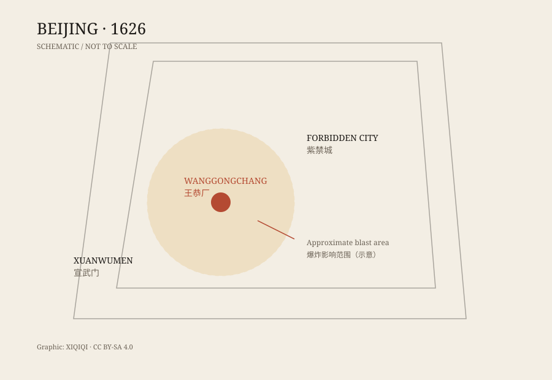

## 1. The sixth day of the fifth month

May 30, 1626. The sixth day of the fifth lunar month, in the sixth year of the Tianqi reign. Around nine in the morning.

The southwestern corner of Beijing. Wanggongchang. It was not an ordinary courtyard. It was a gunpowder depot under the Ministry of Works, storing powder, firearms, and raw materials. Around it were dense houses, shops, and government offices.

First a low rumble, then a much larger one. A column of smoke and dust rose from the ground like a wall. Houses collapsed. Tiles flew. People in the street were thrown off their feet. The shock reached the imperial palace, and the Tianqi Emperor was badly shaken.

Later writers called it a “heavenly change.” It was not an ordinary fire. It was an explosion that the whole city could feel.

## 2. What Wanggongchang was

Ming Beijing had several gunpowder and firearms depots. Wanggongchang was one of them. It stored and produced gunpowder for the capital garrison and the city defenses.

Putting a gunpowder depot inside a city is a risk in itself. The Ming had regulations for managing powder, but how strictly they were followed is another matter. Wanggongchang stood close to crowded streets. If something went wrong, the consequences would not be small.

After the explosion, the court quickly concluded that it was a gunpowder accident and punished officials. The conclusion was not strange. The site was a powder depot, and similar explosions had happened before.

What was strange was the scale, and the details left behind.

## 3. What the streets left behind

Contemporary gazettes and later notes recorded many details.

Some said the blast blew clothes off people without leaving obvious wounds. Some said large trees were torn out of the ground and carried over the city wall. Some said stone lions outside Xuanwumen were thrown beyond the gate. Others said a strange cloud shaped like a lingzhi mushroom appeared in the sky.

These details were copied and retold, each version a little stranger. They may not all be reliable, but they explain why the explosion was remembered: it was not only an accident, but an accident that seemed to disobey common sense.

*Original schematic: the approximate location of Wanggongchang within Beijing. Not a historical map, not to scale. Oddity Archive, CC BY-SA 4.0.*

## 4. The official account

The Ming court's basic account was this: the Wanggongchang powder depot exploded, and the cause was burning gunpowder.

That explains a great deal. There was a large quantity of powder on site. The blast centre was in the depot. Casualties were concentrated nearby. Officials were held responsible afterward.

But questions remain. How much powder was stored at Wanggongchang? Did the yield match the damage? Why was the blast area so large? Why were there those strange secondary effects?

People asked these questions in the Ming dynasty. They still do.

## 5. Why it is still discussed

Modern writers have proposed several explanations.

The first is a gunpowder explosion. It is the safest and best fits the site. The question is whether the amount stored could produce the observed damage.

The second is an earthquake. Beijing lies near seismic zones. An earthquake could have started a fire in the depot and could explain collapsed buildings. But it does not explain why the blast centre was so concentrated.

The third is a meteorite or an airburst. Some writers compare Wanggongchang with Tunguska: a huge explosion, strange effects, no obvious crater. But Wanggongchang had a gunpowder depot, and that difference matters.

The fourth is combustible gas or another industrial accident. Ming-era powder workshops, granaries, and drains could produce flammable gas, but the evidence is thin.

No explanation satisfies everyone. Mainstream history still treats it primarily as a gunpowder explosion, while acknowledging that the details are disputed.

## 6. What it is not

Wanggongchang often appears on lists of “UFO explosions” or “alien incidents.” There is no reliable evidence for that.

It is not a completely unsolved mystery either. There was a powder depot, an official investigation, and a large documentary record. The core facts are clear: an explosion in a powder depot inside Beijing caused enormous loss of life.

What unsettles people are the details in the records: the clothes, the trees, the stone lions, the strange cloud. They are like footnotes that refuse to stay in order. Even when the cause is broadly known, a disaster always leaves something that will not fit neatly into the file.

---

**Sources and licenses**: the factual sources are listed in the source ledger S1–S3 at the bottom of this entry. Text and original diagrams are licensed under CC BY-SA 4.0. Modern explanations of the cause are disputed; this article separates official records, contemporary rumors, and later speculation.
