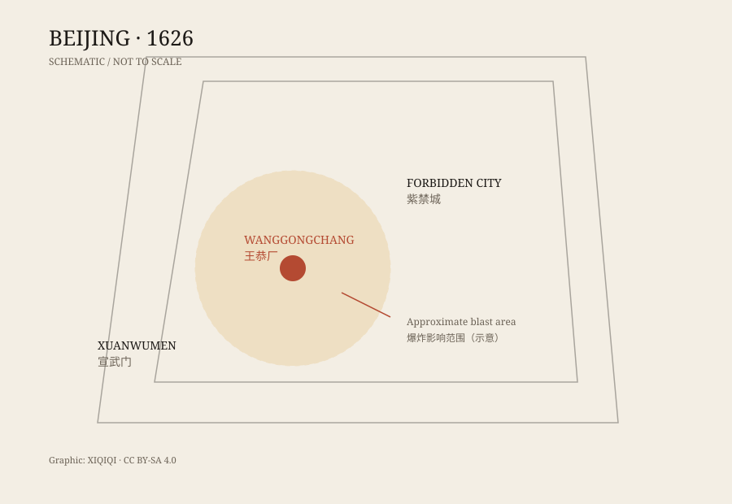

## 一、五月初六

1626 年 5 月 30 日，天启六年五月初六，上午九点左右。

北京城西南角，王恭厂。这里不是普通的院子，而是工部管辖的火药库，存着火药、火器和原料。附近是密集的民居、商铺和衙门。

先是一声闷响，然后是一声更大的。烟尘从地面升起来，像一堵墙。房屋倒了，瓦片飞了，街上的行人被掀翻。爆炸的震动传到皇宫，天启帝受到惊吓，宫中一度混乱。

后来的人用“天变”来形容这一天。它不是一场普通的火灾，而是整座城市都能感到的爆炸。

## 二、王恭厂是什么地方

明代北京有多个火药局、火器库，王恭厂是其中之一。它负责储存和制造火药，供应京营和城防。

火药库放在城里，本身就是一个风险。明代对火药管理有规定，但执行得怎么样，是另一回事。王恭厂附近人口密集，一旦出事，后果不会小。

爆炸之后，朝廷很快把原因定为火药事故，并追究了相关官员的责任。这个结论并不奇怪：现场就是火药库，明代也发生过类似的火药爆炸。

奇怪的是规模，以及爆炸之后留下的那些细节。

## 三、街上留下了什么

当时的邸报和后来的笔记里，留下了很多描述。

有人说，爆炸把衣服从人身上吹走，人却没有明显外伤；有人说，大树被连根拔起，飞过城墙；有人说，宣武门外的石狮子被抛到城外；还有人说，天空出现了一朵灵芝形状的怪云。

这些细节后来被反复转抄，越写越奇。它们不一定全部可信，但它们解释了为什么这场爆炸会被记住：它不只是一场事故，还是一场看起来“不合常理”的事故。

*原创示意图：王恭厂与北京城的大致位置。不是历史地图，不按比例。稀奇奇编辑部，CC BY-SA 4.0。*

## 四、官方怎么说

明代官方的基本说法是：王恭厂火药库发生爆炸，原因是火药起火。

这个说法能解释很多事：现场有大量火药，爆炸中心在库区，伤亡集中在附近，事后也有官员被问责。

但它也留下问题。王恭厂当时存了多少火药？爆炸的威力是否匹配？为什么破坏范围那么大？为什么会有那些奇怪的次生现象？

这些问题在明代就有人问，到了现代也没有完全统一的答案。

## 五、为什么它还在被讨论

现代人提出过几种解释。

第一种是火药爆炸。这是最稳妥的，也最符合现场证据。问题在于库存量和爆炸当量是否对得上。

第二种是地震。北京位于地震带附近，地震可能引发火药库火灾，也可能解释房屋倒塌。但地震说不能解释为什么爆炸中心如此集中。

第三种是陨石或空爆。有人把王恭厂和通古斯放在一起比较：都是大爆炸、都有奇怪的现象、都没有留下明显的陨石坑。但王恭厂有火药库，这个差别很关键。

第四种是可燃气体或其他工业事故。明代的火药作坊、粮仓、下水系统都可能产生可燃气体，但证据不足。

目前没有一个解释能让所有人满意。主流历史叙述仍以火药爆炸为主，同时承认细节上有争议。

## 六、它不是什么

王恭厂爆炸经常被写进“UFO 事件”“外星人爆炸”之类的榜单。这些说法没有可靠证据。

它也不是一个完全无解的谜。现场有火药库，有官方调查，有大量文献记录。它的核心事实是清楚的：一场发生在北京城里的火药库爆炸，造成了巨大伤亡。

真正让人不安的，是记录里的那些细节：衣服、树、石狮子、怪云。它们像是一些不听话的注脚，提醒我们：即使原因基本清楚，灾难的现场也总会留下一些无法整齐归档的东西。

---

**来源与许可**：本文的事实来源见条目底部来源台账 S1–S3。文字与原创示意图采用 CC BY-SA 4.0。关于爆炸原因的现代解释存在争议，本文区分了官方记载、当时传闻和后来的推测。
