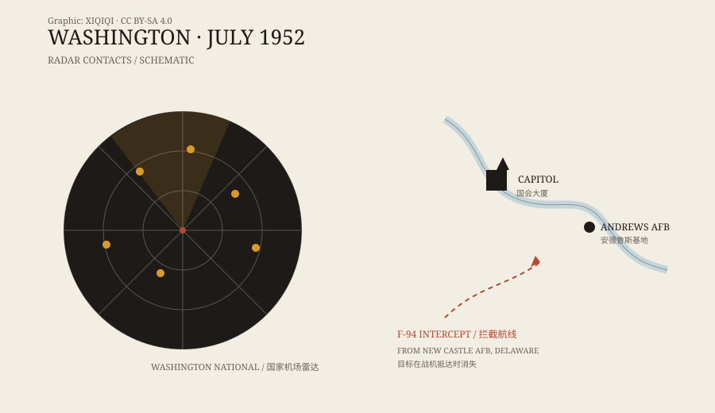

## 1. That summer

Washington, July 1952. The Cold War was on, and the papers carried flying-saucer stories almost every day.

In June the US Air Force had held a press conference to explain that most sightings had ordinary causes. Then the airport radar began to misbehave.

## 2. The radar

Late on the night of 12 July, radar operators at Washington National Airport saw several targets on their screens. They did not behave like flights: they were slow, sometimes faster, sometimes stationary, then suddenly moving. Radar at Andrews Air Force Base saw them too.

At 11:40 p.m. on 19 July, more targets appeared. They passed near the White House and the Capitol. The tower called Andrews, and Andrews confirmed that its radar showed them as well.

*Original schematic: the radar contacts and intercept course on the night of 19 July 1952. Not a radar photograph. Oddity Archive, CC BY-SA 4.0.*

## 3. The jets

F-94 Starfire night fighters took off from New Castle Air Force Base. When the pilots reached the position shown on radar, the targets disappeared. When the aircraft left, the targets returned. This happened more than once.

Casey Pierman, a Capital Airlines pilot, was also in the air. He reported a group of lights roughly matching the radar targets. They were brighter than the stars, he said, and they did not move like aircraft.

## 4. The press conference

The Air Force sent Edward Ruppelt to Washington. He ran Project Blue Book. On 29 July he held a press conference and said the most likely explanation was a temperature inversion.

A temperature inversion is a common summer-night structure: cool air near the ground, warmer air above. Radar waves bend between the layers and can produce false returns. Ground lights can also be refracted into the sky, where they look like points of light.

The explanation was reasonable for the radar technology of the time. It did not satisfy everyone.

## 5. The inversion

The radar operators rejected it. They saw inversion echoes every day, they said, and knew what they looked like. These targets moved, vanished, and reappeared — not like weather.

The pilots rejected it too. What they saw was a real light, they said, not noise on a screen.

The two things are not necessarily in conflict. Radar can be fooled by an inversion, and a pilot can see stars, aircraft lights, or something else. Both accounts can be true and still be incomplete.

## 6. The Robertson Panel

In January 1953 the CIA convened a panel chaired by the physicist Howard Robertson. It reviewed reports including the Washington case and concluded that there was no evidence that unidentified flying objects threatened national security. It recommended “debunking” sightings to reduce public attention.

The report was later declassified. It did not say every sighting was false, but it changed how the government handled such cases: less explanation, less publicity, and an effort to let the subject cool down.

## 7. What remains

The Washington case left no physical object — only radar records, radio traffic, and pilots' reports. It became a template: radar sees something, people see something, jets scramble, nothing is caught.

More than seventy years later, the same scene still plays out. The radar is better and the cameras are everywhere. The answers have not become simpler.

## The 1952 radar

July 1952, Washington, D.C.

For several nights, a group of targets appeared on the radar screen of the national airport. They were found near the no-fly zone, not moving fast, sometimes dispersed, sometimes gathering together. Radar operators said they were not like planes.

On 19 and 20 July, similar targets were reported at the airport towers, Andrews Air Force Base and nearby meteorological radars. The fighter jets took off urgently and the pilots said they saw some light, but the light went away after it.

## Press conference

On July 29, the Air Force held a press conference in Washington.

At the meeting, officials showed radar records and admitted that “it was true that something was captured by radar”, but did not confirm that they were alien ships. That was a cautious statement, but enough to get the paper on the front page.

And that's when the name "Washington Rotten Horse" comes up. It describes the targets that go around the radar, like a carousel in a park.

## Antitemperature layer

The subsequent investigation gave a very general explanation: the reverse temperature.

During summer nights, the ground cools fast, with a warm air above it, creating a temperature reversible. Radar waves are refrigerated in the reverse atmosphere, and the echoes of the ground objects — trucks, buildings, trees — may bend to the radar screen, looking like the target in the air.

This phenomenon is called "radar transmission anomaly." It allows a ground target to appear in an impossible position, and it divides a target into multiple.

## Robertson Group

At the end of 1952, the Central Intelligence Agency organized a team of scientists, chaired by physicist H. P. Robertson, dedicated to the evaluation of the UFO report.

The Panel has looked at a number of cases, including the events in Washington, and has concluded that most of them can be explained by natural phenomena or misperceptions, and that a few cannot be explained, but there is no evidence that they are alien spacecraft.

This conclusion does not end the debate. It simply removes the “outer spaceship” from the official document and leaves the “unexplainable” behind with the private sector.

## Radar tells stories

The events in Washington were important because it was the first time that “radar evidence” had been brought into public view.

In the view of many, radar is an objective machine that can see things that people can't see. But radar is not a camera, it shows echoes, not objects. The atmosphere, the ground, the equipment set, and the operator's judgment change the image on the screen.

A light point, possibly an aircraft, a truck, a reverse layer, or a noise on the screen. To confirm what it is, another radar, another eye, and a record of the same time.

## Supplementary Notes

After the events in Washington, the Air Force has established a more formal UFO investigation procedure. The Blue Book plans to collect tens of thousands of reports, most of which are explained and a few are labelled “unidentifiable”. This classification has been retained until today. It acknowledges the unknown and limits its scope.

## Location of the archives

The Washington event was the beginning of the radar age. It convinced the public for the first time that machines could see things that people could not see. Subsequent studies showed that machines could also be deceived by the atmosphere. The lesson has always been useful: the more the form of evidence becomes technical, the more the need to understand the boundaries of technology.

---

**Sources and licenses**: the factual sources are listed in the source ledger S1–S3 at the bottom of this entry. Text and original diagrams are licensed under CC BY-SA 4.0. This article keeps the radar records, the pilots' sightings, and the later official explanation in separate layers rather than treating any one of them as the whole answer.
