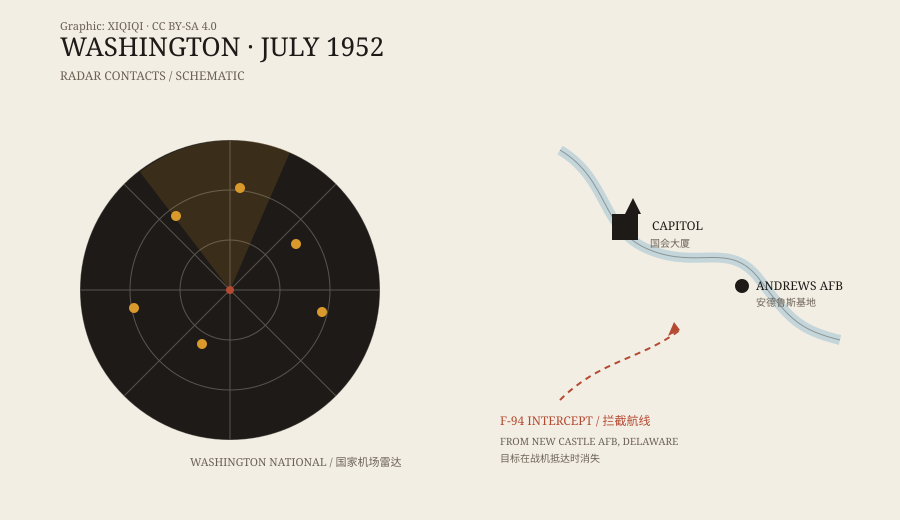

## 1. That summer

Washington, July 1952. The Cold War was on, and the papers carried flying-saucer stories almost every day.

In June the US Air Force had held a press conference to explain that most sightings had ordinary causes. Then the airport radar began to misbehave.

## 2. The radar

Late on the night of 12 July, radar operators at Washington National Airport saw several targets on their screens. They did not behave like flights: they were slow, sometimes faster, sometimes stationary, then suddenly moving. Radar at Andrews Air Force Base saw them too.

At 11:40 p.m. on 19 July, more targets appeared. They passed near the White House and the Capitol. The tower called Andrews, and Andrews confirmed that its radar showed them as well.

*Original schematic: the radar contacts and intercept course on the night of 19 July 1952. Not a radar photograph. Oddity Archive, CC BY-SA 4.0.*

## 3. The jets

F-94 Starfire night fighters took off from New Castle Air Force Base. When the pilots reached the position shown on radar, the targets disappeared. When the aircraft left, the targets returned. This happened more than once.

Casey Pierman, a Capital Airlines pilot, was also in the air. He reported a group of lights roughly matching the radar targets. They were brighter than the stars, he said, and they did not move like aircraft.

## 4. The press conference

The Air Force sent Edward Ruppelt to Washington. He ran Project Blue Book. On 29 July he held a press conference and said the most likely explanation was a temperature inversion.

A temperature inversion is a common summer-night structure: cool air near the ground, warmer air above. Radar waves bend between the layers and can produce false returns. Ground lights can also be refracted into the sky, where they look like points of light.

The explanation was reasonable for the radar technology of the time. It did not satisfy everyone.

## 5. The inversion

The radar operators rejected it. They saw inversion echoes every day, they said, and knew what they looked like. These targets moved, vanished, and reappeared — not like weather.

The pilots rejected it too. What they saw was a real light, they said, not noise on a screen.

The two things are not necessarily in conflict. Radar can be fooled by an inversion, and a pilot can see stars, aircraft lights, or something else. Both accounts can be true and still be incomplete.

## 6. The Robertson Panel

In January 1953 the CIA convened a panel chaired by the physicist Howard Robertson. It reviewed reports including the Washington case and concluded that there was no evidence that unidentified flying objects threatened national security. It recommended “debunking” sightings to reduce public attention.

The report was later declassified. It did not say every sighting was false, but it changed how the government handled such cases: less explanation, less publicity, and an effort to let the subject cool down.

## 7. What remains

The Washington case left no physical object — only radar records, radio traffic, and pilots' reports. It became a template: radar sees something, people see something, jets scramble, nothing is caught.

More than seventy years later, the same scene still plays out. The radar is better and the cameras are everywhere. The answers have not become simpler.

---

**Sources and licenses**: the factual sources are listed in the source ledger S1–S3 at the bottom of this entry. Text and original diagrams are licensed under CC BY-SA 4.0. This article keeps the radar records, the pilots' sightings, and the later official explanation in separate layers rather than treating any one of them as the whole answer.
