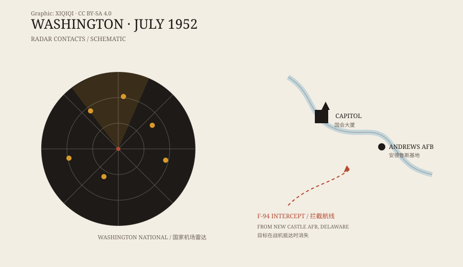

## 一、那个夏天

1952 年 7 月，华盛顿。冷战正紧，报纸上几乎每天都有飞碟的消息。

6 月，美国空军刚开过一次发布会，说大部分目击都能解释。然后，机场的雷达开始出问题。

## 二、雷达

7 月 12 日夜里，华盛顿国家机场的雷达管理员在屏幕上看到几个目标。它们不像航班：速度慢，忽快忽慢，有时停在原地，然后突然移动。安德鲁斯空军基地的雷达也看到了。

7 月 19 日晚上十一点四十，更多目标出现。它们飞过白宫和国会大厦附近。塔台打电话给安德鲁斯，安德鲁斯确认自己的雷达上也有。

*原创示意图：1952 年 7 月 19 日夜里的雷达接触与拦截航线。不是当时的雷达照片。稀奇奇编辑部，CC BY-SA 4.0。*

## 三、战斗机

新卡斯尔空军基地的 F-94 星火夜间战斗机起飞。飞行员到达雷达指示的位置时，屏幕上的目标消失了。飞机离开，目标又出现。如此反复。

首都航空的飞行员凯西·皮尔曼也在空中。他报告看见一组光点，位置和雷达上的目标大致对得上。他说那些光比星星亮，移动方式不像飞机。

## 四、记者会

空军派爱德华·鲁佩尔特到华盛顿。他是“蓝皮书计划”的负责人。7 月 29 日，他召开记者会，说最可能的解释是温度逆温。

温度逆温是夏夜常见的大气结构：地面附近是冷空气，上面是暖空气。雷达波在两层空气之间折射，可能产生虚假回波。地面灯光也可能被折射到空中，让人看见“光点”。

这个解释在当时的雷达技术条件下站得住脚。但它没有让所有人满意。

## 五、逆温层

雷达操作员不接受这个说法。他们说，自己每天都能看到逆温造成的假回波，知道那是什么样子；这次的目标会移动、会消失、会重新出现，不像天气。

飞行员也不接受。他们说自己看到的是实实在在的光，不是屏幕上的噪点。

问题是，这两件事不一定矛盾。雷达可能被逆温欺骗，飞行员可能看到星星、飞机灯光或别的东西。两段证词可以同时为真，也可以同时不完整。

## 六、罗伯逊小组

1953 年 1 月，中央情报局召集了一个小组，由物理学家霍华德·罗伯逊主持。小组看了包括华盛顿事件在内的报告，结论是：没有证据表明不明飞行物威胁国家安全；建议对目击报告进行“去神秘化”，减少公众的过度关注。

这份报告后来解密。它没有说所有目击都是假的，但它改变了官方处理这类事件的方式：少解释，少公开，尽量让话题冷下来。

## 七、剩下什么

华盛顿事件没有留下实物，只有雷达记录、无线电通话和飞行员的报告。它成了一个模板：雷达看见，人眼看见，战斗机起飞，什么也没抓到。

七十多年后，类似的场景还在出现。只是雷达更好了，摄像机更多了，答案并没有因此变得简单。

---

**来源与许可**：本文的事实来源见条目底部来源台账 S1–S3。文字与原创示意图采用 CC BY-SA 4.0。本文把雷达记录、飞行员目击和后来的官方解释分开叙述，不把其中任何一项当成完整答案。
