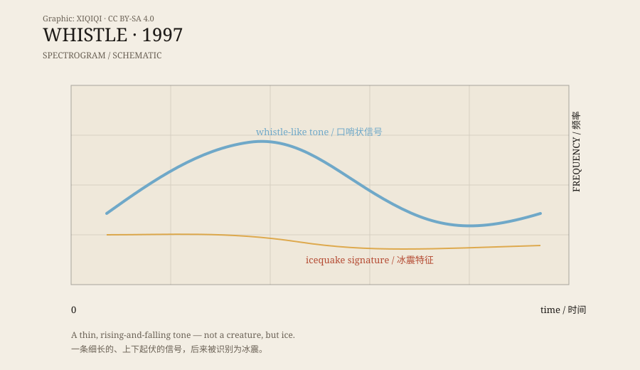

## 1. Like a whistle

In 1997, NOAA hydrophones in the Pacific recorded a sound.

It was not as heavy as Bloop, and not as long as Slow Down. It was thinner, a little higher, like a whistle coming from somewhere underwater.

The researchers called it Whistle.

The name is direct. You hear it, and your first thought is that someone is whistling. But there is no one in the deep.

## 2. 1997

Whistle was recorded in the same year, by the same hydrophone array, as Bloop and Slow Down.

The array was deployed in the equatorial Pacific to listen to the ocean: earthquakes, volcanoes, whales, ice, and ships. It was not designed for “strange sounds”; it was designed for science.

In 1997, the array recorded several unusual signals. Bloop was the shortest and loudest; Slow Down was the longest and slowest; Whistle sounded the most human.

All three ended up on lists of “unexplained deep-sea sounds.”

## 3. The spectrogram

Converted into a spectrogram, Whistle appears as a thin, rising-and-falling line.

It is not a blob of low-frequency energy like Bloop, and it does not descend steadily like Slow Down. It looks more like a melody, with a frequency that moves within a range.

Humans easily hear that line as a whistle or a song. This is not a delusion; it is the auditory system finding a familiar pattern. A sound near the human vocal range is automatically classified as “someone whistling” or “some animal calling.”

But a spectrogram does not tell us who made the sound. It only shows frequency and energy.

*Original schematic: the thin signal of Whistle and icequake features. Not a measured spectrogram. Oddity Archive, CC BY-SA 4.0.*

## 4. Icequakes

Like Bloop and Slow Down, Whistle was later linked to icequakes.

Icequakes are diverse. An iceberg calving can produce a low rumble; an ice shelf cracking can produce a sharp burst; ice scraping can produce continuous high-frequency noise. Different shapes of ice and different modes of breaking produce different spectra.

Whistle's thin signal falls within the range icequakes can produce. It is not a whale song, not a ship, and not a human whistle. It is more like the sound of ice moving in a particular way.

## 5. Why we love “strange sounds”

Half of the Whistle story is about sound. The other half is about people.

We love deep-sea sounds because they seem like unknown creatures speaking. Bloop is a monster, Slow Down is a sigh, Whistle is a whistle. Three sounds, three personalities.

That personification is natural. Humans are social animals. When we hear a sound with rhythm and variation, we look for a speaker. Even if the speaker might be a piece of ice.

That is also why legends spread faster than explanations. A scientific explanation needs spectrograms, instruments, and papers. A legend needs only a name.

## 6. After the answer

The answer to Whistle is not romantic: ice is moving, and the ocean is loud.

But that does not make it less interesting. Once you know it is an icequake, the whistle becomes a record of an invisible process: an ice shelf cracking, a block rolling, pressure changing, sound crossing thousands of kilometres.

It is still a sound from the deep. The speaker has simply changed from “monster” to “ice.”

---

**Sources and licenses**: the factual sources are listed in the source ledger S1–S3 at the bottom of this entry. Text and original diagrams are licensed under CC BY-SA 4.0. The icequake explanation for Whistle is supported by research; this article separates the recording, the auditory impression, and the later identification.
