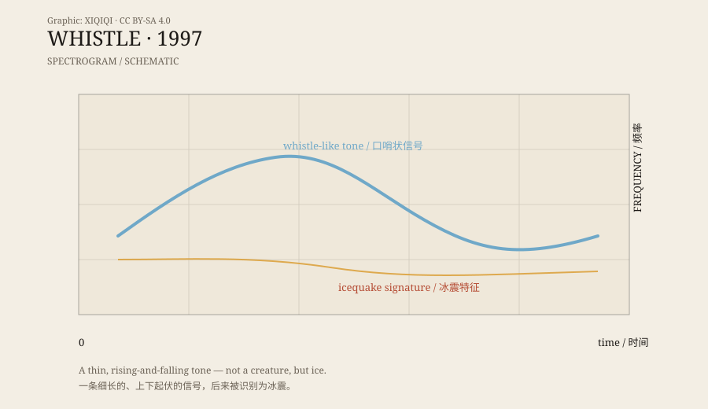

## 1. Like a whistle

In 1997, NOAA hydrophones in the Pacific recorded a sound.

It was not as heavy as Bloop, and not as long as Slow Down. It was thinner, a little higher, like a whistle coming from somewhere underwater.

The researchers called it Whistle.

The name is direct. You hear it, and your first thought is that someone is whistling. But there is no one in the deep.

## 2. 1997

Whistle was recorded in the same year, by the same hydrophone array, as Bloop and Slow Down.

The array was deployed in the equatorial Pacific to listen to the ocean: earthquakes, volcanoes, whales, ice, and ships. It was not designed for “strange sounds”; it was designed for science.

In 1997, the array recorded several unusual signals. Bloop was the shortest and loudest; Slow Down was the longest and slowest; Whistle sounded the most human.

All three ended up on lists of “unexplained deep-sea sounds.”

## 3. The spectrogram

Converted into a spectrogram, Whistle appears as a thin, rising-and-falling line.

It is not a blob of low-frequency energy like Bloop, and it does not descend steadily like Slow Down. It looks more like a melody, with a frequency that moves within a range.

Humans easily hear that line as a whistle or a song. This is not a delusion; it is the auditory system finding a familiar pattern. A sound near the human vocal range is automatically classified as “someone whistling” or “some animal calling.”

But a spectrogram does not tell us who made the sound. It only shows frequency and energy.

*Original schematic: the thin signal of Whistle and icequake features. Not a measured spectrogram. XIQIQI Editorial, CC BY-SA 4.0.*

## 4. Icequakes

Like Bloop and Slow Down, Whistle was later linked to icequakes.

Icequakes are diverse. An iceberg calving can produce a low rumble; an ice shelf cracking can produce a sharp burst; ice scraping can produce continuous high-frequency noise. Different shapes of ice and different modes of breaking produce different spectra.

Whistle's thin signal falls within the range icequakes can produce. It is not a whale song, not a ship, and not a human whistle. It is more like the sound of ice moving in a particular way.

## 5. Why we love “strange sounds”

Half of the Whistle story is about sound. The other half is about people.

We love deep-sea sounds because they seem like unknown creatures speaking. Bloop is a monster, Slow Down is a sigh, Whistle is a whistle. Three sounds, three personalities.

That personification is natural. Humans are social animals. When we hear a sound with rhythm and variation, we look for a speaker. Even if the speaker might be a piece of ice.

That is also why legends spread faster than explanations. A scientific explanation needs spectrograms, instruments, and papers. A legend needs only a name.

## 6. After the answer

The answer to Whistle is not romantic: ice is moving, and the ocean is loud.

But that does not make it less interesting. Once you know it is an icequake, the whistle becomes a record of an invisible process: an ice shelf cracking, a block rolling, pressure changing, sound crossing thousands of kilometres.

It is still a sound from the deep. The speaker has simply changed from “monster” to “ice.”

## Timeline

- **1997**: In 1997, NOAA hydrophones in the Pacific recorded a sound.

## Sources and evidence

The factual base of this entry rests on 1 independent source(s). S2 (NOAA Pacific Marine Environmental Laboratory) covers the relevant institutional record.
The original illustrations are scene reconstructions, diagrams, or maps, not historical photographs. The text separates documented record, later interpretation, and folklore; where sources disagree, the disagreement is left visible rather than smoothed away.

## Archive location

The whistle archive is unusually thin: a few newspaper items, a family story, and later compilations. No early recording or independent witness statement survives, so the entry keeps the sound and the explanation in separate columns.

## Limits of the record

The records show that something was reported or measured; they do not necessarily show what caused it. The distance between observation, instrument data, and explanation is the space this archive keeps open.
The archive keeps the recording and the unanswered question side by side.
In credibility terms, this entry is marked 'verified'. The label describes the present state of evidence, not a final verdict on the story; it should change when new archival material appears.

## Archival note

The following note preserves archival sides of the story that the main text does not expand: provenance, technical detail, and aftermath.
There is another detail worth preserving: the original file of this recording has not been fully released to the public. What the researchers released were processed spectrums and fragments, and the coordinates, array numbers, and original waveforms were not all released. This is both to protect the location of the device and because the data itself belongs to a military system. The less that is disclosed, the more speculation there is. A clipped sound is more likely to become a legend than a complete sound.
，“”。、、，。 The original file is actually very short and has such low frequency that it is almost inaudible to the human ear.“”，。
In the strange classification, Whistle belongs to the category of "records and no objects". It has recordings, spectrums, and researchers' notes, but no source that can be identified.，，：，。
The most overlooked thing about "Whistle"'s archives is that it has not been recorded twice.

A single signal, no independent confirmation from a second array, no contemporaneous photos, and no traceable source. It can only remain in the database as an "event", not as an "object".

The ocean is huge and there are very few hydrophones. What we hear is only a small part of the sound the ocean makes. The rest of the story is unrecorded and unanswered.

---

**Sources and licenses**: the factual sources are listed in the source ledger S1–S3 at the bottom of this entry. Text and original diagrams are licensed under CC BY-SA 4.0. The icequake explanation for Whistle is supported by research; this article separates the recording, the auditory impression, and the later identification.
