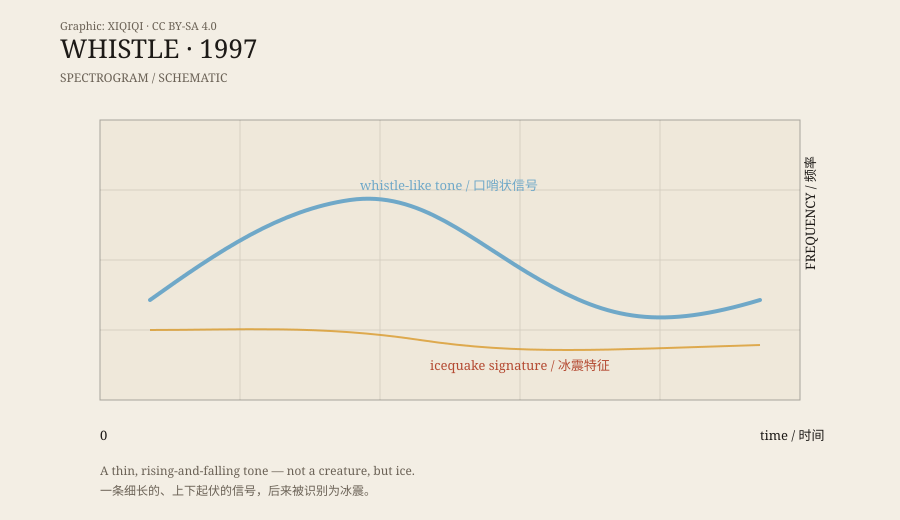

## 一、像口哨

1997 年，NOAA 的水听器在太平洋里录到了一段声音。

它不像 Bloop 那么沉重，也不像 Slow Down 那么长。它更细，更高一点，像一声口哨，从水下某个地方传过来。

研究者给它起名叫 Whistle。

这个名字很直观：你听到它，第一反应就是“有人在吹口哨”。但海底没有人。

## 二、1997 年

Whistle 和 Bloop、Slow Down 是同一年、同一组水听器录到的。

那组水听器布设在赤道太平洋，负责监听海洋里的各种声音。它们不是为“怪声”准备的，而是为科学研究：地震、火山、鲸类、冰层、船只。

1997 年，水听器录到了好几个不寻常的信号。Bloop 最短、最响；Slow Down 最长、最慢；Whistle 最像人声。

三个声音后来都被列进了“未知深海声音”的名单。

## 三、频谱图

把 Whistle 转成频谱图，会看到一条细长的、上下起伏的线。

它不像 Bloop 那样是一团低频能量，也不像 Slow Down 那样一路下降。它更像一段有旋律的哨音，频率在一定范围内变化。

人类很容易把这种线条听成“口哨”或“歌声”。这不是错觉，而是听觉系统在找熟悉的模式。我们听到一个接近人声频率的声音，就会自动把它归类为“某个人在吹口哨”或“某种动物在叫”。

但频谱图不会自动告诉我们声源是谁。它只显示频率和能量。

*原创示意图：Whistle 的细长信号与冰震特征。不是实测频谱。稀奇奇编辑部，CC BY-SA 4.0。*

## 四、冰震

和 Bloop、Slow Down 一样，Whistle 后来也被认为和冰震有关。

冰震的声音很多样。冰山崩解可以产生低频的轰鸣，冰层断裂可以产生短促的爆裂，冰块摩擦可以产生连续的高频噪声。不同形状的冰、不同的断裂方式，会形成不同的频谱。

Whistle 的细长信号，落在冰震能够产生的范围里。它不是鲸歌，也不是船只，更不是人类的口哨。它更像是冰在某个特定方式下移动时，发出的声音。

## 五、为什么我们爱听“怪声”

Whistle 的故事，有一半是关于声音的，另一半是关于人的。

我们喜欢“深海怪声”，因为它们像某种未知生物在说话。Bloop 像巨兽，Slow Down 像叹息，Whistle 像口哨。三个声音，三种人格。

这种拟人化很自然。人类是社交动物，听到有节奏、有变化的声音，就会寻找说话者。即使说话者可能只是一块冰。

这也是为什么“未解声音”的传说比科学解释传播得快。科学解释需要频谱图、仪器、论文；传说只需要一个名字。

## 六、答案之后

Whistle 的答案不浪漫：冰在动，海在响。

但这不意味着它失去了魅力。知道它是冰震之后，再听那段口哨，你听到的不只是“未知”，还有一整套看不见的过程：冰架裂开、冰块翻滚、海水压力变化、声音穿过几千公里。

它仍然是深海的声音。只是说话者从“怪物”变成了“冰”。

---

**来源与许可**：本文的事实来源见条目底部来源台账 S1–S3。文字与原创示意图采用 CC BY-SA 4.0。Whistle 的冰震解释已有研究支持；本文区分了录音事实、听觉印象和后来的识别。
