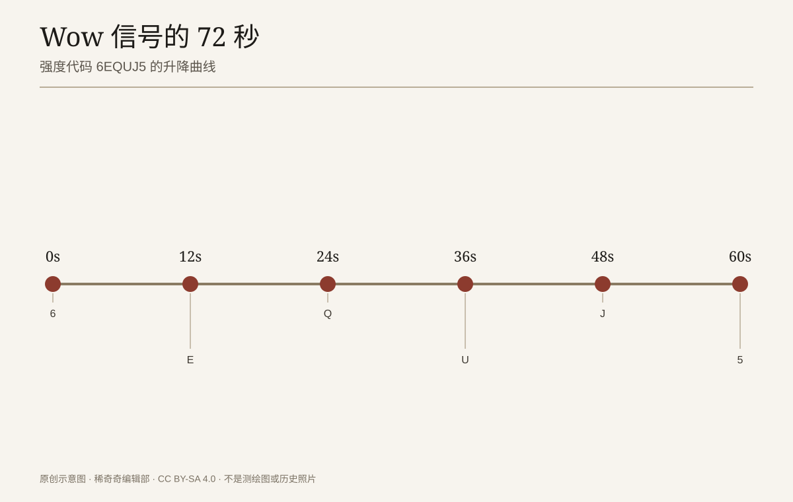
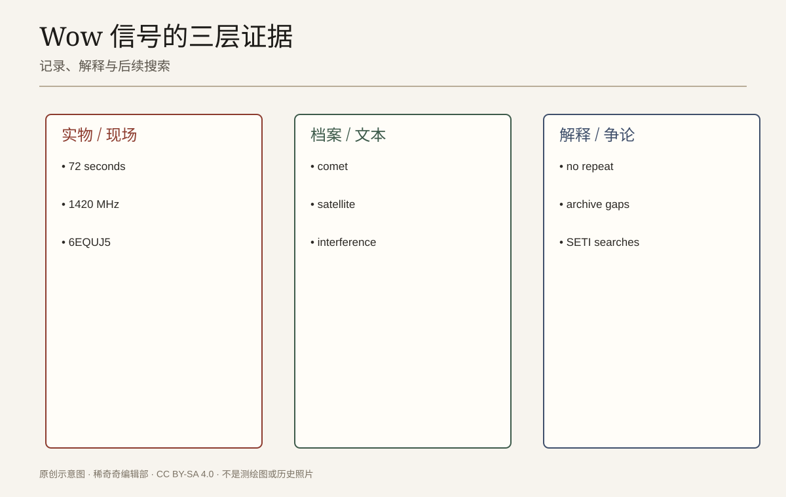

## 1. The Big Ear observation

On 15 August 1977 the Ohio State University 'Big Ear' radio telescope was conducting a routine survey toward Sagittarius. The telescope used transit mode, with Earth's rotation carrying sources through two fixed beams; the signal lasted 72 seconds, about the passage time of one beam. The record came out on a printer, and the duty astronomer, Jerry Ehman, circled it in red and wrote 'Wow!' beside it. The telescope had no active tracking and no rapid follow-up system.

## 2. 6EQUJ5

The '6EQUJ5' on the printout is a strength code: digits 0–9 give signal-to-noise ratios and letters A–Z higher values. 6, E, Q, U, J, 5 trace a rise and fall, with a peak about thirty times the background. The centre frequency was near 1420.4556 MHz, close to the 21-centimetre line of neutral hydrogen; the bandwidth was narrow, under 10 kHz. Narrowband is a signature of artificial signals, because natural radio sources usually cover wider bands.

*Original diagram: the rise and fall of the Wow signal's intensity code. Not a survey drawing. XIQIQI Editorial, CC BY-SA 4.0.*

## 3. Explanations and failures

The most direct explanation is ground interference or a satellite, but the region near 1420 MHz is internationally protected and transmissions are normally prohibited; satellites in 1977 could still have produced something similar. The comet hypothesis, advanced by Antonio Paris in 2017, held that the hydrogen cloud of comet 266P/Christensen could explain it, but critics noted that the comet was not in the beam at the time and the cloud signal would be too weak. Other work suggests plasma lensing or interstellar scintillation. No explanation satisfies frequency, bandwidth, duration, and direction together.

## 4. Later searches

After 1977 astronomers repeatedly pointed larger, more sensitive telescopes at the original direction and detected nothing. SETI projects, amateur radio groups, and successors to Big Ear all searched; the result was not 'found' but 'not repeated'. That neither proves the signal was extraterrestrial nor proves it was not. The randomness of a single observation, the state of the equipment, and the incompleteness of the record are part of the explanation.

*Original diagram: the printout record, explanatory hypotheses, and follow-up searches for the Wow signal. Not a survey drawing. XIQIQI Editorial, CC BY-SA 4.0.*

## 5. The archive

The original printout, observing log, and Big Ear survey records were later preserved and digitised by Ohio State University and the North American Astrophysical Observatory (NAAPO). The record includes time, right ascension and declination, intensity code, and beam position; but the 1977 instrument parameters, calibration records, and interference logs are incomplete. To recheck, a researcher must compare the printout, logs, and telescope archives. The gap in the archive is one technical reason the Wow signal cannot be closed.

## 6. A cultural icon

The 'Wow!' annotation turned a technical record into a cultural symbol. It appears in textbooks, documentaries, science fiction, and stamps, and is often cited as evidence that humanity may not be alone. But the symbol also invites misreading: the signal was not a continuing broadcast, not a decodable message, and has no confirmed civilisational source. For SETI it is a reminder that an anomaly needs repetition, independent confirmation, and multi-band observation before it moves from 'interesting' to 'known'.

The cover is an AI-assisted reconstruction of “The Wow Signal: Seventy-Two Seconds of Narrowband Radio”, not a site photograph; the two inline figures are original diagrams, not survey drawings. Image types and licences are recorded row by row in research/image-audit.csv.

## Archive location

The Wow signal's archive is mainly in Ohio: Ohio State University Libraries hold the Big Ear survey printouts, observing logs, and some instrument files; NAAPO holds telescope history, members' recollections, and follow-up search material. The original printout is the core physical record, but it gives only intensity codes, time, and beam position, not complete calibration or interference data. SETI institutions and later observing teams keep their own search logs, but none closes the loop with the 1977 record. This entry states frequency, duration, intensity code, and non-repetition as recorded facts; source explanations, the comet hypothesis, and instrument state are marked as unverified or disputed. The incompleteness also explains why the record has never been reproduced: without original calibration, interference, and instrument-state data, later searches can narrow the field but cannot rebuild the observing conditions. 'Wow' is therefore both a real record and an open question, and those two things are not in conflict.

## Limits of the record

The Wow signal was recorded once and never independently repeated. Its frequency is close to the hydrogen line at 1420 MHz and its intensity curve looks like a drift, but the source direction, polarisation, bandwidth, and follow-up searches never closed the loop. Comet, satellite, ground interference, hydrogen cloud, and extraterrestrial explanations each account for some features but not all at once. This entry separates the record from the explanation: the record is real, the source remains unknown.

---

**Sources and licenses**: for “The Wow Signal: Seventy-Two Seconds of Narrowband Radio”, the factual claims above are traced to S1 and S2 in the source ledger; S3 covers the AI-assisted cover and the two original diagrams. Text and original diagrams are licensed CC BY-SA 4.0. This entry separates the documented record from reconstruction and marks remaining uncertainty under 'Limits of the record'. Where the archive is silent, the text says so rather than filling the gap with narrative. Dates and figures follow the cited pages; interpretations are identified as interpretations, and no hypothesis is presented as a settled fact.
