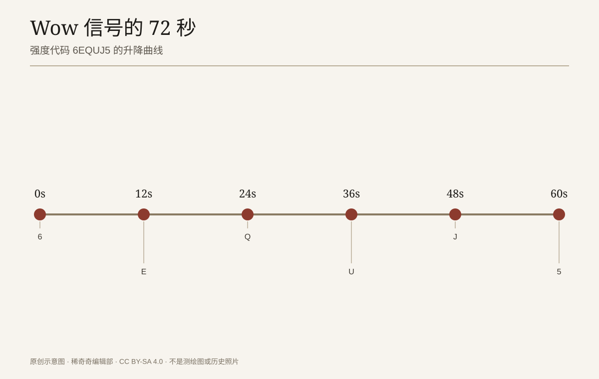
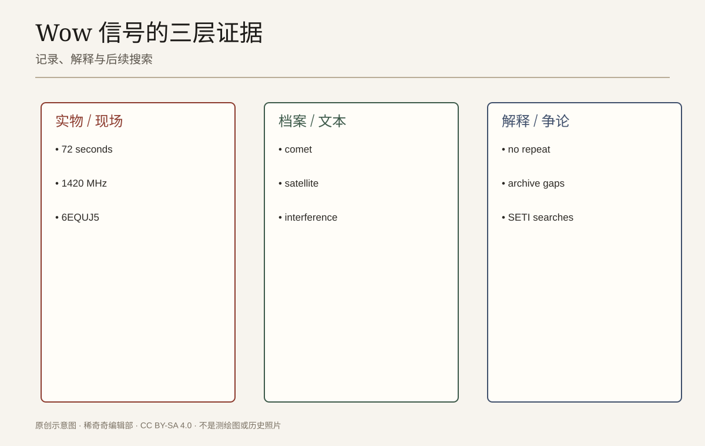

## 一、大耳朵望远镜的观测

1977 年 8 月 15 日，俄亥俄州立大学的“大耳朵”射电望远镜在射手座方向进行例行巡天。望远镜采用 transit 模式，地球自转使天体依次穿过两个固定波束；信号持续 72 秒，正好是一个波束的通过时间。记录由打印机打在纸上，值班天文学家杰里·埃曼用红笔圈出，并在旁边写下“Wow!”。这台望远镜没有主动追踪能力，也没有后续的快速复核机制。

## 二、6EQUJ5 的含义

打印记录上的“6EQUJ5”是一串强度代码：数字 0–9 表示信噪比，字母 A–Z 表示更高的值。6、E、Q、U、J、5 对应一个先升后降的曲线，峰值超过背景约 30 倍。信号中心频率接近 1420.4556 MHz，靠近中性氢的 21 厘米发射线；带宽很窄，不到 10 kHz。窄带是人为信号的一个特征，因为自然射电源通常覆盖更宽的频段。

*原创示意图：Wow 信号强度代码随时间的变化。不是测绘图。稀奇奇编辑部，CC BY-SA 4.0。*

## 三、解释与失败

最直接的解释是地面干扰或卫星信号，但 1420 MHz 附近受国际保护，通常禁止发射；卫星在 1977 年也可能产生类似信号。彗星说在 2017 年由 Antonio Paris 提出，认为彗星 266P/Christensen 的氢云可以解释，但批评者指出彗星当时不在观测波束内，氢云信号也太弱。另一些研究提出等离子体透镜或星际闪烁。没有一种解释同时满足频率、带宽、持续时间和方向。

## 四、后续搜索

1977 年以后，天文学家多次用更大、更灵敏的望远镜指向原方向，没有再次检测到信号。SETI 项目、业余射电天文团体和“大耳朵”的继任者都做过搜索；结果不是“找到”，而是“没有重复”。这既不能证明信号是外星文明，也不能证明它一定不是。一次观测的偶然性、设备的状态和记录的不完整，都是解释的一部分。

*原创示意图：Wow 信号的打印记录、解释假说与后续搜索。不是测绘图。稀奇奇编辑部，CC BY-SA 4.0。*

## 五、档案在哪里

原始打印纸、观测日志和“大耳朵”的巡天记录，后来由俄亥俄州立大学与北美国际天文台组织（NAAPO）保存和数字化。记录包含时间、赤经赤纬、强度代码和波束位置；但 1977 年的设备参数、校准记录和干扰日志并不完整。研究者要复核，必须把打印纸、日志和望远镜档案对照起来。档案的缺口，也是“Wow 信号无法结案”的技术原因之一。

## 六、从数据到文化符号

“Wow!”这个批注让一个技术记录变成了文化符号。它出现在教科书、纪录片、科幻小说和邮票上，被当作“人类可能并不孤独”的证据。但符号化也带来误读：信号不是持续广播，不是可解码的信息，也没有确认的文明来源。对 SETI 而言，它更像一个提醒：一次异常需要重复、独立验证和多波段观测，才能从“有趣”变成“已知”。

## 时间线

- **1977 年 8 月 15 日**：大耳朵望远镜记录到 72 秒窄带信号
- **1977 年 8 月**：杰里·埃曼在打印纸上写下“Wow!”
- **1977 年以后**：多次搜索未再检测到信号
- **2017 年**：彗星 266P/Christensen 假说提出并受到质疑
- **1998 年**：大耳朵望远镜停止运行

## 来源与证据

本文的可核对材料以 S1、S2 为主：S1 提供遗址/器物的基本信息与官方记录，S2 提供独立的研究或档案背景。S3 是编辑部制作的封面与示意图，只用于视觉说明，不作为史实依据。凡正文出现年代、数量、地点与归属判断，尽量回到 S1/S2 的具体页面；无法回到页面的说法，在“档案空白”里标明。

封面为 AI 辅助场景复原，不是现场照片；两张插图为原创示意图，不是测绘图。图片类型与许可逐行记录在 `research/image-audit.csv`。

## 档案位置

Wow 信号的档案主要在俄亥俄州：俄亥俄州立大学图书馆保存“大耳朵”巡天打印记录、观测日志与部分设备文件；NAAPO 保存望远镜历史、成员口述和后续搜索资料。原始打印纸是核心物证，但它只记录强度代码、时间与波束位置，不含完整的校准和干扰信息。SETI 机构与后续观测团队保存自己的搜索日志，但没有一份能与 1977 年的记录形成闭环。本文把频率、持续时间、强度代码和“未重复”写成记录事实；来源解释、彗星假说与设备状态，则标明为待验证或仍有争议的部分。档案的不完整也解释了为什么这项记录至今无法被重复：缺少校准、干扰与设备状态的原始数据，后续搜索只能缩小范围，不能重建当时的观测条件。因此，“Wow”既是一个真实的记录，也是一个开放的问题；两者并不矛盾。

## 档案空白

Wow 信号只被记录到一次，没有独立的重复观测。它的频率接近氢线 1420 MHz，强度曲线像一次漂移，但来源方向、极化、带宽和后续搜索都没有形成闭环。彗星、卫星、地面干扰、氢云和地外文明等解释，各自能解释一部分特征，却不能同时解释全部。本文把“记录本身”与“解释”分开：记录是真实的，来源仍未知。
