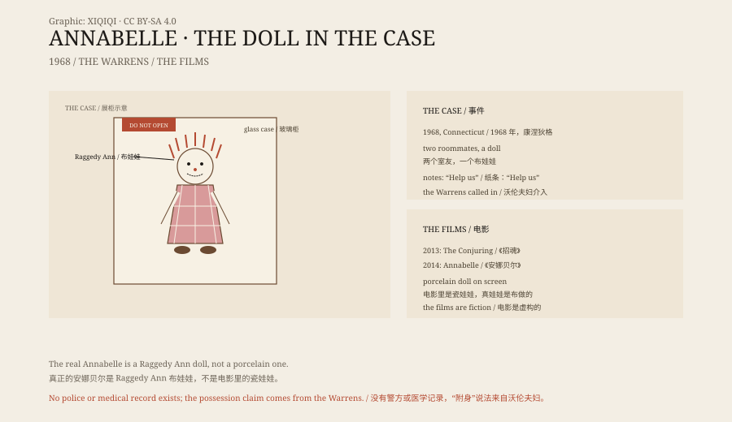

## 1. 1968

In 1968 Donna was a nursing student in Connecticut. She shared an apartment with a roommate named Angie.

Donna's mother bought her a doll and gave it to her. It was a Raggedy Ann doll, with a red-and-white checked dress, yarn hair and a stitched smile.

Donna put it on her bed. A few days later she found it in a different position.

## 2. The notes

More things happened.

The doll turned up in different rooms, in different poses. Sometimes it was sitting, sometimes standing, sometimes propped against a door.

Donna and Angie began finding notes in the apartment. The handwriting was not theirs. One said “Help us”. Another said “Help Lou”.

Lou was a friend of theirs. One night he stayed in the apartment, and woke with scratches on his chest and a torn shirt. He said the doll was beside him.

## 3. The Warrens

They contacted Ed and Lorraine Warren.

The Warrens described themselves as paranormal investigators and handled “haunted” cases across the United States. They examined the doll and said it was not the spirit of a dead person but a demon. The demon had attached itself to the doll in order to get close to people.

They asked a priest to bless the doll. Then they took it away in their car.

## 4. The glass case

The doll was taken to the Warrens' Occult Museum in Monroe, Connecticut.

It was placed in a glass case with a note on it: “Warning: Positively Do Not Open.”

The Warrens said the doll was still active inside the case, and the case was blessed by a priest from time to time.

## 5. The films

Annabelle appears at the start of The Conjuring (2013). In 2014 she got a film of her own.

The doll in the films is porcelain, in a white dress, sitting in a rocking chair. The real Annabelle is a rag doll that looks like a child's toy, not a horror prop.

The films are fiction. The real case rests on the Warrens' account.

## 6. The evidence

There is no police report, no hospital record, no photograph, and no independent third-party evidence.

The names Donna, Angie and Lou do appear, but they rarely spoke in public. The details of the story come mainly from the Warrens' books, lectures and television appearances.

That does not prove they were lying. But it means the story of Annabelle is a “someone said” story, not a case with a chain of evidence.

## 7. Now

The doll is still in the museum in Monroe, locked in its glass case.

It has become part of popular culture. Films, documentaries, short videos and Halloween costumes all repeat the story.

A rag doll became a symbol because of a claim. The line on the glass case turned out to be its most effective advertisement.

*Original schematic: the 1968 account, the Warrens' involvement, the museum case and the film adaptations. Not a photograph of the object. Oddity Archive, CC BY-SA 4.0.*

---

**Sources and licenses**: the factual sources are listed in the source ledger S1–S3 at the bottom of this entry. Text and original diagrams are licensed under CC BY-SA 4.0. This article separates the 1968 account, the Warrens' explanation, the museum and the films; there is no verifiable police or medical record, and the claim that the doll was possessed comes from the Warrens. The illustration is a scene reconstruction, not a photograph of the object.
