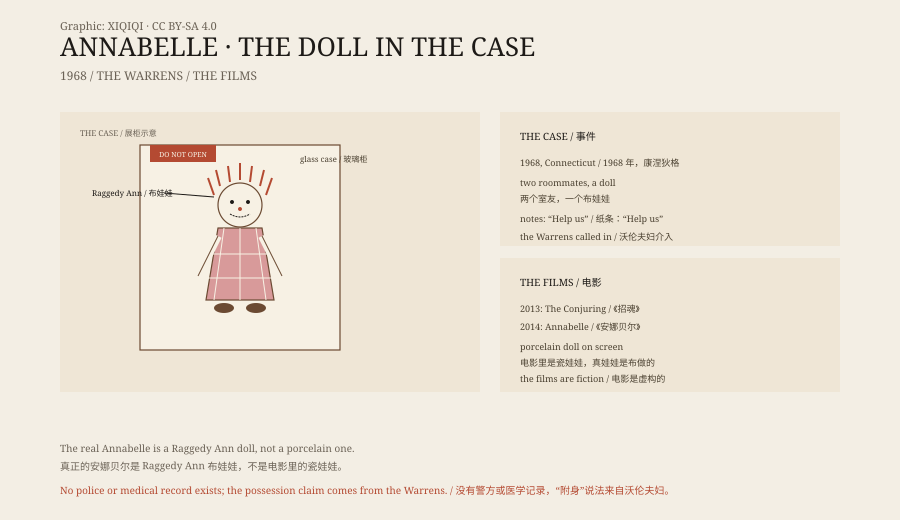

## 一、1968 年

1968 年，唐娜是康涅狄格州的一名护理专业学生。她和一个叫安吉的室友合租公寓。

唐娜的母亲买了一个布娃娃，送给她。那是 Raggedy Ann 系列的娃娃，红白格子裙，毛线头发，脸上缝着笑。

唐娜把它放在床上。几天后，她发现娃娃换了位置。

## 二、笔记

事情越来越多。

娃娃会出现在不同的房间，姿势也会变。有时它坐着，有时它站着，有时它靠在门口。

唐娜和安吉开始在家里找到纸条。纸条上写着字，笔迹不是她们的。有一张写着“Help us”，另一张写着“Help Lou”。

卢是她们的朋友。有一天他留在公寓里过夜，醒来时胸口有几道抓痕，衬衫也破了。他说，娃娃就在旁边。

## 三、沃伦夫妇

她们找了埃德·沃伦和洛琳·沃伦。

沃伦夫妇自称是灵异调查员，在美国各地处理“闹鬼”案件。他们看了娃娃，说里面不是一个死去的人的灵魂，而是一个恶魔。恶魔附在娃娃上，是为了接近人。

他们请一位神父为娃娃祝福。然后他们把娃娃带走，放进自己的车里。

## 四、玻璃柜

娃娃被带到沃伦夫妇的灵异博物馆，在康涅狄格州门罗。

它被放在一个玻璃柜里，柜子上贴着一张纸条：“警告：绝对不要打开。”

沃伦夫妇说，娃娃在柜子里仍然有动静，所以柜子定期请神父祝福。

## 五、电影

2013 年的电影《招魂》开头出现了安娜贝尔。2014 年，它有了自己的电影。

电影里的娃娃是瓷的，穿着白裙子，坐在摇椅上。真正的安娜贝尔是一个布娃娃，看起来像儿童玩具，不像恐怖片道具。

电影是虚构的。真实的案件，只有沃伦夫妇的叙述。

## 六、证据

没有警方报告，没有医院记录，没有照片，也没有独立的第三方证据。

唐娜、安吉和卢的名字都出现过，但他们很少公开讲述。故事的细节，主要来自沃伦夫妇的书、讲座和电视节目。

这并不能证明他们在撒谎。但它意味着，安娜贝尔的故事是一个“有人说”的故事，不是一个有证据链的案件。

## 七、现在

娃娃还在门罗的博物馆里，锁在玻璃柜里。

它成了流行文化的一部分。电影、纪录片、短视频、万圣节服装，都在重复这个故事。

一个布娃娃，因为一个说法，变成了一个符号。玻璃柜上那句话，反而成了它最有力的广告。

*原创示意图：1968 年事件、沃伦夫妇的介入、博物馆玻璃柜与电影改编。不是文物照片。稀奇奇编辑部，CC BY-SA 4.0。*

---

**来源与许可**：本文的事实来源见条目底部来源台账 S1–S3。文字与原创示意图采用 CC BY-SA 4.0。文中把 1968 年的说法、沃伦夫妇的解释、博物馆现状与电影改编分开叙述；没有可核实的警方或医学记录，娃娃“被附身”的说法来自沃伦夫妇。插图是场景复原，不是文物照片。
