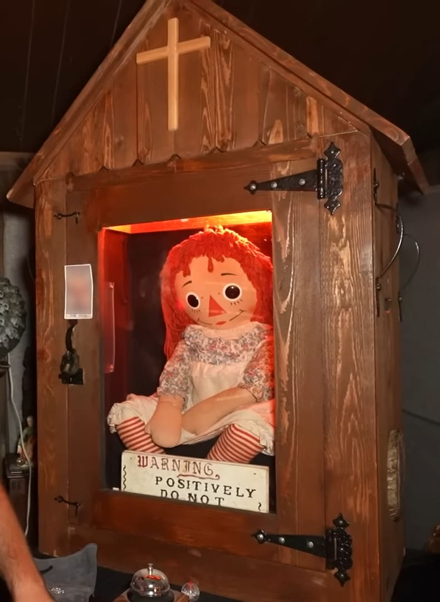
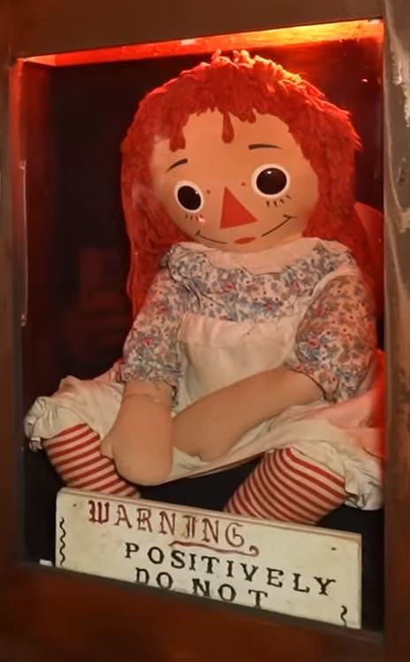
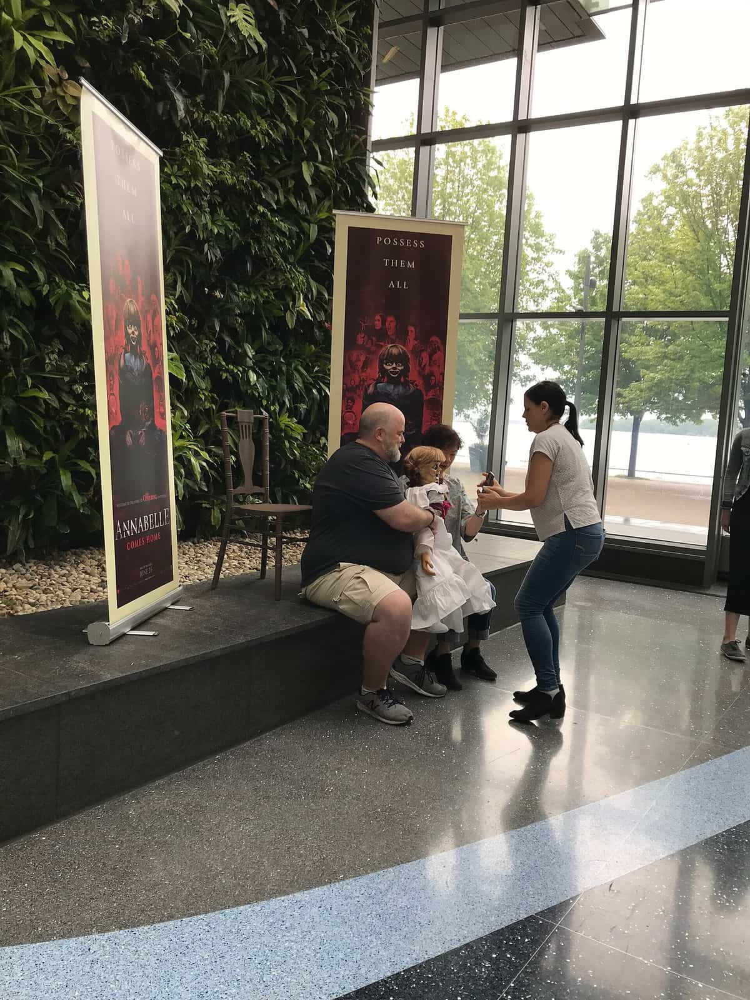
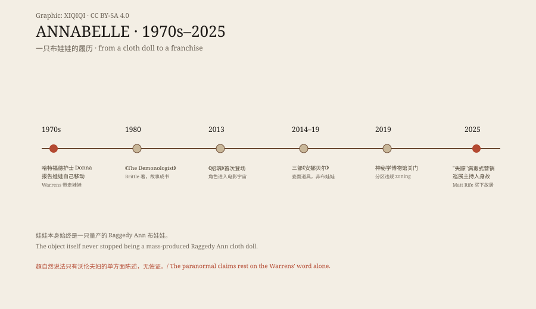

## 一、它首先是一只布娃娃

先看实物。红毛线头发，布脸上一个三角鼻子，嘴是缝出来的一道弧线，碎花裙，红白条纹的腿。它是一只 Raggedy Ann——美国量产了几十年的布娃娃，便宜、柔软、随处可见。它的头发是毛线，一绺一绺缝在布头皮上；鼻子是一块红布三角；眼睛是两颗黑纽扣般的圆片。没有任何机关，没有任何可以"自己移动"的结构。

它现在坐在一个木盒里。木盒做成小教堂的形状：顶上一个十字架，铁铰链，正面一扇玻璃窗，柜里打着红光。玻璃窗旁贴着一块空白标签位，像博物馆的编号牌，但上面没有字。柜前放着一只服务铃，像博物馆前台，又像某种警告的按钮。

*现场照片：2025-09-13，OVERNIGHT，CC BY 4.0（Wikimedia Commons）。真实的安娜贝尔：Raggedy Ann 布娃娃，置于教堂形木盒玻璃柜中。*

## 二、Donna 的公寓

故事从 1970 年代开始。按沃伦夫妇的说法，哈特福德一名 28 岁的实习护士 Donna 得到这只娃娃后，它开始自己移动：位置变了，姿势变了，后来甚至出现血迹和抓痕。

一位灵媒告诉 Donna 和她的室友：娃娃里住着一个叫安娜贝尔的七岁死女孩的灵魂。两份口供来自同一屋檐下，这一点与"独立证人"的要求相去甚远。沃伦夫妇介入后给出另一个结论——不是女孩的灵魂，是恶魔附身。他们把娃娃带走，放进自己在康涅狄格州门罗的神秘学博物馆。注意顺序：灵媒的说法先于沃伦夫妇——是灵媒给了"七岁女孩安娜贝尔"这个名字，沃伦夫妇把它改写成恶魔。两个解释互相矛盾，却共用同一个娃娃；名字从此固定下来。

## 三、玻璃柜里的履历

进了博物馆，娃娃有了一块牌子："WARNING, POSITIVELY DO NOT OPEN"——警告，绝对不要打开。牌子上的"POSITIVELY"被下划线强调了一遍。它警告的不是娃娃，是打开柜子这个动作。

*现场照片：2025-09-13，OVERNIGHT，CC BY 4.0（Wikimedia Commons）。柜中娃娃与手写警告牌。*

沃伦夫妇陆续给它添了一份履历：它能造成"灵体抓痕"让人流血；一位侮辱过它的牧师把车开进了树里；一名凶案警探被它刺伤，被迫提前退休。这些说法全部出自沃伦夫妇之口，没有第三方记录。它们也进过报纸：1987 年《格洛斯特县时报》写沃伦夫妇在罗格斯大学讲"抓痕"与牧师的车祸，1991 年《晨呼报》写警探被刺。报道照录说法，没有核实。

1980 年，杰拉尔德·布里特尔的《The Demonologist》出版，把这套说法写成书。作者自称与洛林·沃伦有"独家协议"。书成了后来一切改编的底本。

## 四、好莱坞换了一张脸

2013 年《招魂》里它第一次露面；2014、2017、2019 年三部《安娜贝尔》把它捧成主角。它还在《招魂2》《哭泣女人的诅咒》《招魂3》《招魂4》里露脸——一个配角娃娃的出场次数，比大多数演员都多。但电影没有用 Raggedy Ann 的形象：一半因为商标，一半因为布娃娃不够吓人。于是观众记住的是一张瓷面的、毁容的、一眼就不怀好意的脸。

*现场照片：2019-06-20，PvOberstein，CC0（Wikimedia Commons）。《安娜贝尔回家》宣传活动：观众与瓷面道具娃娃合影；道具与真实的布娃娃完全不同。*

把两张照片放在一起看就够了：柜子里那只缝着笑的布娃娃，和海报上那张瓷脸，不是同一个东西。布娃娃的笑是缝出来的，瓷娃娃的笑是雕出来的；前者让人想抱，后者让人想跑。制片方要的是后者。恐惧是后来加上去的。

娃娃也是一份财产：2009 年 Evergreen Media 与沃伦夫妇签下开发协议，2014 年华纳兄弟宣称从沃伦一方取得《The Demonologist》相关章节的权利；围绕"招魂"系列的诉讼索赔一度达 9 亿美元。它的脸还客串进《海王》《沙赞》。一个布娃娃的肖像权，比它的"灵异"更真实地存在。

## 五、2019–2025：关门、"失踪"、巡展

2019 年，神秘学博物馆因分区违规关门。2025 年 5 月，"安娜贝尔失踪"的消息病毒式传播；沃伦遗产方顺势推广一个叫"Devils on the Run"的巡展。新英格兰心灵研究协会负责人托尼·斯佩拉澄清："娃娃从来没有失踪。我们只是带它去几个地方短暂巡展。"

2025 年 7 月，巡展的组织者兼主持丹·里韦拉在宾夕法尼亚州葛底斯堡突然死亡。里韦拉生前在 TikTok 上发布娃娃的视频，是巡展最主要的推广者；他死后，"娃娃克死主持人"的说法立刻出现，而警方的结论只有四个字：没有异常。2025 年 8 月，喜剧演员马特·莱夫买下沃伦故居与博物馆，成为整批收藏——包括这只娃娃——至少五年的法定监护人。

*原创示意图：从护士公寓到玻璃柜、电影宇宙、关门与巡展的时间线。稀奇奇编辑部，CC BY-SA 4.0。*

## 六、学者怎么看

德州州立大学宗教学者约瑟夫·莱科克说，怀疑者眼里沃伦的博物馆"满是现成的万圣节杂物、娃娃和玩具、任何书店都买得到的书"。他指出"恶魔附身的娃娃"这个套路早有来源：罗伯特娃娃的传说，以及沃伦故事前五年的一集《阴阳魔界》——《Living Doll》，里面母亲的名字就叫 Annabelle。

科学作家莎伦·希尔更直接："和现实中的埃德·沃伦一样，现实中的安娜贝尔其实远没那么惊人。"关于那些超自然说法，她说："我们只有埃德的一面之词，博物馆里物件的历史和来源也一样。"她还批评围绕博物馆的煽情报道，说许多人已经分不清沃伦夫妇和他们的银幕形象。

莱科克有一句更冷的总结："恶魔附身的娃娃"这个想法，让现代恶魔学家能在最平庸、最家居的地方找到超自然的恶。他把这类故事叫作"流行文化与超自然民俗之间关系"的案例研究：电影喂给传说形象，传说再喂给电影票房。

柜子还在，铃还在，警告牌还在。玻璃后面那只布娃娃仍然缝着它出厂时的那道笑。它不需要真的动；只要有人愿意替它动，故事就继续。

---

**来源与许可**：事实来源见台账 S1–S5。文字与原创示意图 CC BY-SA 4.0。三张现场照片为 Wikimedia Commons 署名作品（CC BY 4.0 / CC0），许可见台账。沃伦夫妇的超自然说法无第三方佐证，本文将其作为"被陈述的说法"而非事实呈现。