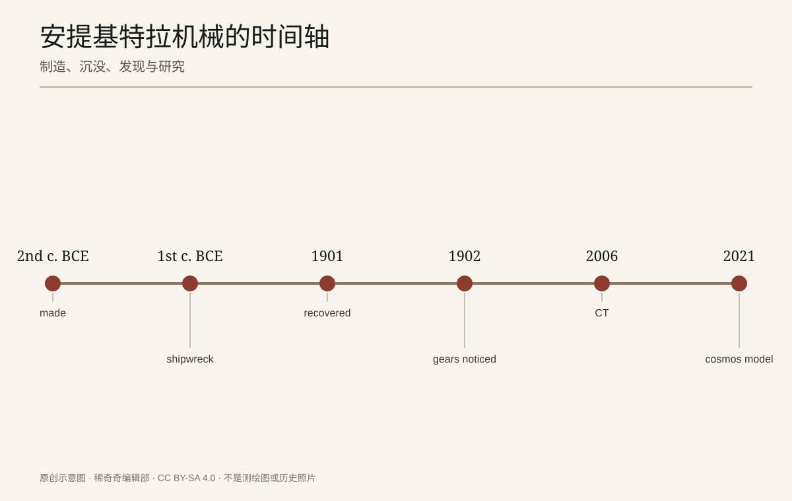
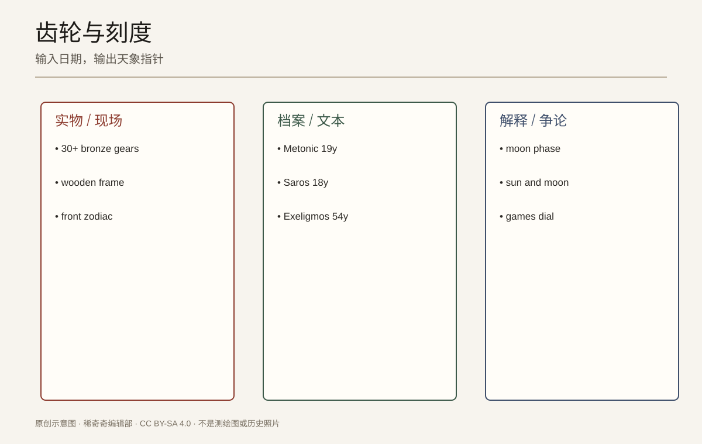

## 1. A wreck, a crate, a geared object

In 1900 Greek sponge divers found an ancient shipwreck near the island of Antikythera; in 1901 the recovered cargo included bronze and marble statues, glassware, coins, and an unremarkable wooden crate. Inside were severely corroded bronze gears and dials, later named the Antikythera Mechanism. The wreck itself sank around the first century BCE, and its cargo came from the eastern Mediterranean; there is no direct evidence for the device's place of origin, though it is usually linked to craft traditions of Rhodes, Corinth, or Syracuse.

## 2. Gears and dials

The core is more than thirty interlocking bronze gears mounted in a wooden frame, with a zodiac ring and calendar dial on the front and several spiral dials on the back. The tooth counts were designed to convert different cycles into pointer positions: the solar year, the synodic month, the sidereal year, and the Saros cycle of eclipses. Inscriptions on the fragments mention the sun, moon, planets, and 'cycles'. It was not a general-purpose calculator but a dedicated astronomical simulator: set a date, and several pointers moved to their predicted positions.

*Original diagram: the Antikythera Mechanism from manufacture to modern research. Not a survey drawing. XIQIQI Editorial, CC BY-SA 4.0.*

## 3. Who made it?

The device carries no maker's name. Ancient texts mention a celestial globe made by Archimedes of Syracuse and a craft tradition on Rhodes; these clues fit the device's date and construction but do not prove authorship. Scholars tend to see it as the product of a workshop: astronomical knowledge drawn from Babylonian and Greek observing traditions, gear craft from mechanical workshops in the eastern Mediterranean. Calling it 'made by Archimedes himself' is an attractive attribution without direct evidence.

## 4. What it calculated

The front outer ring carries the zodiac and calendar, with inner pointers for the sun and moon; the large spiral dial on the back displays the 19-year Metonic cycle, the 18-year 11-day Saros cycle, and the 54-year Exeligmos. Another small dial relates to the four-year cycle of athletic games. A small sphere showed the moon's phase. Its predictions were not infinitely precise: tooth counts, friction, and manufacturing error accumulate, and eclipses could only be given approximately. It was a 'sky almanac' rather than a modern navigational instrument or computer.

*Original diagram: the Antikythera gear train, front calendar dial, and rear cycle dials. Not a survey drawing. XIQIQI Editorial, CC BY-SA 4.0.*

## 5. Research history

In 1902 the archaeologist Valerios Stais noticed the gears; in 1959 the historian of science Derek de Solla Price published a systematic study; in the 1970s X-ray and photogrammetry advanced the internal structure; in 2006 Freeth and colleagues published a CT reconstruction in Nature confirming the gear train and astronomical function; in 2021 a UCL team proposed a 'cosmos' reconstruction in Scientific Reports, extending the discussion of planetary display. Each technical advance changed the readable gear count and inscriptions, and with them the reconstruction.

## 6. Museum, replicas, and open questions

The mechanism is held in the National Archaeological Museum in Athens; the original is rarely displayed for long because of corrosion and fragility. Research teams have built interactive replicas and digital models to explain how the gears turn; these are interpretive tools, not the original. Open questions include whether it was unique or part of a series, the original appearance of the frame and pointers, how far the planetary display went, and why it sank with a cargo of statues. Later surveys of the wreck found more cargo and hull structure, but the device's 'birthplace' remains blank.

The cover is an AI-assisted reconstruction of “The Antikythera Mechanism: A Clockwork Cosmos from a Shipwreck”, not a site photograph; the two inline figures are original diagrams, not survey drawings. Image types and licences are recorded in the source ledger below.

## Archive location

The mechanism's archival core is in Athens: the National Archaeological Museum holds the original, fragment numbers, and early accession records; the Greek archaeological service holds wreck-survey and recovery logs; research teams keep CT slices, gear measurements, and inscription transcriptions in university and journal archives. Different reconstructions use different fragment numbers and gear assumptions, so a reader who sees only one diagram may mistake a model for a settled structure. The gear count and functions here follow the museum's public description and the 2006/2021 papers; finer tooth counts, missing gears, and frame dimensions remain each team's model, not a single answer readable from the original.

## Limits of the record

The Antikythera Mechanism left no direct text naming its maker, place of use, or purpose. Its gear count, missing parts, and original layout are inferred from corroded fragments, X-ray imaging, and reconstruction; different reconstructions disagree in detail. 'The world's first computer' is a popular label, not an ancient term; the device calculated certain astronomical cycles, which is not the same as simulating all planetary motion. This entry treats imaged gears, readable inscriptions, and museum records as fact, and reconstruction models as conditional interpretation.

---

**Sources and licenses**: Text and original diagrams are licensed CC BY-SA 4.0; third-party image and source licences are listed in the source ledger below.
