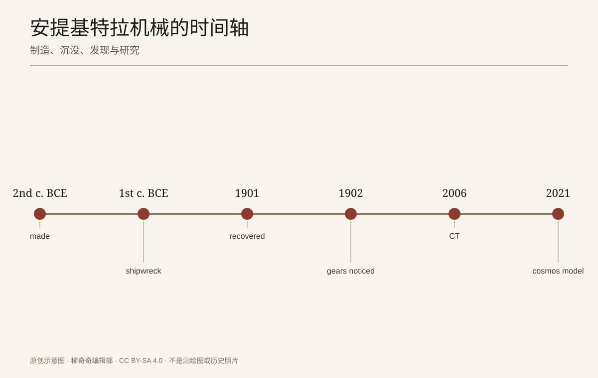

## 一、沉船、木箱与齿轮

1900 年，希腊海绵潜水员在安提基特拉岛附近发现一艘古代沉船；1901 年，捞出的货物中有青铜与大理石雕像、玻璃器皿、钱币和一只不起眼的木箱。箱内是一组严重腐蚀的青铜齿轮与刻度盘，后来被称为“安提基特拉机械”。沉船本身约在公元前 1 世纪失事，货物来自东地中海；机械的具体来源地没有直接证据，通常与罗得岛、科林斯或叙拉古的工艺传统联系起来。

## 二、齿轮与刻度

机械的核心是三十多个互相咬合的青铜齿轮，安装在木框内，正面有 zodiac 环与日历盘，背面有多个螺旋刻度盘。齿轮的齿数经过设计，用来把不同的周期换算成指针位置：太阳年、朔望月、恒星年，以及日食和月食的沙罗周期。残片上的铭文提到太阳、月亮、行星和“周期”等词。它不是一台通用计算器，而是一台专用天文模拟器：输入一个日期，输出若干天象指针的位置。

*原创示意图：安提基特拉机械从制造到现代研究的时间轴。不是测绘图。稀奇奇编辑部，CC BY-SA 4.0。*

## 三、谁造的

机械没有留下制作者的名字。古代文献提到叙拉古的阿基米德制造过天球仪，也提到罗得岛的工艺传统；这些线索与机械的年代和构造相近，却不能直接证明作者。学者更倾向于把它看作一个工匠团队的产品：天文知识来自巴比伦和希腊的观测传统，齿轮工艺来自地中海东部的机械作坊。把它说成“阿基米德亲手制造”，是一种有吸引力但缺少直接证据的归属。

## 四、它计算什么

正面外环是 zodiac 与日历，内环显示太阳和月亮的位置；背面的大螺旋盘用于显示 19 年默冬周期、18 年 11 天的沙罗周期，以及 54 年三沙罗周期。另一个小盘与四年周期的运动会有关。机械还能用一个小球表示月相。它的预测不是无限精确：齿轮的齿数、摩擦和制造误差都会累积，日食和月食也只能给出大致时间。它更像一台“天象预告器”，而不是现代意义上的导航仪或计算机。

*原创示意图：安提基特拉机械的齿轮组、正面日历盘与背面周期盘。不是测绘图。稀奇奇编辑部，CC BY-SA 4.0。*

## 五、研究史

1902 年，考古学家 Valerios Stais 注意到齿轮；1959 年，科学史家 Derek de Solla Price 发表系统研究；1970 年代，X 射线与摄影测量推进了内部结构；2006 年，Freeth 等人在《Nature》发表 CT 重建，确认了齿轮组与天文功能；2021 年，UCL 团队在《Scientific Reports》提出“宇宙模型”复原，进一步讨论行星显示。每一次技术升级都改变了可读的齿轮数目和铭文，也改变了复原图。

## 六、博物馆、复制品与未解之处

机械现存雅典国家考古博物馆，原件因腐蚀和脆弱很少长时间展出。研究团队制作了交互式复制品和数字模型，用于解释齿轮如何转动；这些复制品是解释工具，不是原物。仍不清楚的问题包括：它是一件孤品还是系列产品，木框和指针的原始外观，行星显示到底做到什么程度，以及它为什么随一船雕像沉入海底。沉船遗址的后续调查又发现了新的货物与船体结构，但机械的“出生地”仍是空白。

## 来源与证据

本文的可核对材料主要来自 S1《The Antikythera Mechanism》与 S2《A Model of the Cosmos in the ancient Greek Antikythera Mechanism》；S3 及后续编号为编辑部制作的封面、示意图或补充说明，只用于视觉与背景，不作为史实依据。正文中的年代、数量、地点与归属判断，尽量回到 S1/S2 的具体页面。

封面是「安提基特拉机械：沉船里的齿轮宇宙」的 AI 辅助场景复原，不是现场照片；两张插图为原创示意图，不是测绘图。图片类型与许可逐行记录在 research/image-audit.csv。

## 档案位置

机械的档案核心在雅典：国家考古博物馆保存原件、残片编号与早期入藏记录；希腊考古部门保存沉船调查与打捞日志；研究团队则把 CT 切片、齿轮测量和铭文转录保存在大学与期刊附录中。不同复原方案使用不同的碎片编号和齿轮假设，读者若只看一张复原图，容易误以为结构已经确定。本文的齿轮数量与功能描述，以博物馆公开说明和 2006/2021 年论文为准；更细的齿数、缺失齿轮与木框尺寸，仍属各研究组的模型，不是原件上可直接读出的唯一答案。

## 档案空白

安提基特拉机械没有留下制作者、使用地和用途的直接文字。它的齿轮数目、缺失部分和原始布局，是靠腐蚀残片、X 射线成像与碎片拼接推断出来的；不同复原方案在细节上并不一致。所谓“世界上第一台计算机”是传播用语，不是古代术语；它能计算某些天体周期，不等于能模拟全部行星运动。本文把已成像的齿轮、可读的铭文和博物馆记录写成事实，把复原模型写成有条件的解释。

---

**来源与许可**：本文的事实来源见条目底部来源台账 S1–S3。文字与原创示意图采用 CC BY-SA 4.0。
