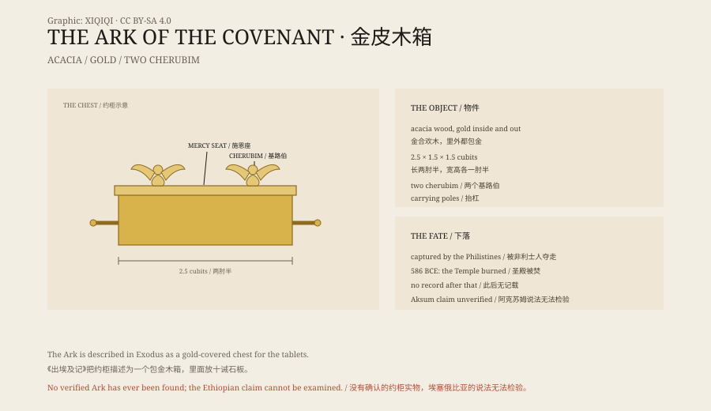

## 1. The chest

Exodus gives the dimensions: two and a half cubits long, one and a half wide, one and a half high. In modern units, roughly 1.1 metres long and 65 centimetres wide and high.

It was made of acacia wood, covered with gold inside and out. Gold rings at the four corners held carrying poles, also covered in gold. On top was a gold “mercy seat”, with a cherub at each end, wings spread towards the middle.

The contents are described slightly differently in different texts. The core is the two stone tablets bearing the Ten Commandments. Other traditions add a jar of manna and Aaron's rod.

## 2. The sanctuary

The Ark stood in the innermost part of the tabernacle and later in the Holy of Holies of the Temple in Jerusalem.

The Holy of Holies was an empty room. Only the high priest could enter, and only once a year, on the Day of Atonement. He came with blood and with incense, and the smoke was meant to cover the mercy seat so that he would not see it.

For the ancient Israelites the Ark was not an artifact. It was the footstool of God among his people, and in war it was carried at the head of the army.

## 3. Captured

In the book of Samuel the Israelites went to war with the Philistines and brought the Ark to the front.

The Israelites were defeated and the Philistines took the Ark. They put it in the temple of Dagon. The next morning the statue of Dagon had fallen on its face, its head and hands broken off. Then disease broke out in the Philistine cities, with tumours and mice in the fields.

The Philistines asked their priests what to do. In the end they put the Ark on a new cart, harnessed two cows that had recently calved, and let it travel back to Israel on its own. On the cart were gold models of the tumours and the mice, as a guilt offering.

## 4. Lost

David brought the Ark to Jerusalem. Solomon built the First Temple and placed the Ark in the Holy of Holies.

In 586 BCE Nebuchadnezzar of Babylon took Jerusalem and burned the Temple. The Bible lists a long inventory of sacred objects carried away: gold dishes, gold bowls, lampstands, incense burners. The Ark is not on the list.

After that, no reliable record says where the Ark was. When the Second Temple was built, the Holy of Holies was empty. When the Romans took Jerusalem, they did not mention the Ark either.

## 5. Ethiopia

Ethiopia has a different account.

The Kebra Nagast, a text compiled in the fourteenth century, says that the Queen of Sheba visited Solomon in Jerusalem and bore him a son, Menelik. When Menelik grew up and visited his father, his companions swapped the real Ark for a copy and carried it back to Ethiopia.

According to this tradition, the Ark is now in the Church of Our Lady Mary of Zion in Aksum, in a dedicated chapel. Only one guardian monk may see it. He lives in a small hut beside the chapel, keeps it for life, and is succeeded by another monk when he dies.

No outsider has independently examined the object. The Ethiopian Orthodox Church does not allow it to be seen.

## 6. The search

The Ark is one of the most sought-after sacred objects in popular culture.

Raiders of the Lost Ark turned it into an adventure story: Nazis, deserts, snakes, and a chest that kills anyone who opens it. Since the film, documentaries and “expeditions” have never stopped.

Archaeologically, there is no confirmed Ark. No photograph, no inscription, no excavation record. Every claim comes either from scripture, from tradition, or from someone's own inference.

## 7. Now

The story of the Ark is the story of something missing.

The more precisely it is described — dimensions, materials, decoration, poles — the more completely it vanishes. After 586 BCE it drops out of the historical record and survives only in legend and film.

The guardian monk is still in Aksum. The Holy of Holies in Jerusalem is only stone. Between the two lies a question with no answer.

*Original schematic: the construction of the Ark, its capture by the Philistines, the destruction of the Temple and the Ethiopian tradition. Not a photograph of the object. XIQIQI Editorial, CC BY-SA 4.0.*

## Box

The Ark of the Covenant was a wooden box.

"Exodus" says that it was made of acacia wood and overlaid with gold on the inside. It was two cubits and a half long, a cubit and a half wide, and a cubit and a half high. The chest had two cherubim, their wings touching, and in the middle is the "mercy seat".

## Sanctuary

The Ark of the Covenant was placed in the Holy of Holies.

The Holy of Holies was the innermost part of the tent or temple and was accessible only to the high priest once a year. There is a pillar of cloud on top of the Ark of the Covenant, symbolizing the presence of God.

## Robbed

The Ark of the Covenant was captured more than once.

The Philistines defeated the Israelites and took the ark away. Later, the Ark was returned and placed in Jerusalem. After the Babylonians destroyed the temple, the Ark disappeared.

## Disappearance
There is no reliable record of the whereabouts of the Ark of the Covenant.

Some say it was buried under the Temple Mount; some say it was taken to Ethiopia; some say it was carried away by angels. Each claim lacks evidence.

## Ethiopia

There is a Church of Our Lady of Zion in Aksum, Ethiopia.

An "Ark of the Covenant" is enshrined in the church, but it is not open to the public. Ethiopian legend says that the Ark was carried away by Solomon and the son of the Queen of Sheba.

## Looking for

Archaeologists searched for the Ark of the Covenant but could not find it.

The Temple Mount is a sensitive area and cannot be excavated at will. Ethiopian churches also do not allow outsiders to view them. The Ark became an unverifiable object.

A box that has been searched for, fought for, and imagined for three thousand years. Whether it exists is no longer just an archaeological question.

## Theology

The Ark of the Covenant is a symbol of God’s presence.

It's not a magic box. Its power comes from the contract it represents, not from wood or gold.

## Archaeology
Archaeologists have not found the Ark of the Covenant.

The Temple Mount cannot be excavated and churches in Ethiopia are not open. The existence of the Ark of the Covenant can only depend on words and faith.

A box became a sacred object of three religions. Its meaning is greater than its physical form.

## Summing Up
The Ark of the Covenant is a box.

Its meaning is not in the wood and gold, but in the contract it represents.

There is no archaeological evidence to prove where it is. Its existence belongs to faith, not to museums.

The story of the Ark of the Covenant is not over. It just moves from one place to another, and then to people's imagination.

The box can disappear, the story cannot. As long as there are people who believe in that covenant, the Ark of the Covenant is still somewhere, being carried around.

---

**Sources and licenses**: the factual sources are listed in the source ledger S1–S3 at the bottom of this entry. Text and original diagrams are licensed under CC BY-SA 4.0. This article separates the biblical description, the historical record and the Ethiopian tradition; there is no verifiable Ark, and the Aksum claim cannot be independently examined. The illustration is a scene reconstruction, not a photograph of the object.
