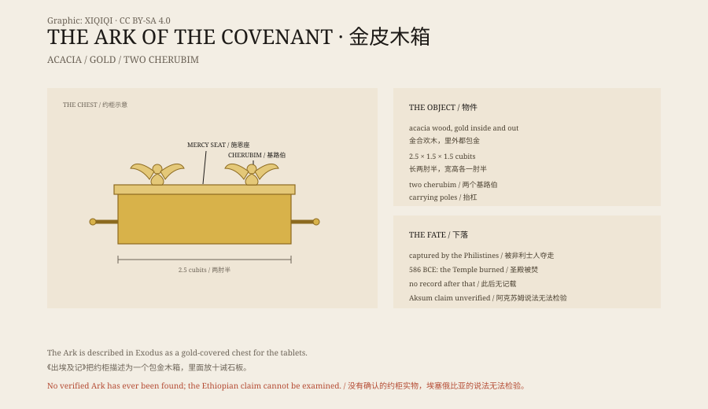

## 一、箱子

《出埃及记》给了约柜的尺寸：长两肘半，宽一肘半，高一肘半。按常见的换算，大约一米一长，六七十厘米宽，同样高。

材料是金合欢木。里外都包金。四角有金环，穿过抬杠，抬杠也包金。柜子上方是一块金的“施恩座”，两头各有一个基路伯，翅膀张开，朝向中间。

柜子里放什么，不同经文说法略有出入。最核心的是两块石板，上面刻着十诫。也有说法提到，里面还有一罐吗哪和亚伦发芽的杖。

## 二、圣所

约柜放在会幕的最里面，后来放在耶路撒冷圣殿的“至圣所”。

至圣所是一个空房间，只有大祭司能进，而且一年只有一次，在赎罪日。他进去的时候要带着血，要烧香，烟要遮住施恩座，免得他看见。

对古代以色列人来说，约柜不是一件文物。它是神坐在人间的脚凳，是战争时被抬在最前面的东西。

## 三、被夺

《撒母耳记》里，以色列人和非利士人打仗，把约柜抬到前线。

结果以色列人败了，约柜被非利士人夺走。非利士人把它放进大衮神庙，第二天早上，大衮的像倒在地上，头手都断了。接着，非利士人的城里爆发疾病，长出肿瘤，田里闹老鼠。

他们请祭司想办法，最后把约柜放在一辆新车上，配上两头刚下崽的母牛，让它自己走回以色列。车上还放着金做的肿瘤和老鼠，作为赔罪的礼物。

## 四、消失

大卫王把约柜抬到耶路撒冷。所罗门建了第一圣殿，把约柜放进至圣所。

公元前 586 年，巴比伦王尼布甲尼撒攻破耶路撒冷，烧了圣殿。圣经列了一长串被抢走的圣殿器物：金盘、金碗、灯台、香炉。约柜不在名单里。

从那以后，没有一条可靠的记载说约柜在哪里。第二圣殿重建时，至圣所里是空的。罗马人攻入耶路撒冷时，也没有提到约柜。

## 五、埃塞俄比亚

埃塞俄比亚有一个不同的说法。

14 世纪的《列王荣耀记》说，示巴女王去耶路撒冷见所罗门，怀了他的儿子门涅利克。门涅利克长大后去耶路撒冷见父亲，回程时，随从用一个复制品换走了真约柜，把它带到了埃塞俄比亚。

按照这个传统，约柜现在在阿克苏姆的锡安圣母玛利亚教堂，放在一个专门的礼拜堂里。只有一位守柜的修士能看见它。他住在礼拜堂旁边的小屋里，终身守护，死后由下一位接替。

没有人独立检验过这件东西。埃塞俄比亚教会也不让外人看。

## 六、寻找

约柜是流行文化里最常被寻找的圣物之一。

电影《夺宝奇兵》让它变成了一个冒险故事：纳粹、沙漠、蛇、打开就死的箱子。电影之后，关于约柜的纪录片和“考察队”一直没有断过。

考古学上，没有一件被确认的约柜。没有照片，没有铭文，没有出土记录。所有的说法，要么来自经文，要么来自传统，要么来自某个人自己的推断。

## 七、现在

约柜的故事，核心是一个“不见了”的东西。

它被描述得越具体——尺寸、材料、装饰、抬杠——它消失得就越彻底。公元前 586 年之后，它从历史记录里掉了出去，只在传说和电影里继续存在。

埃塞俄比亚的守柜修士还在。耶路撒冷的至圣所只剩石头。两个地方，隔着一个没有答案的问题。

*原创示意图：约柜的构造、非利士人夺取、巴比伦毁灭与埃塞俄比亚传统。不是文物照片。稀奇奇编辑部，CC BY-SA 4.0。*

---

**来源与许可**：本文的事实来源见条目底部来源台账 S1–S3。文字与原创示意图采用 CC BY-SA 4.0。文中把圣经描述、历史记载与埃塞俄比亚传统分开叙述；约柜没有可核实的实物，阿克苏姆的说法无法独立检验。插图是场景复原，不是文物照片。
