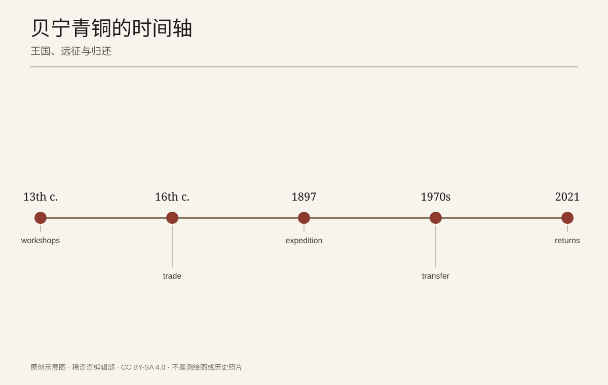
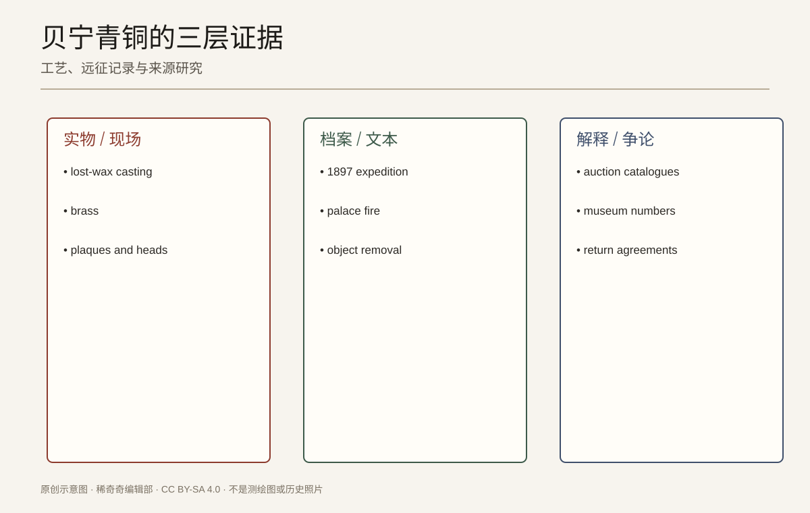

## 1. A palace workshop

The kingdom of Benin was centred on what is now Benin City in Nigeria and lasted from around the thirteenth century to the end of the nineteenth. Palace workshops made bronze and brass objects for the oba: relief plaques on palace walls, ancestor heads, ritual figures and animals, ivory and coral ornaments. These were not simply 'art objects'; they recorded kingship, military success, sacrifice, and foreign trade, and were placed at specific points in palaces, altars, and ceremonies.

## 2. The 1897 expedition

In 1897 Britain launched the 'Benin Punitive Expedition', citing the killing of an official on the way to Benin City. British forces entered the city, burned palaces and town areas, and removed large quantities of bronze, ivory, and royal objects. The oba, Ovonramwen, was deposed and exiled. This was not an ordinary archaeological excavation but systematic looting in a colonial war; later collections, auctions, and museum accessions all rest on this event.

*Original diagram: the Benin Bronzes from palace workshops to the 1897 expedition and returns. Not a survey drawing. XIQIQI Editorial, CC BY-SA 4.0.*

## 3. Dispersal into museums

The removed objects were distributed to officers and the British government, then entered institutions such as the British Museum, the Berlin Ethnological Museum, and the Metropolitan Museum of Art through auctions. Today the 'Benin Bronzes' are scattered across European and American museums and private collections, and some were only recatalogued late in the twentieth century. Provenance research is therefore central: an object's accession record, auction catalogue, and chain of owners often explain how it left Nigeria better than the label 'Benin' on a display case.

## 4. The return debate

Nigeria has sought return since the mid-twentieth century. Some objects were transferred in the 1970s; in 2021–2022 several German and British institutions began returning or transferring title, and the Smithsonian took similar steps. Returns are not uniform: some countries are constrained by museum law and can offer only long-term loans; others choose 'shared custody' or digital access. The argument between 'universal museums' and 'source-country rights' still has no globally consistent rule.

*Original diagram: casting technique, the 1897 expedition record, and provenance research for the Benin Bronzes. Not a survey drawing. XIQIQI Editorial, CC BY-SA 4.0.*

## 5. Casting and material

Most of these objects are brass (a copper-zinc alloy) rather than strict 'bronze' (copper-tin); 'Bronze' is a historical collective term. They were made by lost-wax casting: a wax model was coated in clay, heated so the wax ran out, and molten metal poured in. The relief detail of plaques, the casting thickness of heads, and surface patina are clues to date and workshop. They connect to the casting tradition of Ife, trans-Saharan trade, and European goods, and cannot be understood in isolation.

## 6. What restitution changes

Returned objects need new conditions for conservation, research, and display. Nigeria plans a museum in Benin City and the reinstallation of some works in palaces and sites; electricity, climate control, security, and staff training remain practical issues. Return is not an endpoint: it changes ownership and the right to narrate. The next questions are who has the authority to interpret these objects, and whether audiences can see them where they were made.

The cover is an AI-assisted reconstruction of “The Benin Bronzes: Palace, Punitive Expedition, and Return”, not a site photograph; the two inline figures are original diagrams, not survey drawings. Image types and licences are recorded row by row in research/image-audit.csv.

## Archive location

The Benin archive has two layers, 'origin' and 'present': the British Museum, the Berlin Ethnological Museum, the Smithsonian, and other institutions hold accession registers, auction catalogues, and dealer records from the 1897 expedition; Nigeria's National Commission for Museums and Monuments holds palace-site, excavation, and return files; the palace and community in Benin City keep oral memory and ritual records. Provenance research turns on matching an object's museum number to the 1897 removal lists and later sale catalogues. Not every object can be traced through that chain; some early records say only 'Benin' without a specific palace or altar, and that is the hardest part of the return negotiations. That asymmetry is part of the object's history, not a technical footnote; it shapes claims of ownership as much as the objects themselves do. The archive is not a neutral inventory: it was built by the same institutions that acquired the objects, and its categories still shape how the return is argued.

## Limits of the record

'Benin Bronzes' is a collective label covering plaques, heads, figures, ivory, and metalwork made over several centuries in more than one workshop. How many objects were taken in the 1897 expedition is uncertain, and museum holdings and archival counts do not agree; some pieces passed through several owners, auctions, and private collections. Legal routes to return differ by country, and EU, UK museum law, and Nigerian collection policy are not uniform. This entry separates checkable expedition records, museum numbers, and completed returns.

---

**Sources and licenses**: for “The Benin Bronzes: Palace, Punitive Expedition, and Return”, the factual claims above are traced to S1 and S2 in the source ledger; S3 covers the AI-assisted cover and the two original diagrams. Text and original diagrams are licensed CC BY-SA 4.0. This entry separates the documented record from reconstruction and marks remaining uncertainty under 'Limits of the record'. Where the archive is silent, the text says so rather than filling the gap with narrative. Dates and figures follow the cited pages; interpretations are identified as interpretations, and no hypothesis is presented as a settled fact.
