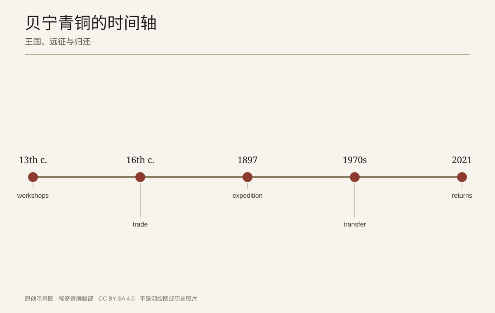
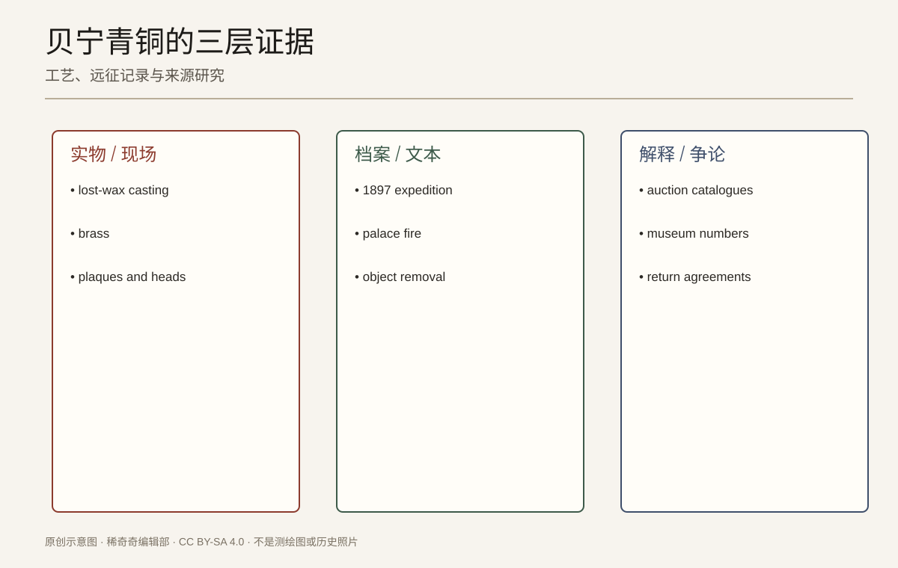

## 一、宫殿里的作坊

贝宁王国以今天的尼日利亚贝宁城为中心，从 13 世纪前后延续到 19 世纪末。宫廷作坊为 oba（国王）制作青铜与黄铜器物：宫殿墙上的浮雕 plaque、祖先头像、仪式用的人物与动物、象牙与珊瑚饰物。这些器物不是单纯的“艺术品”，它们记录王权、战功、祭祀和外来贸易，安放在宫殿、祭坛和仪式的具体位置。

## 二、1897 年的远征

1897 年，英国以一名官员在前往贝宁城途中被杀为由，发动“贝宁惩罚远征”。英军攻入贝宁城，焚烧宫殿与城镇，掠走大量青铜、象牙和皇家器物。oba Ovonramwen 被废黜并流放。这次行动不是一次普通考古发掘，而是殖民战争中的系统性掠夺；后来的收藏、拍卖和博物馆入藏，都建立在这一节点上。

*原创示意图：贝宁青铜从宫廷作坊到 1897 年远征与归还的时间轴。不是测绘图。稀奇奇编辑部，CC BY-SA 4.0。*

## 三、流散与馆藏

掠走的器物被分给参与行动的军官和英国政府，随后通过拍卖进入大英博物馆、柏林民族学博物馆、纽约大都会艺术博物馆等机构。今天“贝宁青铜”分散在欧美多家博物馆和私人收藏中，部分器物直到 20 世纪后期才被重新编目。来源研究（provenance）因此成为关键：一件器物的入藏记录、拍卖目录和经手人，往往比展签上的“贝宁”二字更能说明它如何离开尼日利亚。

## 四、归还的路径

尼日利亚自 20 世纪中期以来持续要求归还。1970 年代，部分器物被移交给尼日利亚；2021–2022 年，德国与英国的多家机构开始归还或转移所有权，史密森尼学会也采取了类似行动。归还并不统一：有的国家受博物馆法限制，只能长期借展；有的机构选择“共同保管”或数字共享。围绕“普世博物馆”与“来源国权利”的争论，至今没有全球一致的规则。

*原创示意图：贝宁青铜的铸造工艺、1897 年远征记录与来源研究。不是测绘图。稀奇奇编辑部，CC BY-SA 4.0。*

## 五、工艺与材料

这些器物多为黄铜（铜锌合金），而非严格意义上的“青铜”（铜锡合金）；“Bronze”一词是历史形成的统称。制作使用失蜡法：先以蜡制模，覆泥成壳，加热使蜡流出，再浇入金属。plaque 的浮雕细节、头像的铸造厚度和表面包浆，都是判断年代与作坊的线索。它们与 Ife 的铸造传统、跨撒哈拉贸易和欧洲货物之间存在联系，不能孤立看待。

## 六、归还之后

归还的器物需要新的保存、研究和展示条件。尼日利亚计划在贝宁城建设博物馆，并在宫殿与遗址中重新安置部分作品；但电力、气候控制、安保和人员培训仍是现实问题。归还也不是终点：它改变的是所有权和叙事权，接下来要回答的是，谁有权解释这些器物，以及观众能否在它们被制作的地方看到它们。

## 来源与证据

本文的可核对材料主要来自 S1《Benin Bronzes》与 S2《Benin Bronzes》；S3 及后续编号为编辑部制作的封面、示意图或补充说明，只用于视觉与背景，不作为史实依据。正文中的年代、数量、地点与归属判断，尽量回到 S1/S2 的具体页面。

封面是「贝宁青铜：宫殿、远征与归还」的 AI 辅助场景复原，不是现场照片；两张插图为原创示意图，不是测绘图。图片类型与许可逐行记录在 research/image-audit.csv。

## 档案位置

贝宁青铜的档案分成“来源”与“当下”两层：大英博物馆、柏林民族学博物馆、史密森尼等机构保存 1897 年远征的入藏登记、拍卖目录和经手人记录；尼日利亚国家博物馆与纪念物委员会保存宫殿遗址、出土与归还文件；贝宁城的宫廷与社区则保留口述记忆和仪式记录。来源研究的关键，是把一件器物的馆藏编号与 1897 年的掠夺清单、后来的拍卖图录对应起来。并非所有器物都能完成这条链；有些早期记录只写“贝宁”，没有具体宫殿或祭坛，这正是归还谈判中最难的部分。档案的空白本身也是争议的一部分：谁掌握记录，谁就有权叙述器物的来路。

## 档案空白

“贝宁青铜”是一个集合名称，包含 plaque、头像、人物像、象牙与金属器物，年代跨越数百年，制作作坊也不止一处。1897 年远征中究竟有多少件被带走，各馆藏品与档案的数字并不一致；有些器物后来经过多次转手、拍卖和私人收藏。归还的法律路径因国家而异，欧盟与英国的博物馆法、尼日利亚的收藏政策并不统一。本文把可核对的远征记录、馆藏编号与已完成的归还分开陈述。

---

**来源与许可**：本文的事实来源见条目底部来源台账 S1–S3。文字与原创示意图采用 CC BY-SA 4.0。
