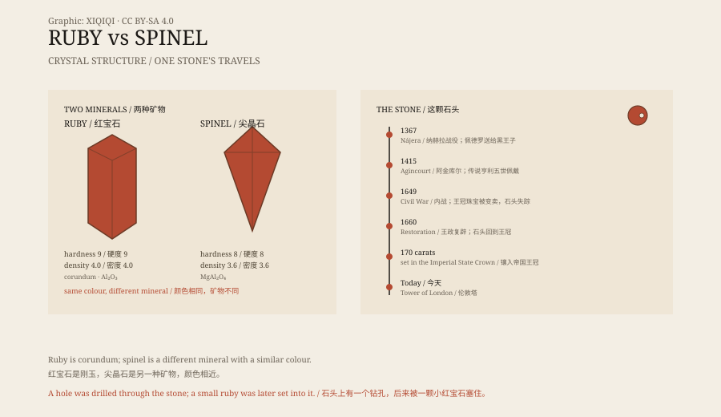

## 1. The front of the crown

A large red stone sits at the front of the British Imperial State Crown.

It is set in the cross pattée at the front, directly above the 317-carat Cullinan II diamond. The stone has no facets; its surface is a smooth dome, and its colour is a deep red with a hint of purple.

It is called the Black Prince's Ruby and weighs about 170 carats. It is one of the oldest components of the Crown Jewels.

The Imperial State Crown is not worn every day. The monarch wears it at the State Opening of Parliament, reads the speech, and then takes it off. For most of the year it sits in a display case in the Tower of London.

*Original schematic: the crystal structures of ruby and spinel, and the documented stations of the Black Prince's Ruby. Not a gemmological report. Oddity Archive, CC BY-SA 4.0.*

## 2. The Black Prince

The stone is tied to a prince.

Edward was the eldest son of Edward III, Prince of Wales, and later known as the Black Prince. In 1367 he led an army into Iberia and helped Pedro I of Castile recover his throne at the Battle of Nájera.

After the battle, Pedro gave him a large red stone. It became the Black Prince's Ruby.

Edward died in 1376, and the stone remained with the English crown. It was set into different crowns and passed with the throne.

## 3. Agincourt

Tradition says Henry V wore the stone at the Battle of Agincourt in 1415.

At that battle, English longbowmen defeated a larger French army. The story goes that the red stone was mounted on Henry's helmet. Later painters repeated the detail, and the stone acquired a reputation as a talisman.

There is no firm contemporary record of exactly where the stone was mounted during the battle. It is a story that has been repeated more often than it has been documented.

## 4. A stone with a hole

The stone has a very practical detail: it was drilled through.

The hole runs through the middle, possibly so that it could be worn as a pendant at an earlier date. Later, a small ruby was set into the hole to plug it. The repair can still be seen today.

The stone also disappeared for a time. During the English Civil War in the seventeenth century, the crown jewels were broken up and sold, and the stone was temporarily lost. It returned to the crown after the monarchy was restored.

## 5. Ruby and spinel

For centuries, people called it a ruby.

Ruby is a variety of corundum, aluminium oxide; spinel is magnesium aluminium oxide. Both can form red, transparent crystals and look very similar. Before modern instruments, merchants, kings, and jewellers could not reliably tell them apart.

It is not the only one. Many “rubies” in old European and Asian crowns have since been identified as spinels. The difference is not colour but crystal structure and refractive index.

Only in the nineteenth century, as mineralogy matured, was the stone's identity corrected. It is still a spinel, and it is still in the crown.

## 6. Now

The Imperial State Crown is kept in the Jewel House at the Tower of London.

The display light falls on the front. The red stone looks dark, with a rim of gold. Visitors file past and have a few seconds to look.

It is not a ruby. But it has seen a battle in 1367, another in 1415, a civil war, and a coronation. The name is wrong; the history is real.

---

**Sources and licenses**: the factual sources are listed in the source ledger S1–S3 at the bottom of this entry. Text and original diagrams are licensed under CC BY-SA 4.0. This article separates the stone's physical properties, its documented owners, and the legends attached to it; the claim that Henry V wore it at Agincourt is traditional rather than firmly documented.
