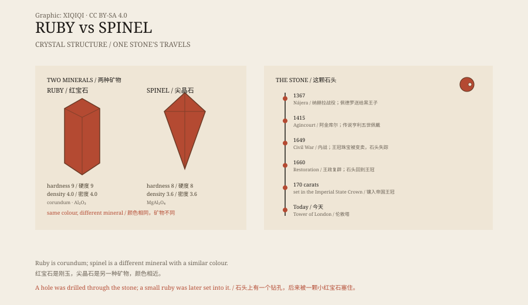

## 1. The front of the crown

A large red stone sits at the front of the British Imperial State Crown.

It is set in the cross pattée at the front, directly above the 317-carat Cullinan II diamond. The stone has no facets; its surface is a smooth dome, and its colour is a deep red with a hint of purple.

It is called the Black Prince's Ruby and weighs about 170 carats. It is one of the oldest components of the Crown Jewels.

The Imperial State Crown is not worn every day. The monarch wears it at the State Opening of Parliament, reads the speech, and then takes it off. For most of the year it sits in a display case in the Tower of London.

*Original schematic: the crystal structures of ruby and spinel, and the documented stations of the Black Prince's Ruby. Not a gemmological report. Oddity Archive, CC BY-SA 4.0.*

## 2. The Black Prince

The stone is tied to a prince.

Edward was the eldest son of Edward III, Prince of Wales, and later known as the Black Prince. In 1367 he led an army into Iberia and helped Pedro I of Castile recover his throne at the Battle of Nájera.

After the battle, Pedro gave him a large red stone. It became the Black Prince's Ruby.

Edward died in 1376, and the stone remained with the English crown. It was set into different crowns and passed with the throne.

## 3. Agincourt

Tradition says Henry V wore the stone at the Battle of Agincourt in 1415.

At that battle, English longbowmen defeated a larger French army. The story goes that the red stone was mounted on Henry's helmet. Later painters repeated the detail, and the stone acquired a reputation as a talisman.

There is no firm contemporary record of exactly where the stone was mounted during the battle. It is a story that has been repeated more often than it has been documented.

## 4. A stone with a hole

The stone has a very practical detail: it was drilled through.

The hole runs through the middle, possibly so that it could be worn as a pendant at an earlier date. Later, a small ruby was set into the hole to plug it. The repair can still be seen today.

The stone also disappeared for a time. During the English Civil War in the seventeenth century, the crown jewels were broken up and sold, and the stone was temporarily lost. It returned to the crown after the monarchy was restored.

## 5. Ruby and spinel

For centuries, people called it a ruby.

Ruby is a variety of corundum, aluminium oxide; spinel is magnesium aluminium oxide. Both can form red, transparent crystals and look very similar. Before modern instruments, merchants, kings, and jewellers could not reliably tell them apart.

It is not the only one. Many “rubies” in old European and Asian crowns have since been identified as spinels. The difference is not colour but crystal structure and refractive index.

Only in the nineteenth century, as mineralogy matured, was the stone's identity corrected. It is still a spinel, and it is still in the crown.

## 6. Now

The Imperial State Crown is kept in the Jewel House at the Tower of London.

The display light falls on the front. The red stone looks dark, with a rim of gold. Visitors file past and have a few seconds to look.

It is not a ruby. But it has seen a battle in 1367, another in 1415, a civil war, and a coronation. The name is wrong; the history is real.

## Black Prince

The name "Black Prince's Ruby" comes from the eldest son of Edward III, Edward, Prince of Wales.

He served in the Hundred Years War between England and France and was known for his black armor, so he was called the "Black Prince". The stone later came into his possession and was mounted on his helmet or hat.

Henry V wore it at the Battle of Agincourt in 1415. Legend has it that his helmet was chopped off in battle and the stone protected him. This story gave gemstones a reputation as "protective".

## Crown

Today, the stone is set on the front of the British Empire State Crown.

It is a large red gemstone surrounded by diamonds. The crown is used for coronation and only appears during ceremonies. The weight, cut and color of the stone make it the visual centerpiece of the crown.

But it's not ruby. In modern gemological terms, it is a spinel.

The Imperial Crown is for coronation.

It's set with diamonds, pearls, sapphires and this red spinel. The crown is heavy and is only worn during ceremonies. When a monarch is crowned, a crown is placed on his head to symbolize power.

The position of the gemstone, on the front of the crown, is very conspicuous. Its red color contrasts with the surrounding diamonds. It is the first thing visitors see.

## Spinel

Ruby and spinel are chemically different.

Ruby is corundum, whose main component is aluminum oxide; spinel is magnesium aluminum oxide. The colors of the two can be very similar, but the hardness and refractive index are different. In an era before modern instruments, red spinel was often mistaken for ruby.

This "Black Prince Ruby" came from Central Asia and may have passed through the hands of gem traders such as Tavernier. It is dark in color, not very transparent, but very large. For the royal family, size and story mattered more than mineral classification.

Spinel was often regarded as ruby ​​in ancient times.

Its color, hardness and luster are close to ruby. Without instruments, it's difficult to tell the difference. It was not until the nineteenth century that mineralogy separated the two.

The name "Black Prince Ruby" is a historical misunderstanding. It's not a ruby, but it's still a precious spinel. The name is wrong, the value is not.

## Drill Hole

There is a small hole in the gemstone.

Legend has it that it was drilled and used for threading or fixing. The hole reduces the value of the gem and leaves a trace of history. Later inlays obscured it, but it can still be seen if you look closely.

The cut of the gemstone is also not a modern cut. It was re-sharpened many times, its shape changed, and so did its weight. The stone today is not what it was originally.

## Now

The Imperial Crown is on display in the Tower of London.

Visitors looking at it through the glass see lights of red, gold and diamonds. The label will say "Black Prince Ruby" and also indicate that it is a spinel.

A stone that had been misidentified for hundreds of years ended up being part of the crown. Its name is wrong, its story is right.

## Sources
This spinel comes from Central Asia.

In the fourteenth century, gemstones entered Europe via the Silk Road or Indian Ocean trade. It probably belonged to the Moorish king of Granada and was later taken by the king of Castile.

Edward, the "Black Prince" acquired it during the Spanish campaign. He brought it back to England and mounted it on his helmet. Later, it became part of the British Crown.

## Value

The value of gemstones lies not only in their material.

It's in history: The Black Prince, Agincourt, Henry V, The Imperial Crown. Every piece of history adds a story to the gem. The story cannot be cut or scaled, but it can make the stone more expensive.

A spinel, if placed in a jewelry store, might just be a red stone. Placed on the crown, it is the symbol of the empire.

---

**Sources and licenses**: the factual sources are listed in the source ledger S1–S3 at the bottom of this entry. Text and original diagrams are licensed under CC BY-SA 4.0. This article separates the stone's physical properties, its documented owners, and the legends attached to it; the claim that Henry V wore it at Agincourt is traditional rather than firmly documented.
