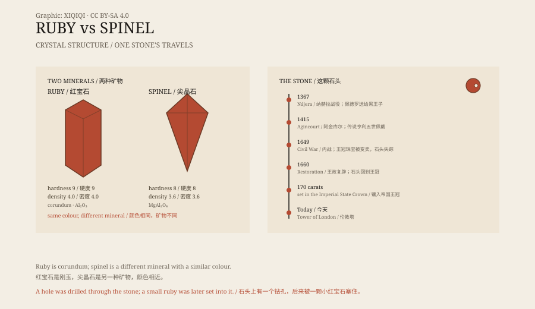

## 一、王冠正面

英国帝国王冠的正面，有一颗很大的红色宝石。

它镶在正前方的十字架里，下面就是重达三百多克拉的“库里南二号”钻石。宝石没有刻面，表面磨成圆润的弧面，颜色是深的、带一点紫的红。

它的名字叫“黑王子红宝石”，重量约 170 克拉。在英国王冠珠宝里，它是最古老的部件之一。

帝国王冠不是天天戴的。君主在议会开幕时戴上它，念完讲稿，再摘下来。大部分时间，它放在伦敦塔的展柜里。

*原创示意图：红宝石与尖晶石的晶体结构对比，以及“黑王子红宝石”的流转节点。不是宝石鉴定报告。稀奇奇编辑部，CC BY-SA 4.0。*

## 二、黑王子

这颗石头和一位王子有关。

爱德华是英王爱德华三世的长子，封威尔士亲王，后来被称为“黑王子”。1367 年，他率军进入伊比利亚半岛，在纳赫拉战役中帮卡斯蒂利亚国王佩德罗一世夺回了王位。

战后，佩德罗把一颗大红宝石送给了他。这就是后来的“黑王子红宝石”。

黑王子 1376 年去世，石头留在了英国王室手里。它被镶进过不同的王冠，跟着王位一起换主人。

## 三、阿金库尔

传说里，亨利五世在 1415 年的阿金库尔战役中戴过这颗宝石。

那一战，英格兰长弓手打败了人数更多的法国骑士。亨利五世的头盔上据说镶着这颗红宝石。这个细节被后来的画家反复描绘，石头也因此有了“护身”的名声。

不过，石头在战役中具体镶在哪里，没有确凿的记录。它更像一个被不断重复的故事，而不是一份清单。

## 四、一颗被钻洞的石头

这颗宝石有一个很实际的细节：它被钻透过。

孔从石头中间穿过，可能是为了让它在更早的时候作为吊坠佩戴。后来，有人在孔里塞了一颗小红宝石，把洞补上。今天仔细看，还能看到那个位置。

石头还经历过一次消失。十七世纪英国内战期间，王室珠宝被拆散、变卖，这颗宝石一度下落不明。王政复辟后，它又回到了王冠上。

## 五、红宝石与尖晶石

几百年来，人们一直叫它红宝石。

红宝石是刚玉的一种，化学成分是氧化铝；尖晶石是镁铝氧化物。两者都能长成红色、透明的晶体，外观非常像。在没有现代仪器的年代，商人、国王和珠宝匠都分不清。

不只是这一颗。欧洲和亚洲的旧王冠里，很多“红宝石”后来都被鉴定为尖晶石。区别不是靠颜色，而是靠晶体结构和折射率。

十九世纪以后，矿物学逐渐成熟，这颗石头的身份才被更正。它仍然是尖晶石，但仍然镶在王冠上。

## 六、现在

今天，帝国王冠放在伦敦塔的珠宝馆里。

展柜的灯光打在正面，红色石头很暗，边缘有一圈金光。游客排队走过，只能看几十秒。

它不是红宝石。但它见证过一场 1367 年的战役、一次 1415 年的战役、一场内战和一次加冕。名字错了，历史是真的。

---

**来源与许可**：本文的事实来源见条目底部来源台账 S1–S3。文字与原创示意图采用 CC BY-SA 4.0。文中把宝石的物理属性、历任持有者与传说分开叙述；“亨利五世在阿金库尔佩戴它”属于传统说法，缺乏同时代的确凿记录。
