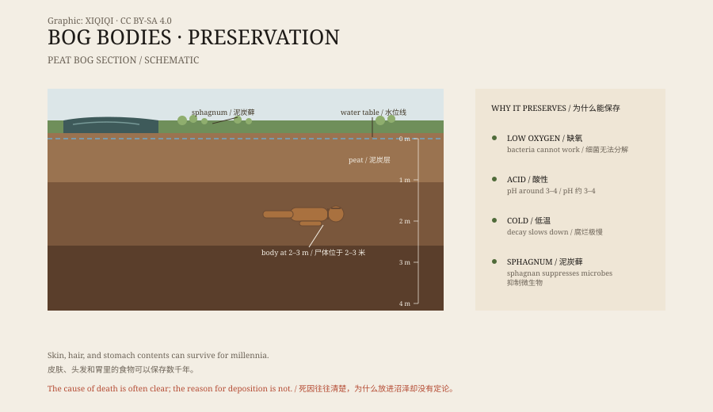

## 1. A face in the peat

In May 1950, two brothers were cutting peat in the Bjældskovdal bog on the Jutland peninsula in Denmark.

Peat had been dug there for fuel for generations. That day, their spades hit something hard. They opened the peat and saw a face.

The face was complete. The eyes were closed, the lips were still there, there was stubble on the chin, and a pointed leather cap sat on the head. The brothers assumed they had found a recent murder victim and went to fetch the police.

The police assumed the same thing. Then someone noticed that the body lay too deep, in peat that was far too old.

The body became known as Tollund Man. Radiocarbon dating put his death between 405 and 380 BCE, at about thirty to forty years of age.

*Original schematic: the layers of a peat bog, its low-oxygen environment, and where a body is preserved. Not an archaeological survey drawing. Oddity Archive, CC BY-SA 4.0.*

## 2. Why a bog preserves a body

In an ordinary grave, a body decays. A bog is different.

A peat bog is a waterlogged wetland covered in sphagnum moss. The moss releases a polysaccharide that suppresses bacteria; the water is cold and acidic, and there is very little oxygen. The microbes that normally break down tissue cannot work.

The result is that skin and muscle are tanned into leather, hair and nails survive, and the last meal in the stomach can still be analysed. Bone, on the other hand, may slowly dissolve in the acid.

When Tollund Man was lifted out, a leather noose was still around his neck. He had been hanged and then placed in the bog. The noose and the cap stayed where they were.

## 3. More than one

Hundreds of bodies have come out of European peat bogs.

The oldest is the Koelbjerg Man from Denmark, dated to about 8000 BCE; only his skeleton survives. Most of the best-preserved bodies are Iron Age: Tollund Man, Grauballe Man, Lindow Man, and the Irish bodies known as Clonycavan Man and Old Croghan Man.

In 2011, peat cutters in County Laois, Ireland, found Cashel Man. He died around 2000 BCE and is the oldest fleshed bog body known.

The finds are spread across Denmark, Ireland, Britain, Germany, and the Netherlands. They are not the product of one local custom but of the same geological conditions in different places.

## 4. How they died

Many of these deaths were violent.

Tollund Man was hanged. Grauballe Man's throat was cut from ear to ear. Lindow Man had been struck on the head, had a cord around his neck, and his throat had been cut. Cashel Man had cut marks on his body and a wound on his arm.

These injuries do not look accidental. Researchers have proposed several explanations: execution of criminals, punishment for adultery, the sacrifice of a sick person or an offering to the gods, or the burial of someone with a special status.

The “threefold death” is a pattern often mentioned: strangling, stabbing, and drowning combined. Lindow Man shows something similar. But not every body fits the pattern, so it is better treated as a possible ritual than a fixed rule.

## 5. The bog as a doorway

To Iron Age people, a bog was not ordinary ground.

It lies between land and water, gives way underfoot, and does not give back what is thrown in. Such places were often seen as entrances to another world. Besides people, the bogs have yielded weapons, wagons, cauldrons, gold, and silver.

Placing a person in a bog may have been both a burial and an offering. The bodies were not simply dumped; many were laid out as if sleeping, covered with branches or cloth. Tollund Man's expression is calm, as though he were asleep.

## 6. Now

Tollund Man's head sits in a glass case at the Silkeborg Museum in Denmark.

His body is kept elsewhere; the display shows the head and the cap. Grauballe Man is at the Moesgaard Museum, Lindow Man at the British Museum, and Cashel Man and several other Irish bodies at the National Museum of Ireland.

Conservation remains difficult. Once a bog body meets the air, it can dry, shrink, and grow mould. Researchers have to choose between display and preservation.

A man died more than two thousand years ago, and his skin is still there, his hair still reddish. It is not because he was treated specially, but because he fell into a place that would not let him rot.

---

**Sources and licenses**: the factual sources are listed in the source ledger S1–S3 at the bottom of this entry. Text and original diagrams are licensed under CC BY-SA 4.0. This article separates the discovery, the preservation mechanism, the causes of death, and the ritual interpretations; both the cause of death and the reason for deposition remain debated.
