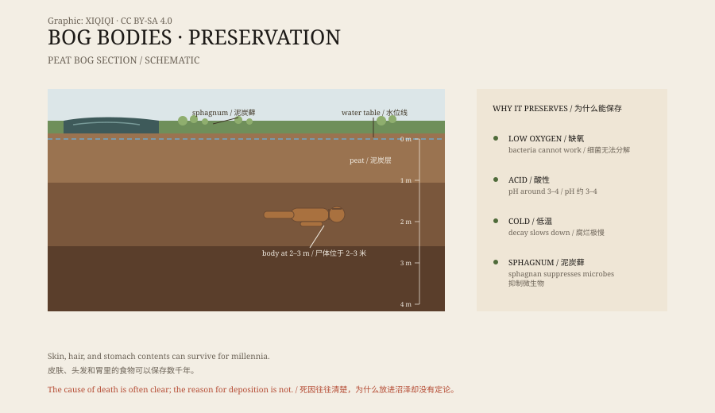

## 一、泥炭坑里的脸

1950 年 5 月，丹麦日德兰半岛，两个兄弟在比耶尔德斯科夫沼泽里挖泥炭。

泥炭可以当燃料，当地人挖了很多年。这一天，他们的铁锹碰到了一个硬东西。挖开泥炭，露出一张脸。

脸是完整的。眼睛闭着，嘴唇还在，下巴上有短胡茬，头上戴着一顶尖顶皮帽。兄弟俩以为挖到了最近被谋杀的人，跑去找警察。

警察也以为是凶案。直到有人注意到，尸体的位置太深了，周围的泥炭太古老了。

这具尸体后来被称为图伦人。碳十四测年显示，他死于公元前 405 年到公元前 380 年之间，年龄大约三十到四十岁。

*原创示意图：泥炭沼的层次、缺氧环境与尸体保存位置。不是考古测绘图。稀奇奇编辑部，CC BY-SA 4.0。*

## 二、沼泽为什么能保存人

普通的埋葬，尸体会腐烂。沼泽不一样。

泥炭沼是水饱和的湿地，表面长着泥炭藓。泥炭藓的细胞壁会释放一种多糖，能抑制细菌活动；沼泽水又冷、又酸，氧气很少。分解菌在这种环境里几乎无法工作。

结果是，皮肤和肌肉被“鞣”成了皮革一样的质地，头发和指甲保存下来，胃里的最后一餐也能被分析。骨头反而可能被酸慢慢溶掉。

图伦人被挖出来时，脖子上套着一根皮绳。他被吊死，然后被放进沼泽。尸体入水后，绳套和帽子都留在了原位。

## 三、不止一具

欧洲的泥炭沼里，已经出土了数百具尸体。

最早的一具是丹麦的克勒比约人，只剩骨架，年代约公元前 8000 年。保存最完整的一批，大多属于铁器时代：图伦人、格劳巴勒人、林多人，还有爱尔兰的克隆尼卡万人和克罗汉老人。

2011 年，爱尔兰莱伊什郡的泥炭沼里又挖出了卡斯尔人。他死于约公元前 2000 年，是已知最早的、还带着皮的沼泽尸体。

这些尸体分布很广：丹麦、爱尔兰、英国、德国、荷兰。它们不是同一个地方的风俗，而是同一种地质条件在不同地区留下的结果。

## 四、他们是怎么死的

很多沼泽尸体的死法都不平静。

图伦人被吊死。格劳巴勒人的喉咙被割开，从一边耳朵切到另一边。林多人头部受过重击，脖子上有绳痕，喉咙也被割开。卡斯尔人身上有刀伤，手臂上也有伤口。

这些伤口不像意外。研究者提出了几种解释：处决罪犯、惩罚通奸者、把病人或祭品献给神，或者埋葬有特殊身份的人。

“三次死亡”是一个常被提到的模式：勒死、刺伤、溺死，三种方式同时出现。林多人身上能看到类似的痕迹。但并不是每一具尸体都符合这个模式，所以它更像一种可能的仪式，而不是统一的规定。

## 五、沼泽是门

在铁器时代的人眼里，沼泽不是一块普通的地。

它介于陆地和水的之间，踩上去会下陷，扔下去的东西不会再回来。这种地方常被当作通往另一个世界的入口。除了人，沼泽里还出土过武器、马车、大锅和金银器。

把人放进沼泽，可能既是埋葬，也是献出。尸体没有被随意丢弃，很多都被摆成安睡的姿势，身上盖着树枝或衣物。图伦人的表情很平静，像是睡着了一样。

## 六、现在

图伦人的头现在放在丹麦锡尔克堡博物馆的玻璃柜里。

他的身体被保存在别处，展览里只有头部和那顶帽子。格劳巴勒人在莫斯加德博物馆，林多人在大英博物馆，卡斯尔人和另外几具爱尔兰沼泽尸体在国家博物馆。

保存仍然是难题。尸体一旦接触空气，就会迅速变干、收缩、发霉。研究者要在展示和研究之间做取舍。

一个人死了两千多年，皮肤还留着，头发还是红的。这不是因为他被特别对待，而是因为他掉进了一个不让他腐烂的地方。

## 泥炭

泥炭沼泽是湿冷的。

水少氧，酸性强，细菌难以繁殖。尸体被埋进去，皮肤会变成深棕色，头发变红，骨头变软。

## 保存

沼泽保存的不只是尸体。

衣服、绳子、工具、食物，也会被保存。这些东西让考古学家能看到古代人的生活细节。

## 不止一具

欧洲的沼泽里，发现了很多尸体。

丹麦的 Tollund Man、Lindow Man，荷兰的 Yde Girl，德国的 Rendswühren Man。他们来自不同年代，不同地区。

## 怎么死的

他们的死因，各不相同。

有人被勒死，有人被割喉，有人被溺死。有人说，他们是罪犯；有人说，他们是祭品；有人说，他们是意外死亡。

## 沼泽是门

北欧的神话里，沼泽是通往另一个世界的门。

把东西放进沼泽，是献给神的礼物。尸体可能是祭品，也可能是被惩罚的人。

## 现在

沼泽尸体在博物馆展出。

他们的脸被复原，衣服被展示。游客可以看到两千年前的人。

一具尸体，从沼泽里出来，成了历史的证人。

## 考古

沼泽尸体，提供了古代生活的细节。

他们的衣服、发型、饮食和疾病，都能被研究。他们不是“怪物”，是普通人。

## 伦理

展出沼泽尸体，有伦理争议。

有人说，这是对人的不尊重；有人说，这是历史教育。博物馆通常在说明牌上写清楚，这些人不是展品，是死者。

一具尸体，从沼泽到博物馆。它的旅程，比它的生命更长。

## 小结

沼泽尸体，不是“怪物”。

他们是普通人，被泥炭保存下来。他们的死因，可能是惩罚、祭祀或意外。

他们让我们看到古代生活的细节，也让我们面对一个伦理问题：死人能不能被展出。

---

**来源与许可**：本文的事实来源见条目底部来源台账 S1–S3。文字与原创示意图采用 CC BY-SA 4.0。文中把发现过程、保存机制、死亡方式与仪式解释分开叙述；沼泽尸体的死因和埋葬原因仍有不同解释。
