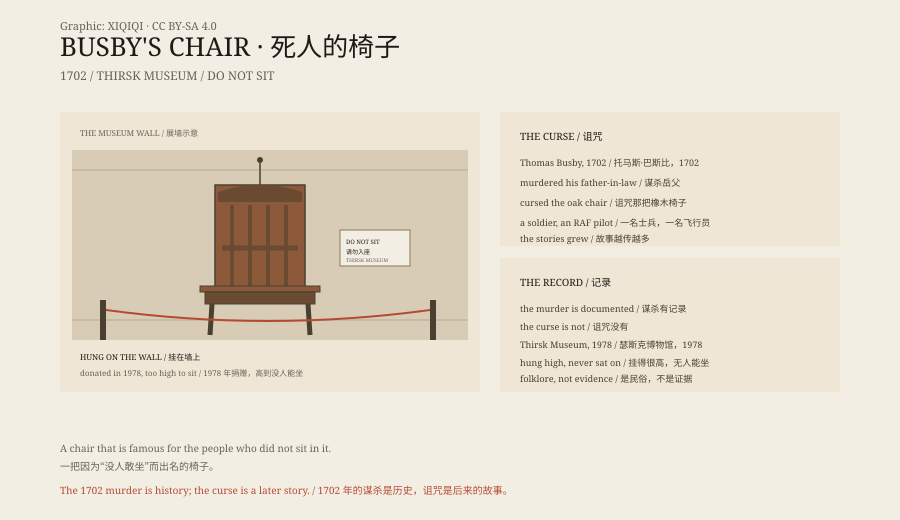

## 1. 1702

In 1702, in North Yorkshire, England, Thomas Busby was executed for murdering his father-in-law, Daniel Awety.

Legend says that before he was hanged, he cursed the oak chair his victim had sat in: anyone who sat in it would die.

## 2. The Chair

The chair stayed at a local inn, later called the Busby Stoop Inn.

In the eighteenth and nineteenth centuries it was just an old chair. In the twentieth century the story grew.

## 3. The Deaths

During the Second World War, a soldier sat in the chair and died a few days later in a training accident.

Later, an RAF pilot sat in it and was killed in a crash soon afterwards.

There were workers, passers-by and drinkers too. The stories multiplied, and the details became more specific.

## 4. The Museum

In 1978 the inn donated the chair to the Thirsk Museum.

The museum did not put it on the floor. It hung it high on a wall so that no one could sit in it.

It became one of Britain's most famous "cursed objects".

## 5. The Truth

Thomas Busby's murder and execution are historical records.

"Anyone who sits dies" is not.

Most of the death stories are retrospective: someone sat in the chair and later died of something unrelated, and the story joined the two events together.

## 6. The Chair

The chair itself is ordinary: oak, a straight back, a seat polished by use.

It hangs on a wall like a specimen.

People come to look at it, not to sit in it, but to make sure they will not.

*Original schematic: the 1702 murder, the curse legend and the 1978 move to the museum. Not a photograph of an artefact. Oddity Archive, CC BY-SA 4.0.*

---

**Sources and licenses**: the factual sources are listed in the source ledger S1–S3 at the bottom of this entry. Text and original diagrams are licensed under CC BY-SA 4.0. This article separates the 1702 murder and execution, the twentieth-century curse legend and the retrospective death stories; the murder is documented, the curse is not. The illustration is a scene reconstruction, not a photograph of an artefact.
