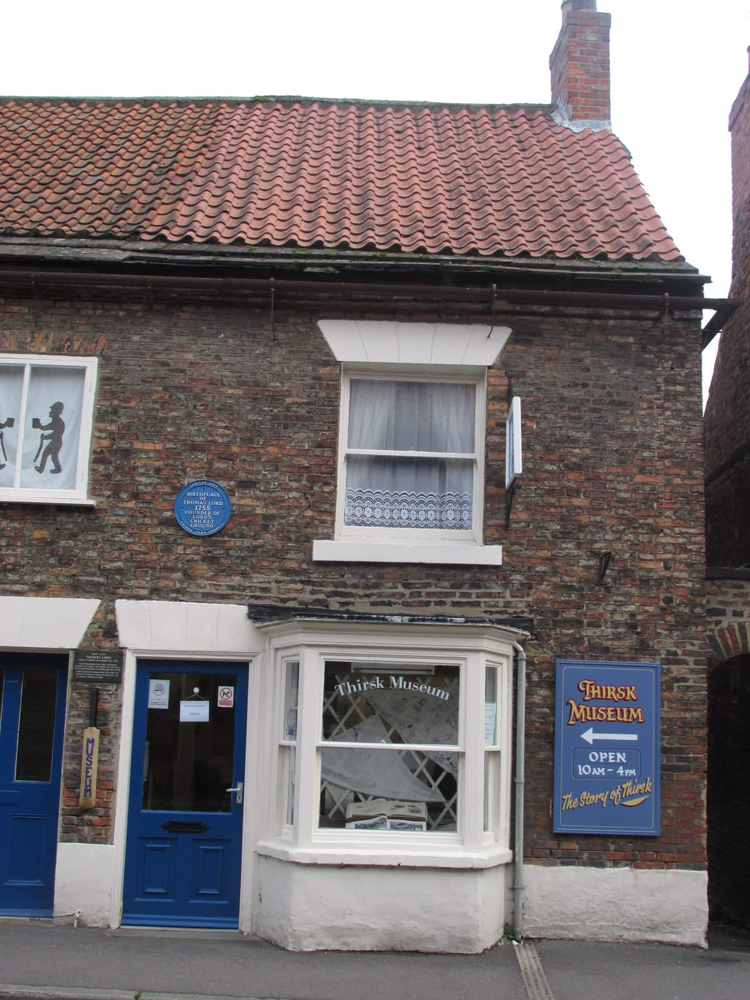
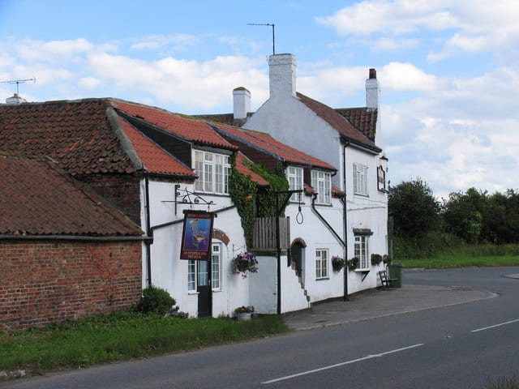
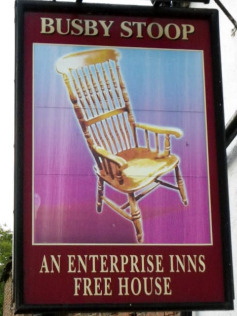
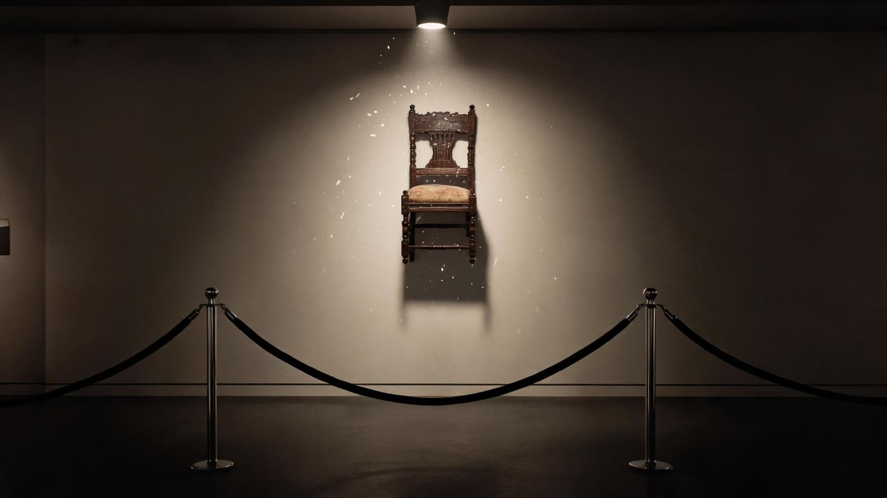
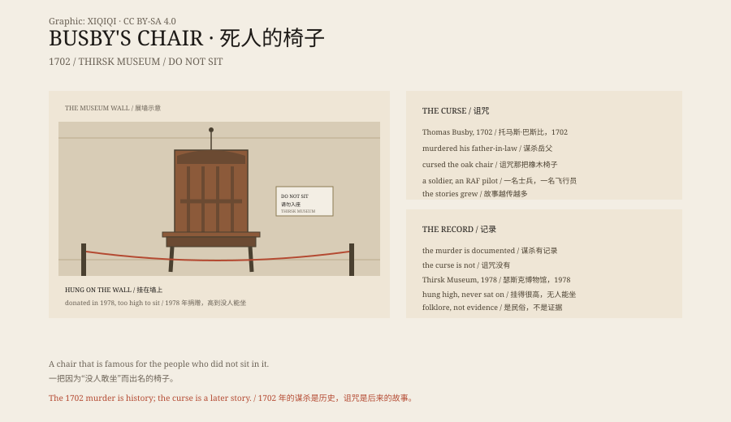

## 1. The Chair on the Ceiling

Thirsk Museum occupies a narrow two-storey building on Kirkgate. In one of its rooms an oak chair hangs in mid-air, four legs pointing down, higher than a person's head. A rope keeps visitors back. The label hangs on the wall beside it.

*Site photograph: Thirsk Museum on Kirkgate, 2014. Mike Kirby, CC BY-SA 2.0 (Wikimedia Commons). The sign by the door gives the opening hours.*

The chair arrived in 1978 from a pub three miles away. The man who gave it up attached one condition: nobody was to sit in it again. The museum complied by hanging it from the ceiling, high enough that even the staff changing a bulb could not reach it.

More than forty years have passed. Nobody has sat in it.

## 2. A Man Who Made False Coins

Thomas Busby worked in and around Kirby Wiske, in the North Riding of Yorkshire, and his trade was counterfeiting. His father-in-law, Daniel Auty, had come from Leeds and bought a farm he called Danotty Hall, where he built a hidden room connected to the cellar by a passage and coined money in it. The two men were partners. They did not get on.

In 1702 they quarrelled again. The accounts differ on what happened that day: one version has Auty sitting in Busby's favourite chair, another has him threatening to take his daughter away. What is certain is that Busby picked up a hammer, walked to Danotty Hall, beat his father-in-law to death and hid the body in the woods. A search party found it; Busby was arrested at the inn.

That summer he was tried at the York assizes and sentenced to death. After execution his body was tarred, placed in an iron cage and hung from a post at the Sandhutton crossroads, facing his own inn. The inn took the name Busby Stoop Inn. A "stoop" was the local word for the post his body hung from.

*Site photograph: the old Busby Stoop Inn, with the crossroads in front of it, 2008. David Rogers, CC BY-SA 2.0 (Wikimedia Commons). The pub is no longer trading.*

## 3. The Earliest Witness Left Out the Chair

On 17 May 1703 the Leeds antiquary Ralph Thoresby rode from Topcliffe to Northallerton, passed the crossroads and wrote in his diary: "Mr. Busby hanging in chains, for the murder of his father-in-law, Daniel Auty, formerly a Leeds clothier." It is the earliest dated record of the case that survives. The sentence contains no chair.

In 1821 an anonymous History of Thirsk printed the affair as a story for the first time: Danotty Hall, the secret coining room, the quarrel, and a gallows "near Carlton". The book names no victim, mentions no chair and says nothing about a curse.

In 1859 William Grainge gave the fullest early account in The Vale of Mowbray. He joined the "Daniel Auty" of Thoresby's diary to Danotty Hall and quoted the diary in a footnote. He also noted that the post had long since gone, and that nobody of his generation had seen it.

## 4. The Chimney Sweep of 1894

The best-known death attached to the chair dates from 1894, when a chimney sweep was said to have been found hanging beside Busby's post. The story has been retold for more than a century, and each retelling makes it look more like proof of the curse.

The curator at Thirsk Museum later pointed out that the inquest returned a verdict of suicide. Grainge had already recorded in 1859 that no post remained. A man in 1894 could not have hanged himself from a post that had vanished before 1859.

The story did not need a post. It needed a chair that could be sat in.

## 5. The Airmen of 1943

During the Second World War No. 433 Squadron of the Royal Canadian Air Force was stationed in the Thirsk area, flying Halifaxes and Lancasters on night raids over mainland Europe. The pub stood near the airfield, and airmen drank there. Local telling has it that no man who sat in the chair came back from a mission.

This is the most repeated version of the legend, and it yields no name and no date. The squadron was there; men did fail to return. Between the two true things, the chair is the link added afterwards.

*Site photograph: the sign of the Busby Stoop Inn, 2010. Maigheach-gheal, CC BY-SA 2.0 (Wikimedia Commons). The chair painted on the board is a Windsor armchair, not the one in the museum.*

## 6. 1978

The landlord, Tony Earnshaw, handed the chair to the museum. He took no money and asked for one thing: that it be hung up. The Northern Echo recorded the condition in 2014 — it had to hang from the ceiling, so that nobody could sit in it again.

The museum did as asked. The chair was hung from the ceiling, well off the floor. Staff describe the arrangement plainly: hung out of harm's way. Nobody has sat in it since, maintenance workers included.

## 7. The Chair of 1840

In 2014 the furniture historian Adam Bowett examined the chair and noticed that its spindles had been turned by machine. Eighteenth-century chairs were made on a pole lathe, where a rope spins the work and leaves a different cut. Machine-turned spindles point to 1840 or later.

The chair, in other words, was made 138 years after Thomas Busby died. The object that carries the curse did not exist when the curse was spoken.

Cooper Harding, the museum's curator, has said that the 1702 assize records are lost, and that no contemporary source mentions a curse.

*Reconstruction: how the chair is displayed on the wall at Thirsk Museum. Not a photograph of the artefact. XIQIQI Editorial, CC BY-SA 4.0.*

## 8. What Is Actually There

Thirsk Museum is an old building on Kirkgate. It is small: a few rooms of local objects. The chair hangs in one of them, above head height.

Visitors stand outside the rope, look up, take a photograph, read the label. The museum's label tells the murder, and the date: the chair was made after 1840.

A man was hanged at a crossroads; that is true. A post stood there and later rotted; that is true. A chair was sent from a pub to a museum on condition that nobody sit in it; that is true too. The story in between — that everyone who sat died — has only tellers, and no list of names.

*Original schematic: the 1702 murder, the curse legend and the 1978 move to the museum. Not a photograph of an artefact. XIQIQI Editorial, CC BY-SA 4.0.*

---

**Sources and licenses**: sources are listed in the ledger S1–S6 at the foot of this entry. Text and original diagrams are CC BY-SA 4.0. The article keeps apart the 1702 murder and execution, the nineteenth-century shaping of the legend, the twentieth-century death stories and the museum's handling of the chair after 1978; the murder and execution are documented, the curse is not. The reconstruction is not a photograph of the artefact.
