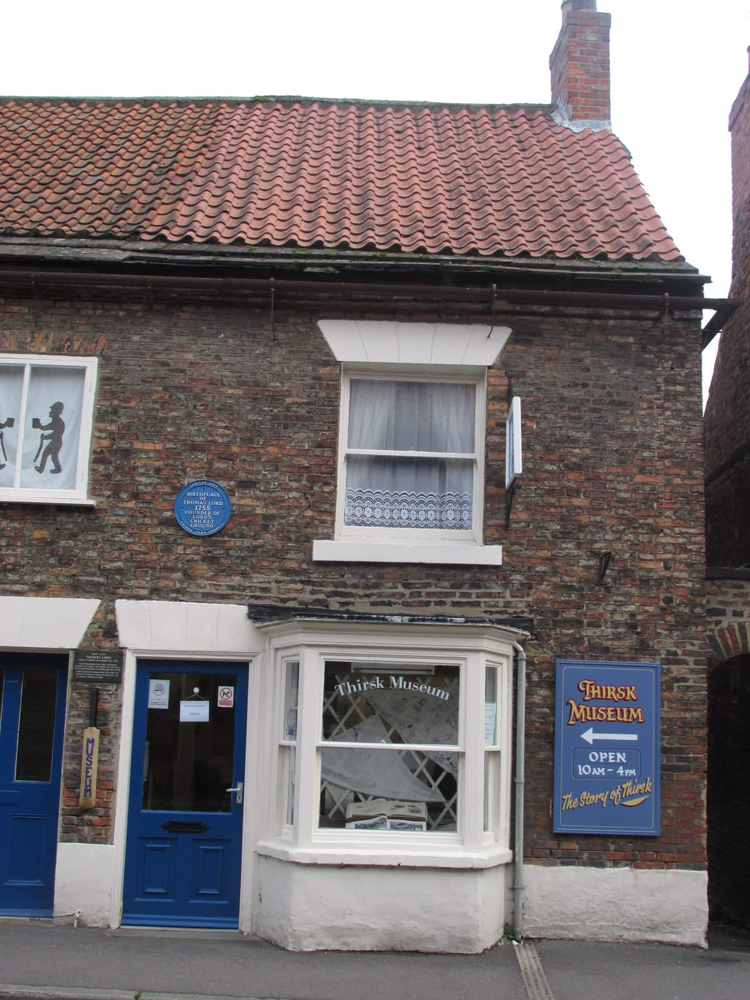
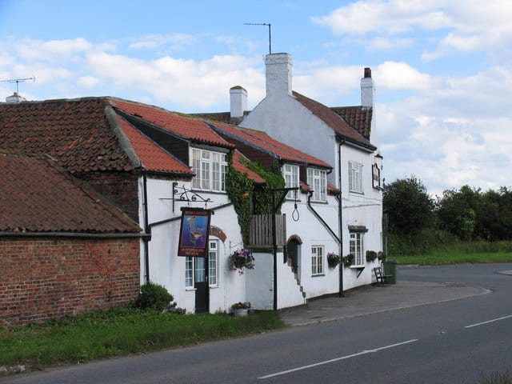
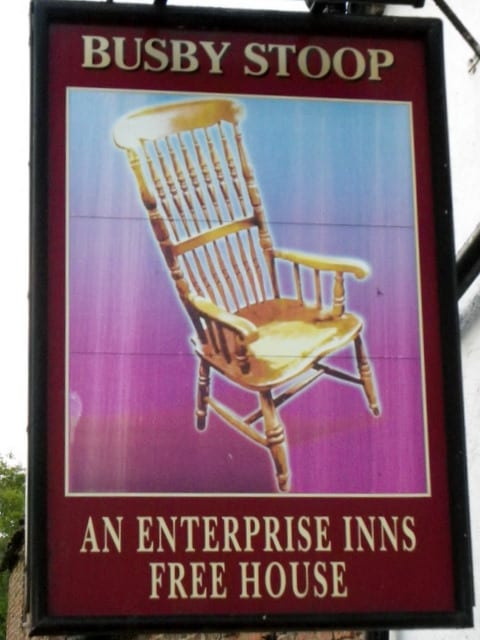
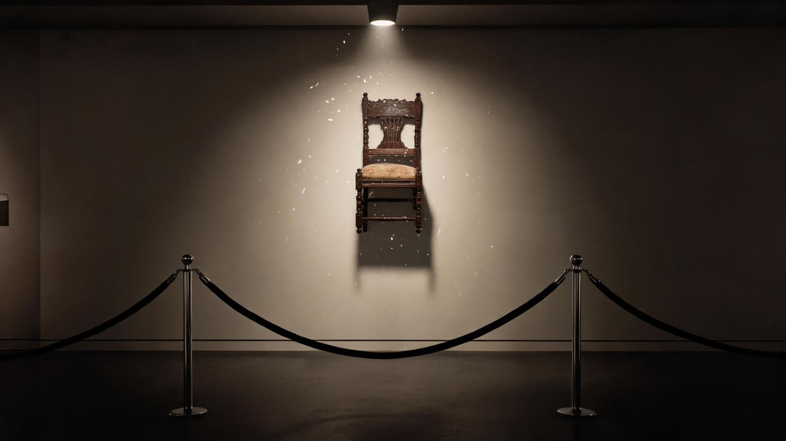
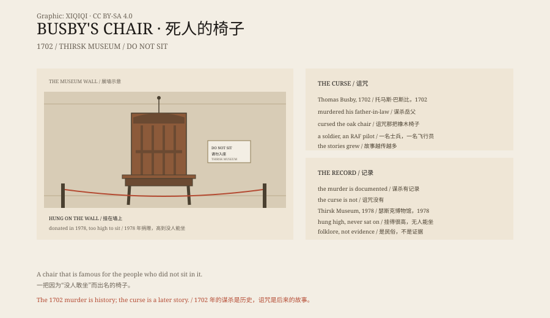

## 一、天花板上的椅子

瑟斯克博物馆在柯克盖特街，一栋窄长的两层小楼。展厅里，一把橡木椅吊在半空，四条腿垂下来，高过人头。绳子拦在下面，说明牌挂在旁边的墙上。

*现场照片：瑟斯克博物馆在柯克盖特街的馆舍，2014 年。Mike Kirby，CC BY-SA 2.0（Wikimedia Commons）。门边的牌子上写着开放时间。*

1978 年，这把椅子从三英里外的酒馆搬来。捐赠的人留下一个条件：不能让它再被人坐。博物馆照办了，把它吊在天花板下面，连换灯泡和打扫的人都不许碰。

四十多年过去，没人坐过它。

## 二、一个造假币的人

托马斯·巴斯比（Thomas Busby）在北约克郡的柯比威斯克一带活动，做的是伪造钱币的营生。他的岳父丹尼尔·奥蒂（Daniel Auty）从利兹搬来，买下一座农场，取名丹诺蒂庄园，在屋里修了暗室，通过地道连着地窖，用来铸假币。两人是合伙生意，关系一向不好。

1702 年的一天，两人又吵起来。那天的细节，流传的版本并不一致：有的说奥蒂坐在巴斯比常坐的椅子上，有的说他威胁要把女儿带走。可以确定的是，巴斯比抓起一把锤子，走到丹诺蒂庄园，把岳父打死，尸体藏进树林。搜山的人找到尸体，巴斯比在酒馆里被捕。

同年夏天，他在约克巡回法庭受审，判了死刑。行刑之后，尸体被涂上沥青、装进铁笼，吊在桑达顿十字路口的一根柱子上示众——就在他自己那家酒馆对面。酒馆从此改名叫巴斯比之椅酒馆（Busby Stoop Inn）。“stoop”是当地的土话，指那根吊尸的柱子。

*现场照片：巴斯比之椅酒馆的老店址，路口就在酒馆门前，2008 年。David Rogers，CC BY-SA 2.0（Wikimedia Commons）。酒馆已停止经营。*

## 三、最早写下他的人，没提椅子

1703 年 5 月 17 日，利兹的古董收藏家拉尔夫·索雷斯比从托普克利夫骑马去诺瑟勒顿，路过那个路口，在日记里写了一句：“巴斯比先生吊在铁链里，为了谋杀他的岳父、利兹的前布商丹尼尔·奥蒂。”这是目前能找到的最早的、有确切日期的记录。整句话里没有椅子。

1821 年，一本不署名的《瑟斯克史》第一次把这个案子印成故事：丹诺蒂庄园、秘密的铸币房、那场争吵，还有“卡尔顿附近”的绞架。书里没有受害人的名字，也没有椅子，更没有诅咒。

1859 年，威廉·格兰奇在《莫布雷谷》里写出更完整的版本。他把索雷斯比日记里的“丹尼尔·奥蒂”和丹诺蒂庄园对上了号，还在脚注里抄了那段日记。他同时记下一件事：那根柱子早就没了，他这一辈人谁也没见过。

## 四、1894 年，扫烟囱的人

1894 年，流传最广的一起死亡出现了：一个扫烟囱的工人被发现吊死在巴斯比柱子旁边。这个故事被讲了一百多年，越讲越像是诅咒的证明。

瑟斯克博物馆的馆长后来指出，当年的验尸结论是自杀。格兰奇在 1859 年就写过，柱子早已不存。一个 1894 年的人，不可能吊在一根 1859 年就已消失的柱子上。

故事需要的不是柱子，是一把能坐的椅子。

## 五、1943 年的飞行员

二战期间，加拿大皇家空军第 433 中队驻扎在瑟斯克一带，驾驶哈利法克斯和兰开斯特轰炸机，执行对欧洲大陆的夜间轰炸。酒馆离机场不远，飞行员来喝酒。本地人说，坐过那把椅子的人，没有一个从任务里回来。

这个版本流传最广，却找不到一个名字、一个日期。第 433 中队确实在那一带驻过，任务里也确实有人没有回来。两件真事之间，椅子是后来接上去的那一环。

*现场照片：巴斯比之椅酒馆的招牌，2010 年。Maigheach-gheal，CC BY-SA 2.0（Wikimedia Commons）。招牌上的椅子是温莎扶手椅，与馆藏那把并非同款。*

## 六、1978 年

酒馆的老板托尼·厄恩肖把椅子交给了博物馆。他不要钱，只要求椅子挂起来。《北方回声报》在 2014 年采访时记下这个条件：必须吊在天花板上，谁也不能再坐。

博物馆照做了。椅子被吊在天花板下面，离地很高。工作人员的说法很平实：挂到够不着的地方。此后馆里再没让人坐过，包括来检修的工人。

## 七、1840 年的椅子

2014 年，家具史学者亚当·鲍伊特看过这把椅子，注意到椅背的纺锤形立柱是机器车出来的。十八世纪的椅子用脚踏旋床，靠绳索带动工件旋转，留下的刀痕和机器车削不是一回事。机器车削的立柱，最早也要到 1840 年前后。

也就是说，这把椅子比托马斯·巴斯比晚生了一百三十八年。被诅咒的物件，在诅咒发生的时候还不存在。

博物馆馆长库珀·哈丁说，1702 年的巡回法庭档案已经遗失，同时代的材料里找不到任何关于诅咒的记载。

*场景复原：椅子在瑟斯克博物馆里吊在半空的展示方式。不是文物照片。稀奇奇编辑部，CC BY-SA 4.0。*

## 八、现在的样子

瑟斯克博物馆在柯克盖特街，是一栋有年头的小楼。馆不大，几间展室，摆着本地的旧物。那把椅子吊在展室里，高过人头。

来看它的人站在绳子外面，仰头，拍照，读说明。博物馆的说明里讲谋杀，也讲年份：这把椅子造于 1840 年之后。

一个人被吊死在路口，是真的。一根柱子立在那里，后来烂掉了，是真的。一把椅子被人从酒馆送到博物馆，条件是不许再坐，也是真的。中间那段谁坐谁死的故事，从头到尾只有讲述，没有名单。

*原创示意图：1702 年谋杀、诅咒传说与 1978 年移入博物馆。不是文物照片。稀奇奇编辑部，CC BY-SA 4.0。*

---

**来源与许可**：事实来源见条目底部来源台账 S1–S7。文字与原创示意图采用 CC BY-SA 4.0。文中把 1702 年的谋杀与处决、19 世纪的传说成形、20 世纪的死亡附会和 1978 年之后的博物馆处置分开叙述；谋杀与处决有同时代记录，诅咒没有。场景复原不是文物照片。
