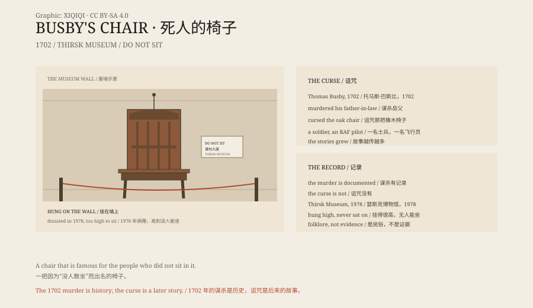

## 一、1702 年

1702 年，英国北约克郡，托马斯·巴斯比因谋杀岳父丹尼尔·阿沃蒂被处决。

传说，他在行刑前诅咒了岳父坐过的那把橡木椅子：谁坐上去，谁就会死。

## 二、椅子

椅子留在当地的一家酒馆里，后来酒馆叫“Busby Stoop Inn”。

十八世纪、十九世纪，它只是一把旧椅子。二十世纪，故事开始变大。

## 三、死亡

二战期间，一名士兵坐在椅子上，几天后死于训练事故。

后来，一名皇家空军飞行员坐过它，不久后坠机身亡。

还有工人、路人、酒客。故事越传越多，细节越来越具体。

## 四、博物馆

1978 年，酒馆把椅子捐给瑟斯克博物馆。

博物馆没有把它放在地上，而是挂在墙上，离地很高，防止有人坐。

它成了英国最著名的“被诅咒的物件”之一。

## 五、真相

托马斯·巴斯比的谋杀和处决有历史记录。

但“谁坐谁死”没有。

那些死亡案例，大多是事后附会：有人坐过椅子，后来死于完全无关的原因；故事把两件事连在一起。

## 六、椅子

椅子本身很普通：橡木，直背，坐面被磨得发亮。

它被挂在墙上，像一个标本。

人们来看它，不是为了坐，而是为了确认：自己不会坐。

*原创示意图：1702 年谋杀、诅咒传说与 1978 年移入博物馆。不是文物照片。稀奇奇编辑部，CC BY-SA 4.0。*

---

**来源与许可**：本文的事实来源见条目底部来源台账 S1–S3。文字与原创示意图采用 CC BY-SA 4.0。文中把 1702 年的谋杀与处决、20 世纪的诅咒传说和死亡附会分开叙述；谋杀有历史记录，诅咒没有证据。插图是场景复原，不是文物照片。
