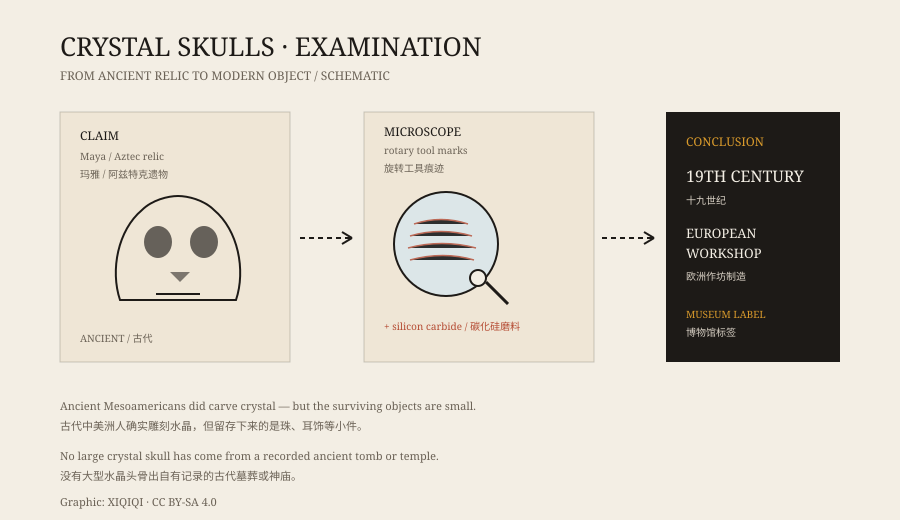

## 1. The skull in the case

A crystal skull is roughly the size of a human skull, or a little smaller. It is made of clear or translucent quartz, polished smooth, with carved eye sockets, cheekbones, and teeth.

The most famous two are in the British Museum and in a private collection; the latter is usually called the Mitchell-Hedges skull. Both appear regularly in documentaries, mystical books, and touring exhibitions.

The story says they come from ancient Mesoamerica, made by the Maya or the Aztecs. It also says there are thirteen such skulls scattered around the world, and that bringing them together will reveal an ancient secret.

## 2. What they are said to do

The legends are numerous.

Some say the skulls glow, some say they move at night, some say they cause strange dreams. Others link them to the 2012 “Maya apocalypse” and claim the skulls contain a prophecy.

Most of these claims appeared in the late twentieth century. They sound ancient, but the written record is not.

## 3. The story of 1924

The Mitchell-Hedges skull has the most often repeated origin story.

It is said that in 1924, Anna Mitchell-Hedges found the skull at the ruins of Lubaantun in British Honduras. Her adoptive father was the explorer Frederick Mitchell-Hedges, and the story travelled with his expedition narratives.

The problem is that the discovery is poorly documented. There are no contemporary photographs, no excavation records, and no independent witnesses. Later researchers suggested the skull may have been bought at auction rather than dug out of the ruins.

*Original schematic: the lines of evidence that moved crystal skulls from “ancient relic” to “modern manufacture.” Not a photograph of an artifact. XIQIQI Editorial, CC BY-SA 4.0.*

## 4. Tool marks

The turning point came from the microscope.

Around 2008, researchers at the British Museum and the Smithsonian Institution examined several crystal skulls. What they saw was not the wear of ancient hand polishing, but regular grooves left by rotary tools, along with particles of modern abrasives such as silicon carbide.

Ancient Mesoamericans had sophisticated stone-working skills, but they did not have bearing-mounted rotary tools or silicon carbide. Working crystal with those tools was a nineteenth-century European practice, and the German town of Idar-Oberstein was known for it.

In other words, the skulls were probably made in the nineteenth century and later presented as ancient.

## 5. Genuinely ancient crystal

Mesoamericans did use crystal.

Archaeology has found crystal beads, ear ornaments, and small decorative objects with fine workmanship and reliable dates. But no large crystal skull has come from a recorded ancient tomb or temple.

This is not to say that ancient people could not carve crystal. It is that the objects with secure dates do not match these skulls.

## 6. Why the story survives

The crystal skull story did not disappear after the analysis.

It is too good to look at: transparent, symmetrical, face-like, and bright under a display light. It is also too good to tell: ancient civilisations, lost knowledge, prophecy, and curses are hard to resist.

The museum label says “nineteenth century, Europe.” The exhibition poster still shows the glowing skull.

The factual trail in this entry runs mainly through S1–S4: S1 is “Wikipedia · Crystal skull” and S2 is “Wikipedia · Lubaantun”. Dates, places, and names in the text follow the lowest common denominator of those sources; image credits and licences are listed at the foot of the entry.

## Limits of the record

“The Crystal Skull Hoax” is strongly evidenced as a fabrication; the entry traces how it was made and spread in made in the 19th century; presented as ancient in the 20th, and why it still finds believers.

“The Crystal Skull Hoax” is currently labelled “hoax”; that label describes the present state of the evidence for this entry, not a final verdict on the subject.

## Archival note

They spent hundreds of hours using copper wheels, sand and water to create a skull that may look similar to ancient ones. This shows that ancient craftsmen could theoretically do it, but there is no evidence that they actually did it.

"Can do" and "been done" are two different things. The controversy surrounding the Crystal Skull does not lie in the technical possibilities, but in the unearthed background and tool marks.
The market for crystal skulls has existed since the 19th century.

European collectors liked "exotic" objects. Crafts from Mexico, Peru, and Egypt were brought to Paris, London, and New York. Businessmen will make up stories and raise prices.

The "Mayan crystal skull" is a good selling point: ancient, mysterious and prophetic. It does not require unearthed records, only a legend.
Scientists use a microscope to examine the surface of the skull.

They found traces of modern tools: the arc of the rotating grinding wheel, the grains of polish, the direction of the cut. These traces are inconsistent with the way ancient Maya tools were used.

The Mayans had jade, obsidian, and sand with which to polish stone. However, the hardness of crystal is high and the processing time is long. A skull this precise requires hundreds of hours of polishing and is prone to chipping.

---

**Sources and licenses**: for “The Crystal Skull Hoax”, the factual sources are listed in the source ledger S1–S4 at the bottom of this entry. Text and original diagrams are licensed under CC BY-SA 4.0. This article separates the collecting story, the folklore, and the scientific examination; the reported discovery of the Mitchell-Hedges skull is disputed and is not treated here as established fact.
