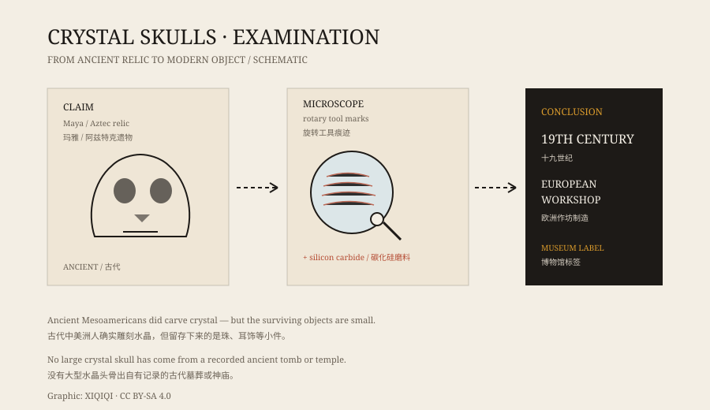

## 一、玻璃柜里的头骨

水晶头骨不大，通常和真人头骨差不多，或者略小。材质是透明或半透明的石英，表面打磨得很亮，眼窝、颧骨、牙齿都雕了出来。

最著名的两颗，一颗在英国博物馆，一颗在私人收藏者手中，常被称作“米切尔-赫奇斯头骨”。它们经常出现在纪录片、神秘学书籍和旅游展览里。

故事说，它们出自古代中美洲，属于玛雅或阿兹特克。故事还说，这样的头骨一共有十三个，散落在世界各地，聚齐时会揭示某个古老的秘密。

## 二、它被说成什么

围绕水晶头骨的传说很多。

有人说它会发光，有人说它在夜里会移动，有人说靠近它会做奇怪的梦。也有人把它和 2012 年的“玛雅末日”联系起来，说头骨里藏着预言。

这些说法大多出现在二十世纪后期。它们听起来很古老，但文字记录并不古老。

## 三、1924 年的故事

米切尔-赫奇斯头骨的来历，是最常被讲的一段。

据说，1924 年，安娜·米切尔-赫奇斯在英属洪都拉斯的卢巴安通遗址发现了这颗头骨。她的养父是探险家弗雷德里克·米切尔-赫奇斯，这个故事随着他的探险叙事一起流传开来。

问题在于，发现过程的记录并不完整。没有当时的照片，没有考古发掘记录，也没有独立见证人。后来有人指出，这颗头骨可能是在拍卖会上买到的，而不是从遗址里挖出来的。

*原创示意图：水晶头骨从“古代遗物”到“现代制品”的鉴定线索。不是文物照片。稀奇奇编辑部，CC BY-SA 4.0。*

## 四、工具痕迹

真正的转折来自显微镜。

2008 年前后，英国博物馆和史密森学会的研究者检查了多颗水晶头骨。他们看到的不是古代手工打磨的痕迹，而是旋转工具留下的规则纹路，以及碳化硅一类的现代磨料颗粒。

古代中美洲人有高超的石雕技术，但他们没有带轴承的旋转工具，也没有碳化硅。用这些工具加工水晶，是十九世纪欧洲作坊的做法，德国伊达尔-奥伯施泰因一带就以水晶加工闻名。

换句话说，这些头骨很可能是十九世纪制作的，后来被包装成“古代遗物”。

## 五、真正古老的水晶

中美洲人确实用过水晶。

考古发现里有水晶珠、水晶耳饰、小件装饰品，工艺精细，年代可靠。但到目前为止，没有一颗大型水晶头骨出自有记录的古代墓葬或神庙。

这不是说古代人不会雕水晶，而是说：能证明年代的东西，和这些头骨对不上。

## 六、为什么还在流传

水晶头骨的故事没有因为鉴定而消失。

它太好看了。透明、对称、像人脸，放在灯光下会发亮；它也太好讲了。古代文明、失落知识、预言、诅咒，这些元素组合在一起，很难不吸引人。

博物馆的标签写得很清楚：“十九世纪，欧洲。”但展览海报上，往往还是那颗发光的头骨。

## 档案补记

他们用铜轮、砂子和水，花了几百小时，做出来的头骨和古代的可能相似。这说明，古代工匠理论上可以做到，只是没有证据表明他们真的做了。

“可以做到”和“曾经做过”是两件事。水晶头骨的争议，不在技术可能性，而在出土背景和工具痕迹。
**市场**。 水晶头骨的市场，从十九世纪就存在。

欧洲的收藏家喜欢“异国情调”的物件。墨西哥、秘鲁、埃及的工艺品，被带到巴黎、伦敦和纽约。商人会编故事，提高价格。

“玛雅水晶头骨”是一个很好的卖点：古老、神秘、有预言。它不需要出土记录，只需要一个传说。
**工具痕迹**。 科学家用显微镜检查头骨表面。

他们发现了现代工具的痕迹：旋转磨轮的弧线、抛光剂的颗粒、切割的方向。这些痕迹和古代玛雅工具的使用方式不一致。

玛雅人有玉石、黑曜石和砂子，可以打磨石头。但水晶的硬度高，加工时间长。一个如此精确的头骨，需要几百小时的打磨，而且很容易崩裂。

---

**来源与许可**：文字与原创示意图采用 CC BY-SA 4.0；第三方图片与资料的许可见文末来源台账。
