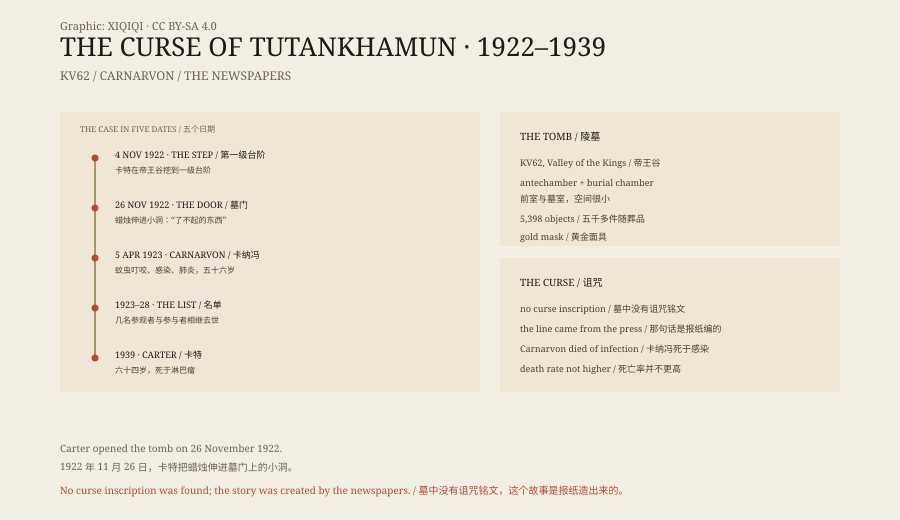

## 1. November 1922

The Valley of the Kings lies on the west bank at Luxor, a dry limestone valley where pharaohs cut their tombs into the rock, hoping to escape robbers.

On 4 November 1922, a workman for the archaeologist Howard Carter uncovered a step. Below it was a sealed doorway. Carter sent a telegram to his sponsor, Lord Carnarvon.

On 26 November the two men stood at the door. Carter made a small hole, held a candle to it and looked inside.

“Can you see anything?” Carnarvon asked.

“Yes, wonderful things,” Carter said.

## 2. 5 April 1923

In March 1923 Carnarvon was bitten by a mosquito on the cheek.

While shaving he cut the bite open. The wound became infected, the infection spread into his blood, and pneumonia followed. On 5 April he died in a Cairo hotel, aged fifty-six.

His health had never been good. A car crash years earlier had damaged his lungs.

## 3. The newspapers

Within weeks of Carnarvon's death, “the curse of the pharaoh” was in the papers.

The stories said that a line was carved above the tomb door: “Death shall come on swift wings to him who disturbs the peace of the king.”

That line is not in the tomb. It is not in the excavation records, on the walls, or in the inscriptions on the objects. It was invented by the press in the 1920s and repeated by books and films ever since.

There was also the archaeologist Arthur Weigall, who is said to have remarked before the tomb was opened that if Carnarvon went on in that spirit, he gave him six weeks to live. The remark was later treated as a prophecy. At the time it was professional irritation.

## 4. The list

The papers began counting the dead.

In May 1923 the American railroad heir George Jay Gould died of pneumonia after visiting the tomb. In September Carnarvon's colleague Aubrey Herbert died. In 1928 A. C. Mace, who had helped catalogue the finds, died. Several others died within a few years.

Arranged in a list, the names look like a curse.

But the list was selected. Dozens of people entered the tomb, worked on the excavation or handled the objects. Carter himself lived until 1939 and died at sixty-four of lymphoma. Many workmen and scholars lived to old age.

## 5. The statistics

People have done the arithmetic, but not in the same way.

If “everyone who entered the tomb” is defined as a very small circle, and the dead are then picked out of it, any list will look suspicious. If all the participants are compared with people of the same age and health, their death rate is not unusual.

The curse has no pattern that can be tested and repeated.

## 6. A medical explanation

Carnarvon's death is not medically mysterious.

A mosquito bite, a shaving cut, a bacterial infection, sepsis, pneumonia — before antibiotics, that was a common way to die. He did not catch anything in the tomb.

Some have suggested that mould or bacteria in the tomb could be lethal. It sounds plausible, but there is no evidence that Carnarvon inhaled a particular spore, and no test result supports it.

## 7. Now

Tutankhamun's tomb is still in the Valley of the Kings. The gold mask is in the museum in Cairo and is one of Egypt's most famous objects.

The curse became part of popular culture. Films, novels and souvenirs use it. The actual excavation reports are read by almost no one.

*Original schematic: the discovery in 1922, Carnarvon's death in 1923, and the newspaper stories about the curse. Not a photograph of the site. Oddity Archive, CC BY-SA 4.0.*

## Karnavon

On April 5, 1923, Count Karnavon died in Cairo.

He was one of those who entered Tutankhamun’s grave in November 1922. Soon after the cemetery opened, he was bitten by a mosquito, then infected, fevered, and eventually died of pneumonia.

The newspaper wrote it as a "Crap": Pharaoh's grave was opened and the sponsor died. The title was fascinating, because Karnavon was a rich man, a nobleman, an explorer, and his death was dramatic.

## Carter

Howard Carter didn't die of the curse.

He's still working in the grave, he's cleaning up the artifacts, and he's published the report. He died in 1939, 17 years from the grave. He's 64 years old, and he's at that time his normal life.

Carter's aides, archaeologists, Egyptian workers, and not in the short term, died collectively. The so-called “death list” is a combination of people who died at different times and for different reasons.

Howard Carter is the man who opened the grave.

He lived a long time, went on to work, wrote books. He was neither cursed nor included in the death list. This means that the curse was not for "the man who entered the grave" but for "the man who can be written into a story."

Carter's not as famous as Carnaves. The death of a noble sponsor is better than the long life of an archaeologist.

## Statistics

The “crap” can be explained statistically.

There are dozens of people, different ages, different health conditions. It's normal to have people die in a few years. Counting every death into a curse is an accident.

And one thing: Karnavon was in bad shape before entering the graveyard. He was wounded, he was immune. Mosquito bites could be just a cause, not "Pharaoh's revenge."

The statisticians read the death list.

They found that the average life expectancy of those entering the grave was similar to that of the British during the same period. There were no unusually high mortality rates.

The curse is an error of choice: remember the dead, forget the living; remember the strange cause of death, forget the common cause of death. The human brain loves stories, doesn't like statistics.

## Public information

The pharaoh curse is made in newspapers.

In the 1920s, there was a fiercely competitive newspaper. Tutankhamun's tomb was the biggest story of the time, and journalists needed a new angle. Curse, gold, death, better sold than archaeology reports.

Egyptian scientists are also involved in the spread. Carter and Karnavon’s teams need funding and public attention. A “corrupt” story brings sponsorship and tourists.

## Now

Tutankhamun's tomb is still in the Valley of the Emperor.

It is repaired, reinforced, ventilated and illumination. Tourists can enter, but they cannot touch cultural objects.

The Curse does not stop tourists. Instead, it becomes part of the tour. Tours talk about Carnaves, tourists take pictures. A news myth, and finally a site.

## List

The Curse of Death List was compiled in the newspaper.

Those on the list have a very long time to die and have different causes of death. Some die from illness, others from accidents, and others from old age. Together, they become a chain of curses.

The list also leaves out a lot of people: archaeologists, Egyptian workers, porters who continue to work. They are not dead, nor are they written into the story.

## Media

The 1920s newspaper, like, "Pharaoh Curse."

The discovery of Tutankhamun's tomb is a global news story. Journalists need continuous coverage, and they need new suspense. Curses, gold, mysterious deaths are the best.

The newspapers also compete. One writes a curse, the other writes a terrible curse. The story is magnified in competition.

---

**Sources and licenses**: the factual sources are listed in the source ledger S1–S3 at the bottom of this entry. Text and original diagrams are licensed under CC BY-SA 4.0. This article separates the discovery, Carnarvon's death, the newspaper coverage and the list of deaths; the “death shall come on swift wings” inscription does not exist in the tomb, Carnarvon died of an infection, and there is no evidence for a curse. The illustration is a scene reconstruction, not a photograph of the site.
