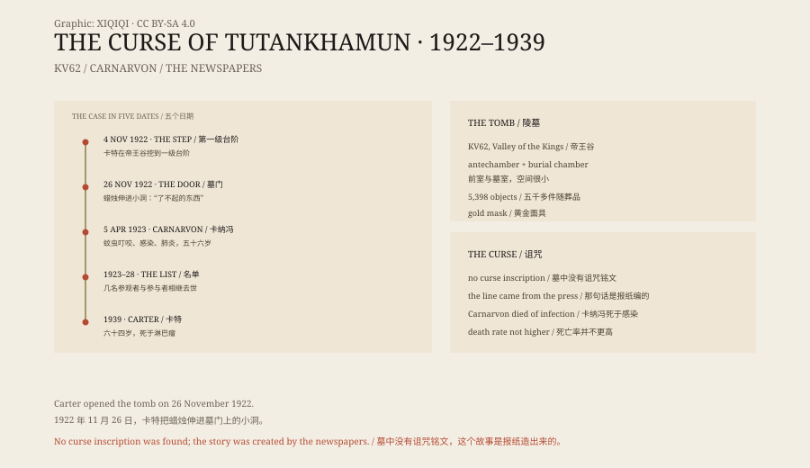

## 1. November 1922

The Valley of the Kings lies on the west bank at Luxor, a dry limestone valley where pharaohs cut their tombs into the rock, hoping to escape robbers.

On 4 November 1922, a workman for the archaeologist Howard Carter uncovered a step. Below it was a sealed doorway. Carter sent a telegram to his sponsor, Lord Carnarvon.

On 26 November the two men stood at the door. Carter made a small hole, held a candle to it and looked inside.

“Can you see anything?” Carnarvon asked.

“Yes, wonderful things,” Carter said.

## 2. 5 April 1923

In March 1923 Carnarvon was bitten by a mosquito on the cheek.

While shaving he cut the bite open. The wound became infected, the infection spread into his blood, and pneumonia followed. On 5 April he died in a Cairo hotel, aged fifty-six.

His health had never been good. A car crash years earlier had damaged his lungs.

## 3. The newspapers

Within weeks of Carnarvon's death, “the curse of the pharaoh” was in the papers.

The stories said that a line was carved above the tomb door: “Death shall come on swift wings to him who disturbs the peace of the king.”

That line is not in the tomb. It is not in the excavation records, on the walls, or in the inscriptions on the objects. It was invented by the press in the 1920s and repeated by books and films ever since.

There was also the archaeologist Arthur Weigall, who is said to have remarked before the tomb was opened that if Carnarvon went on in that spirit, he gave him six weeks to live. The remark was later treated as a prophecy. At the time it was professional irritation.

## 4. The list

The papers began counting the dead.

In May 1923 the American railroad heir George Jay Gould died of pneumonia after visiting the tomb. In September Carnarvon's colleague Aubrey Herbert died. In 1928 A. C. Mace, who had helped catalogue the finds, died. Several others died within a few years.

Arranged in a list, the names look like a curse.

But the list was selected. Dozens of people entered the tomb, worked on the excavation or handled the objects. Carter himself lived until 1939 and died at sixty-four of lymphoma. Many workmen and scholars lived to old age.

## 5. The statistics

People have done the arithmetic, but not in the same way.

If “everyone who entered the tomb” is defined as a very small circle, and the dead are then picked out of it, any list will look suspicious. If all the participants are compared with people of the same age and health, their death rate is not unusual.

The curse has no pattern that can be tested and repeated.

## 6. A medical explanation

Carnarvon's death is not medically mysterious.

A mosquito bite, a shaving cut, a bacterial infection, sepsis, pneumonia — before antibiotics, that was a common way to die. He did not catch anything in the tomb.

Some have suggested that mould or bacteria in the tomb could be lethal. It sounds plausible, but there is no evidence that Carnarvon inhaled a particular spore, and no test result supports it.

## 7. Now

Tutankhamun's tomb is still in the Valley of the Kings. The gold mask is in the museum in Cairo and is one of Egypt's most famous objects.

The curse became part of popular culture. Films, novels and souvenirs use it. The actual excavation reports are read by almost no one.

*Original schematic: the discovery in 1922, Carnarvon's death in 1923, and the newspaper stories about the curse. Not a photograph of the site. Oddity Archive, CC BY-SA 4.0.*

---

**Sources and licenses**: the factual sources are listed in the source ledger S1–S3 at the bottom of this entry. Text and original diagrams are licensed under CC BY-SA 4.0. This article separates the discovery, Carnarvon's death, the newspaper coverage and the list of deaths; the “death shall come on swift wings” inscription does not exist in the tomb, Carnarvon died of an infection, and there is no evidence for a curse. The illustration is a scene reconstruction, not a photograph of the site.
