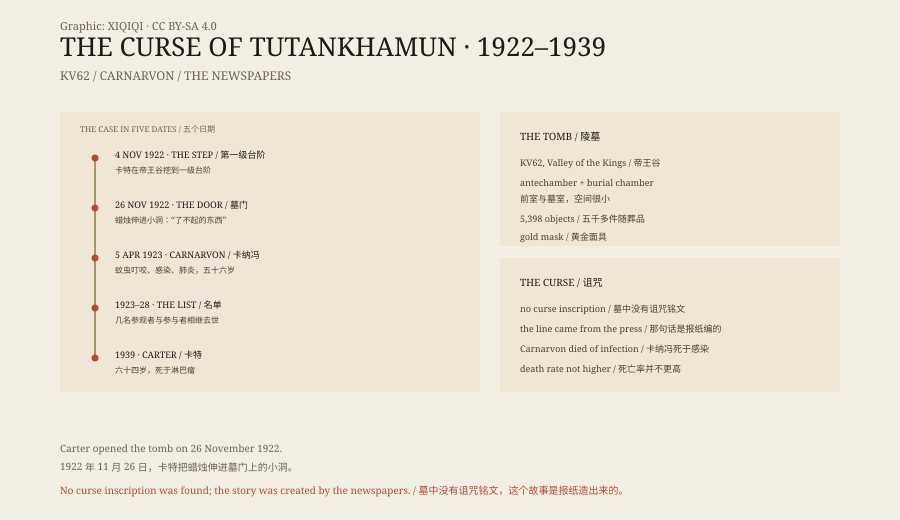

## 一、1922 年 11 月

帝王谷在卢克索西岸，是一片干涸的石灰岩山谷。法老们把自己的陵墓挖在山里，希望躲过盗墓者。

1922 年 11 月 4 日，考古学家霍华德·卡特的工人挖到一级台阶。往下挖，是一道封死的门。卡特给赞助人卡纳冯勋爵发了电报。

11 月 26 日，两人站在门口。卡特在门上凿开一个小洞，把蜡烛伸进去。

“你看见什么了？”卡纳冯问。

“是的，了不起的东西。”卡特说。

## 二、1923 年 4 月 5 日

卡纳冯在 1923 年 3 月被蚊子咬了一口，位置在脸颊上。

他刮胡子时把那处咬伤刮破了。伤口感染，感染扩散到血液，引发肺炎。4 月 5 日，他在开罗的一家酒店去世，五十六岁。

他本来身体就不好。几年前的一场车祸伤过他的肺，他一直呼吸不畅。

## 三、报纸

卡纳冯死后几个星期，“法老的诅咒”登上了报纸。

故事说，墓门上刻着一句话：“死亡将展开翅膀，降临到打扰法老安宁的人身上。”

这句话不在墓里。考古记录、墓室墙壁、随葬品铭文里都没有。它是 1920 年代的报纸编出来的，后来被无数本书和电影重复。

当时还有一位考古学家阿瑟·韦戈尔，据说在卡特打开墓室前说过一句“如果他这样下去，我给他六周时间”。这句话被当成预言，其实只是同行之间的不满。

## 四、死亡名单

报纸开始数人头。

1923 年 5 月，美国铁路继承人乔治·杰伊·古尔德在参观陵墓后死于肺炎。9 月，卡纳冯的同事奥布里·赫伯特去世。1928 年，参与整理文物的 A.C. 梅斯去世。还有几个人，在几年内相继死亡。

这些名字被排成一张表，看上去很像诅咒。

但名单是挑出来的。当时进入陵墓、参与发掘、接触文物的人有几十个。卡特本人活到 1939 年，六十四岁，死于淋巴瘤。许多工人和学者也活到了老年。

## 五、统计

有人算过，但算法各不相同。

如果先把“进入过陵墓的人”定义成一个很小的圈子，再把其中去世的人挑出来，任何名单都会显得可疑。如果把所有参与者和他们的年龄、健康状况放在一起比较，死亡率并不比普通人高。

所谓诅咒，没有一条可以重复验证的规律。

## 六、科学解释

卡纳冯的死，医学上并不神秘。

蚊虫叮咬、刮破皮肤、细菌感染、败血症、肺炎，在抗生素出现之前，这是很常见的死亡路径。他也不是在墓里感染的。

有人提出，墓中的霉菌或细菌可能致命。这个说法听起来合理，但没有证据显示卡纳冯吸入了什么特殊的孢子，也没有检验报告支持。

## 七、现在

图坦卡蒙的墓还在帝王谷。黄金面具在开罗的博物馆里，是埃及最著名的文物之一。

“诅咒”成了流行文化的一部分。电影、小说、旅游纪念品都在用它。真正的考古报告，反而没有人读。

*原创示意图：1922 年发现、1923 年卡纳冯之死与“诅咒”报道的时间线。不是现场照片。稀奇奇编辑部，CC BY-SA 4.0。*

## 来源与证据

关于「法老的诅咒」，本条目的事实线索主要来自来源台账 S1–S3，其中 S1 为《Wikipedia · Curse of the pharaohs》，S2 为《Weird Science History · The Mummy's Curse That Missed Its Main Target》。正文中的年代、地点与人物按这些来源的最低共识处理；图像说明与许可逐条列在条目底部。

## 档案空白

关于「法老的诅咒」，可核对的坐标是埃及，卢克索，帝王谷、1922，以及来源台账中的 S1《Wikipedia · Curse of the pharaohs》与 S2《Weird Science History · The Mummy's Curse That Missed Its Main Target》。出土层位、修复记录与成分检测之间仍有缺口；公开页面往往只给结论，不给完整检测链。

条目目前标记为“folklore”；这个标签描述的是当前证据状态，不是对题材真伪的终审。
## 档案补记

名单上的人，死亡时间跨度很大，死因也不同。有人死于疾病，有人死于事故，有人死于年老。把他们放在一起，就成了一条“诅咒链”。

名单还漏掉了很多人：继续工作的考古队员、埃及工人、搬运工。他们没有死，也没有被写进故事。
**媒体**。 1920 年代的报纸，喜欢“法老诅咒”。

图坦卡蒙墓的发现，是全球新闻。记者需要连续报道，需要新的悬念。诅咒、黄金、神秘死亡，是最好的素材。

报纸也互相竞争。一家写了“诅咒”，另一家就要写“更可怕的诅咒”。故事在竞争中被放大。
**新闻**。 “法老诅咒”是报纸制造的。

1920 年代，报纸竞争激烈。图坦卡蒙墓是当时最大的新闻，记者需要新的角度。诅咒、黄金、死亡，比考古报告好卖。

埃及学家也参与了传播。卡特和卡纳冯的团队需要资金，需要公众关注。一个“诅咒”的故事，能带来赞助和游客。

---

**来源与许可**：本文的事实来源见条目底部来源台账 S1–S3。文字与原创示意图采用 CC BY-SA 4.0。文中把陵墓发现、卡纳冯的死亡、报纸报道与死亡名单分开叙述；所谓“死亡将展开翅膀”的铭文不存在于墓中，卡纳冯死于感染，没有证据支持诅咒。插图是场景复原，不是现场照片。
