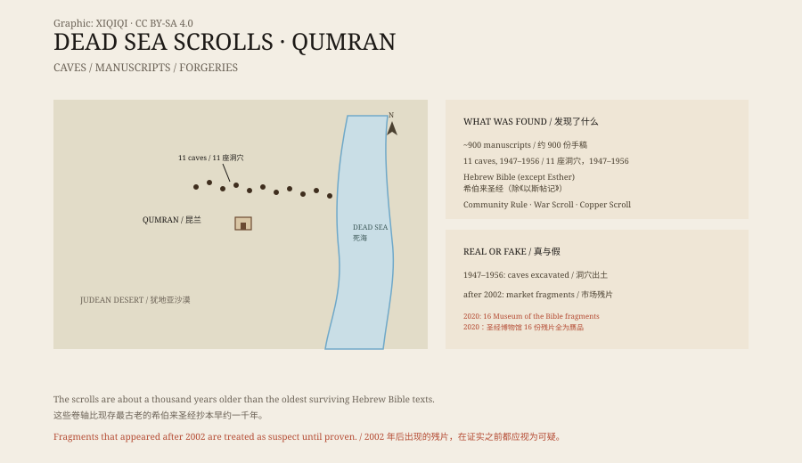

## 1. The shepherd of 1947

In 1947, on the western shore of the Dead Sea, near Qumran.

A Bedouin shepherd was grazing his flock. The story goes that he threw a stone into a cave in the cliff and heard pottery break inside. He climbed in and found several jars containing scrolls wrapped in cloth.

He brought the scrolls out. No one knew how old they were.

They became known as the Dead Sea Scrolls.

## 2. Eleven caves

Between 1947 and 1956, archaeologists and local Bedouin found eleven caves in the cliffs containing manuscripts.

About nine hundred manuscripts came out in total, most of them fragments, a few nearly complete. They were written on parchment and papyrus, some wrapped in linen and stored in jars.

The French archaeologist Roland de Vaux excavated the site at Qumran. On the plateau nearby he found a complex of buildings with cisterns, a dining hall, and a scribal room. Scholars linked the buildings to the scrolls.

*Original schematic: the caves at Qumran, the types of scrolls, and the authentication process. Not an archaeological survey drawing. Oddity Archive, CC BY-SA 4.0.*

## 3. What was in the scrolls

The contents are varied.

The most striking are biblical texts. Every book of the Hebrew Bible except Esther appears among the scrolls, some in more than one version. The most famous is the Great Isaiah Scroll, about seven metres long and almost complete.

Another group belongs to the community itself: the Community Rule, the War Scroll, and the Temple Scroll. They set out rules, an end-time war, and an ideal plan for the Temple.

The Copper Scroll is a different kind of object. It is inscribed on copper and lists a long series of treasures and hiding places. No one has established what it refers to.

The manuscripts date from roughly the third century BCE to the first century CE. That makes them about a thousand years older than the oldest surviving Hebrew Bible manuscripts.

## 4. Who wrote them

The most common explanation is that the scrolls belonged to a Jewish sect living at Qumran, usually identified as the Essenes.

They withdrew from the cities, lived at the edge of the desert, copied scriptures, and waited for the end. The caves were their library and their hiding place.

Not everyone accepts this. Some scholars argue that the scrolls came from several libraries in Jerusalem and were brought to the desert for safekeeping during war. Others say the buildings at Qumran and the scrolls are not directly connected.

The debate has gone on for decades and is not fully settled.

## 5. Forgeries

After 2002, “new” Dead Sea Scroll fragments began to appear on the market.

They were sold to collectors, museums, and evangelical institutions at high prices. The Museum of the Bible in Washington bought sixteen fragments after 2009.

In 2020, an independent investigation funded by the museum concluded that all sixteen were modern forgeries. The forgers had used ancient blank leather, written imitation ancient script on it, and artificially aged the result.

The finding cast doubt on every fragment that appeared after 2002. Today, a newly surfaced fragment is usually treated as suspect until there is a documented excavation record and scientific testing.

## 6. Now

Most of the Dead Sea Scrolls are kept at the Israel Museum in Jerusalem, in the Shrine of the Book.

It is a white domed building with a dark interior, where the Great Isaiah Scroll turns slowly in a glass case. Other fragments are kept in storage, and some have been digitised and can be viewed online.

They did not overturn the Bible or solve every mystery. What they did was put the people who copied, read, and hid these texts two thousand years ago back into history.

---

**Sources and licenses**: the factual sources are listed in the source ledger S1–S3 at the bottom of this entry. Text and original diagrams are licensed under CC BY-SA 4.0. This article separates the discovery, the caves and manuscripts, the question of authorship, and the forgery problem; the relationship between the Qumran site and the scrolls is still debated, and fragments surfacing after 2002 should be treated with caution.
