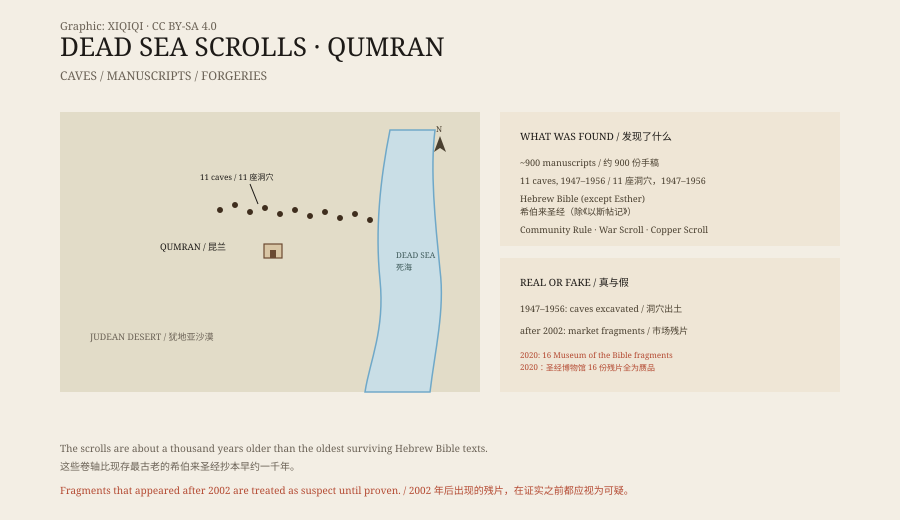

## 一、1947 年的牧羊人

1947 年，死海西岸，昆兰附近的沙漠。

一个贝都因牧羊人在放羊。传说他往山崖上的洞穴里扔了一块石头，听见里面传来陶器破碎的声音。他爬进去，看到几个陶罐，罐子里装着用布包着的卷轴。

他把卷轴带了出来。没有人知道它们有多古老。

这些卷轴后来被称为“死海古卷”。

## 二、十一座洞穴

从 1947 年到 1956 年，考古学家和当地的贝都因人在这片崖壁上找到了十一座藏有手稿的洞穴。

总共出土了大约九百份手稿，大多是碎片，少数保存完整。它们被写在羊皮纸和纸莎草上，有些用亚麻布包着，放在陶罐里。

法国考古学家罗兰·德·沃主持了昆兰遗址的发掘。他在旁边的台地上找到了一处建筑群，有水池、餐厅和抄写室。学者们把这些建筑和卷轴联系在一起。

*原创示意图：昆兰洞穴分布、卷轴类型与真伪鉴定流程。不是考古测绘图。稀奇奇编辑部，CC BY-SA 4.0。*

## 三、卷轴里有什么

死海古卷的内容很杂。

最引人注目的是圣经文本。除了《以斯帖记》，希伯来圣经的每一卷都在这里出现了，有的还不止一个版本。最著名的是“大以赛亚卷”，长约七米，几乎完整。

还有一类是当时这个社群自己的文献：《社区守则》《战争卷》《圣殿卷》。它们讲规矩、讲末日战争、讲圣殿的理想形制。

《铜卷》是另一件奇物。它刻在铜片上，列着一长串宝藏和隐藏地点，至今没有确定它指的是哪里。

这些手稿的年代，大约在公元前三世纪到公元一世纪之间。也就是说，它们比现存最古老的希伯来圣经抄本早了一千年左右。

## 四、谁写的

最常见的解释是：这些卷轴属于一个住在昆兰的犹太教派，通常被认为是艾赛尼派。

他们离开城市，住在沙漠边缘，抄写经文，等待末日。洞穴是他们的图书馆，也是藏匿之处。

但这个解释并不是所有人都接受。有学者认为，卷轴来自耶路撒冷的多个图书馆，是在战乱中被运到沙漠里藏起来的。也有人认为，昆兰的建筑和卷轴之间没有直接关系。

争论持续了几十年，没有完全结束。

## 五、赝品

2002 年以后，市场上开始出现“新的”死海古卷残片。

它们被卖给收藏家、博物馆和福音派机构，价格很高。华盛顿的圣经博物馆在 2009 年后买下了十六份残片。

2020 年，博物馆资助的独立研究得出结论：这十六份残片全部是现代赝品。造假者用古代的空白皮革，写上模仿的古文字，再人为做旧。

这个结果让所有 2002 年之后出现的残片都受到了怀疑。今天，新出现的残片通常会被默认为可疑，直到有完整的出土记录和科学检测。

## 六、现在

大部分死海古卷保存在耶路撒冷的以色列博物馆，放在“圣书之龛”里。

那是一座白色的圆顶建筑，室内很暗，大以赛亚卷在玻璃柜里缓慢转动。其他的碎片保存在库房里，一部分已经数字化，可以在网上查看。

它们没有推翻圣经，也没有解开所有谜团。它们做的是另一件事：把两千年前抄写、阅读、藏匿这些文字的人，重新放回了历史里。

---

**来源与许可**：本文的事实来源见条目底部来源台账 S1–S3。文字与原创示意图采用 CC BY-SA 4.0。文中把发现经过、洞穴与手稿内容、社群归属与赝品问题分开叙述；昆兰遗址与卷轴的关系仍有不同解释，2002 年后出现的残片需谨慎对待。
