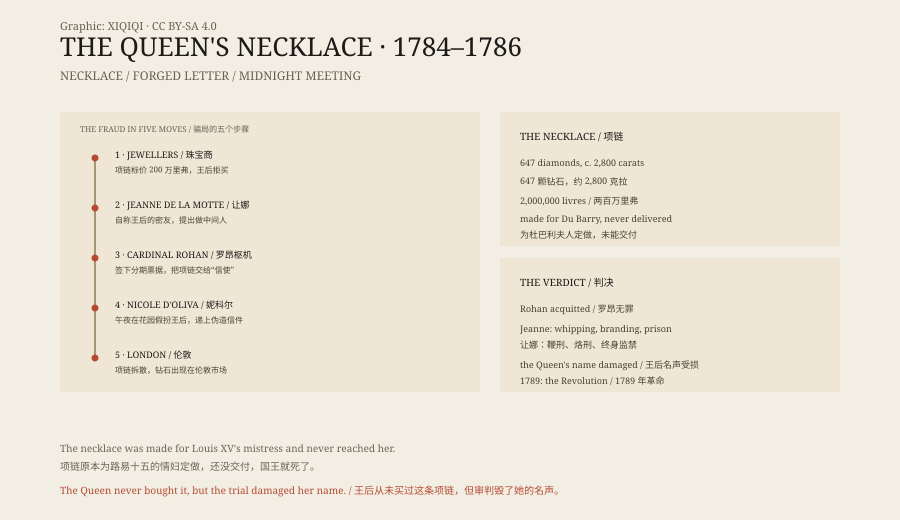
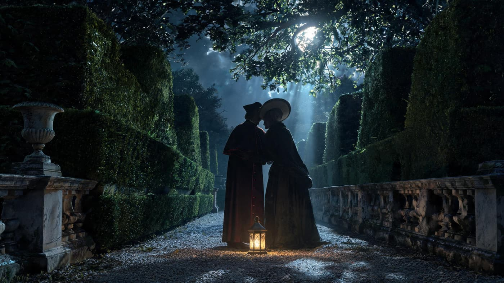

## 1. A necklace

The Paris jewellers Bohmer and Bassenge spent several years making a diamond necklace.

It held more than six hundred diamonds, about 2,800 carats in all, set in a single chain. It had been commissioned by Louis XV for his mistress Madame du Barry, but the king died of smallpox in 1774, before the necklace was delivered, and the buyer was gone.

The jewellers kept it and tried to sell it to the new queen, Marie Antoinette.

## 2. The Queen

The Queen looked at the necklace and did not buy it.

The price was two million livres, and at a time when the treasury was under strain, that sum was too conspicuous. She said she preferred to spend money elsewhere.

The jewellers were desperate. The necklace was too expensive to keep, and they even considered breaking it up and selling the diamonds separately. Then a woman appeared.

## 3. Jeanne

Her name was Jeanne de Valois-Saint-Rémy, and she called herself the Comtesse de la Motte.

She came from a poor noble family and lived on a legend of royal blood. She knew Cardinal Louis de Rohan, a powerful man who had fallen out of favour at court and was eager to win the Queen's approval.

Jeanne told the Cardinal that the Queen did want the necklace, but could not buy it openly for fear of being called extravagant. She offered to act as the intermediary.

*Original schematic: the necklace, the forged letter, the midnight meeting, and the flow of money. Not a historical painting. Oddity Archive, CC BY-SA 4.0.*

## 4. The fraud

To convince the Cardinal, Jeanne arranged a meeting.

In August 1784, in the gardens of Versailles, the Cardinal met a “Queen” at midnight. She wore a hat and a shawl, spoke to him in the dark, and gave him a letter signed “Marie Antoinette”.

There was no moon that night. Gravel sounded under the Cardinal's shoes as he carried his lantern to the agreed hedge. The woman stood in shadow, her hat pulled low, her shawl up to her chin. She did not curtsy. She simply held out a folded paper. The lantern caught the corner of the letter, and the seal was clear. The Cardinal bowed, and never saw her face.

*Reconstruction: the midnight meeting in the gardens of Versailles, August 1784. Not a historical painting. Oddity Archive, CC BY-SA 4.0.*

The “Queen” was a prostitute named Nicole d'Oliva. The letter was forged by Jeanne.

The Cardinal believed it. He bought the necklace in his own name, on credit, and gave it to Jeanne's “messenger”. The necklace was quickly broken up, and the diamonds appeared on the London market.

## 5. Exposure

The jewellers were not paid and complained to the court.

The King ordered an investigation. The Cardinal was arrested, Jeanne was arrested, and the forged letters and intermediaries were uncovered one by one. In 1786 the Parlement of Paris tried the case.

The result was unexpected: the Cardinal was acquitted and released, while Jeanne was sentenced to whipping, branding, and life imprisonment. The Queen had not been directly involved, but all of Paris was talking about her.

## 6. Afterwards

The affair did not end there.

It became a symbol of corruption at court. People believed that the Queen could meet a cardinal secretly in a garden and walk away with a two-million-livre necklace. Whether it was true no longer mattered; the story itself was damaging.

Three years later, the French Revolution began. Marie Antoinette was sent to the guillotine in 1793.

The necklace was never seen intact again. Its diamonds were scattered across crowns and jewellery in Europe, leaving only a story of greed, credulity, and court politics.

## The necklace

This necklace was made for Mary Antoinette, Queen of Louis XVI.

The jeweller Boehmer designed a huge diamond necklace, with hundreds of diamonds, at an unusually high price. He wanted the queen to buy it, but the queen didn't. The necklace was left in the shop, and it became a burden.

## Ron

Bishop Cardinal de Rohan wants to please the Queen.

He was an ambitious and indebted nobleman. He believed that if he could buy the necklace for the queen, he would enter the heart of the palace.

## Jenna

Jeanne de la Motte is the key to this scheme.

She claims to be a friend of the Queen who can arrange a secret deal. She convinces Ron that the Queen wants a necklace, but she doesn't want to buy it publicly. Ron signed the contract, took it, and handed it to Jeanna.

## Liar

The necklace is not in the hands of the Queen.

Janna and her associates took down the diamonds and sold them to London. Ron received no thanks from the queen, but was charged by the court. In 1785, Ron was arrested and brought to trial.

## Trial

The trial was held in the Paris High Court.

Ron was acquitted, and Jeanna was sentenced to flogging and imprisonment. The queen's reputation was damaged because the public believed that she really wanted the necklace. A scheme in which she was not involved became evidence of her “luxury”.

The trial was held in public.

Ron was acquitted and Jean-Jenna was sentenced. Instead of making the truth clearer, the verdict made the court more embarrassing. A pontificate, a queen, a liar, contradicts one another.

## After

Diamonds from the necklace are scattered.

Some have been recovered, others have disappeared. The necklace itself is no longer complete. Its story is longer than diamonds. On the eve of the French Revolution, the necklace became a symbol of the corruption of the palace.

## The Queen's name

Mary Antoinette didn't buy that necklace.

But the public didn't believe her. She was famous for her luxury, and the story of the necklace fits the impression. A transaction that didn't happen was evidence of her “save”.

## Decline

Diamonds from the necklaces were removed and sold to London.

Some diamonds are recovered and others disappear. Today, no one can put them back together. The necklace is just a design and a transcript.

## History

The necklace became one of the sparks of the French Revolution.

It's not how much it's worth, it's because it makes people believe that the court is dealing in secret, squandering, cheating. A scam is more dangerous than a necklace.

## Summing up

The story of this necklace is a case of “belief”.

No one really saw the queen buy the necklace, but many believed she would. The trick was not based on greed, but on the imagination of the court.

The necklace disappears and the story remains. It reminds people that a rumour that meets a person's impression does not require evidence.

---

**Sources and licenses**: the factual sources are listed in the source ledger S1–S3 at the bottom of this entry. Text and original diagrams are licensed under CC BY-SA 4.0. This article separates the origin of the necklace, the Queen's refusal, Jeanne's fraud, the trial, and the aftermath; the Queen did not buy or wear the necklace, but the affair badly damaged her reputation.
