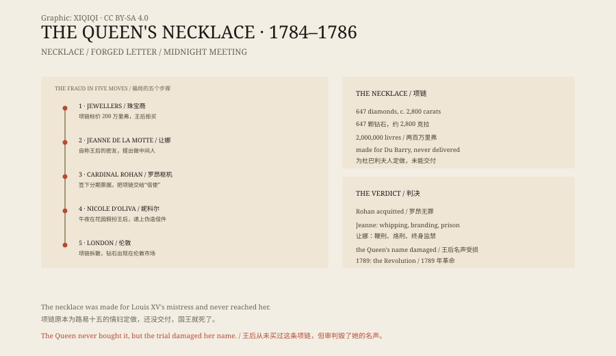
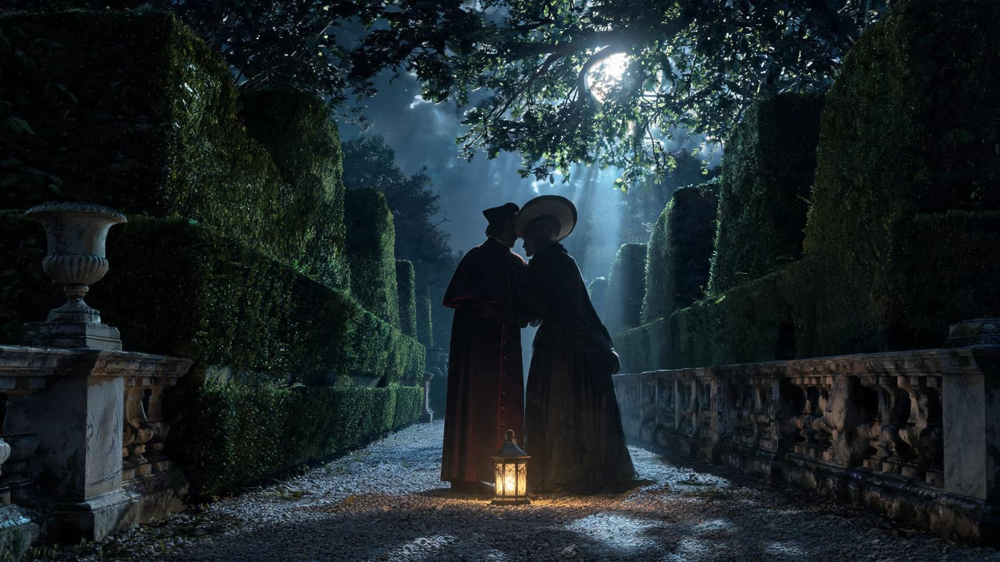

## 1. A necklace

The Paris jewellers Bohmer and Bassenge spent several years making a diamond necklace.

It held more than six hundred diamonds, about 2,800 carats in all, set in a single chain. It had been commissioned by Louis XV for his mistress Madame du Barry, but the king died of smallpox in 1774, before the necklace was delivered, and the buyer was gone.

The jewellers kept it and tried to sell it to the new queen, Marie Antoinette.

## 2. The Queen

The Queen looked at the necklace and did not buy it.

The price was two million livres, and at a time when the treasury was under strain, that sum was too conspicuous. She said she preferred to spend money elsewhere.

The jewellers were desperate. The necklace was too expensive to keep, and they even considered breaking it up and selling the diamonds separately. Then a woman appeared.

## 3. Jeanne

Her name was Jeanne de Valois-Saint-Rémy, and she called herself the Comtesse de la Motte.

She came from a poor noble family and lived on a legend of royal blood. She knew Cardinal Louis de Rohan, a powerful man who had fallen out of favour at court and was eager to win the Queen's approval.

Jeanne told the Cardinal that the Queen did want the necklace, but could not buy it openly for fear of being called extravagant. She offered to act as the intermediary.

*Original schematic: the necklace, the forged letter, the midnight meeting, and the flow of money. Not a historical painting. Oddity Archive, CC BY-SA 4.0.*

## 4. The fraud

To convince the Cardinal, Jeanne arranged a meeting.

In August 1784, in the gardens of Versailles, the Cardinal met a “Queen” at midnight. She wore a hat and a shawl, spoke to him in the dark, and gave him a letter signed “Marie Antoinette”.

There was no moon that night. Gravel sounded under the Cardinal's shoes as he carried his lantern to the agreed hedge. The woman stood in shadow, her hat pulled low, her shawl up to her chin. She did not curtsy. She simply held out a folded paper. The lantern caught the corner of the letter, and the seal was clear. The Cardinal bowed, and never saw her face.

*Reconstruction: the midnight meeting in the gardens of Versailles, August 1784. Not a historical painting. Oddity Archive, CC BY-SA 4.0.*

The “Queen” was a prostitute named Nicole d'Oliva. The letter was forged by Jeanne.

The Cardinal believed it. He bought the necklace in his own name, on credit, and gave it to Jeanne's “messenger”. The necklace was quickly broken up, and the diamonds appeared on the London market.

## 5. Exposure

The jewellers were not paid and complained to the court.

The King ordered an investigation. The Cardinal was arrested, Jeanne was arrested, and the forged letters and intermediaries were uncovered one by one. In 1786 the Parlement of Paris tried the case.

The result was unexpected: the Cardinal was acquitted and released, while Jeanne was sentenced to whipping, branding, and life imprisonment. The Queen had not been directly involved, but all of Paris was talking about her.

## 6. Afterwards

The affair did not end there.

It became a symbol of corruption at court. People believed that the Queen could meet a cardinal secretly in a garden and walk away with a two-million-livre necklace. Whether it was true no longer mattered; the story itself was damaging.

Three years later, the French Revolution began. Marie Antoinette was sent to the guillotine in 1793.

The necklace was never seen intact again. Its diamonds were scattered across crowns and jewellery in Europe, leaving only a story of greed, credulity, and court politics.

---

**Sources and licenses**: the factual sources are listed in the source ledger S1–S3 at the bottom of this entry. Text and original diagrams are licensed under CC BY-SA 4.0. This article separates the origin of the necklace, the Queen's refusal, Jeanne's fraud, the trial, and the aftermath; the Queen did not buy or wear the necklace, but the affair badly damaged her reputation.
