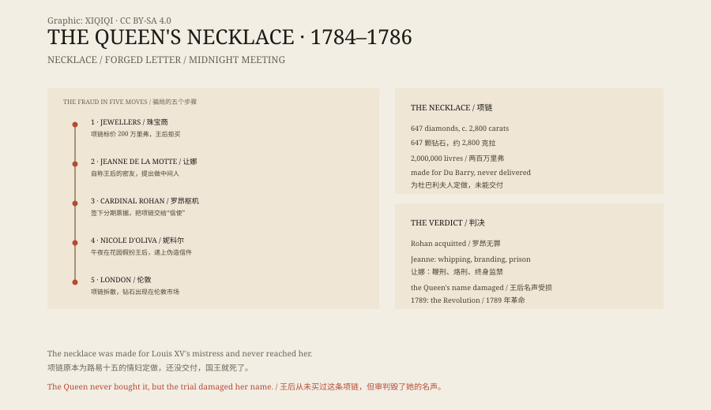

## 一、一条项链

巴黎的珠宝商伯默和巴桑热，花了几年时间做了一条钻石项链。

项链上有六百多颗钻石，总重约两千八百克拉，镶成一串。它原本是路易十五为情妇杜巴利夫人定做的，但国王在 1774 年死于天花，项链还没交付，买主就没了。

珠宝商把项链留了下来，想卖给新王后玛丽·安托瓦内特。

## 二、王后

王后看了项链，没有买。

价格是两百万里弗，在国库紧张的时候，这个数字太扎眼。王后说，她更喜欢把钱花在别的地方。

珠宝商急了。项链太贵，压在手里卖不出去，他们甚至考虑把钻石拆开单卖。就在这时，一个女人出现了。

## 三、让娜

她叫让娜·德瓦卢瓦-圣雷米，自称拉莫特伯爵夫人。

她出身没落贵族，靠一点王室血统的传说混迹宫廷。她认识罗昂枢机——一位在宫廷里失势、急于讨好王后的大人物。

让娜告诉枢机：王后其实想要那条项链，但不想公开买，怕被人说奢侈。她愿意做中间人。

*原创示意图：项链、伪造信件、午夜会面与资金流向。不是历史画作。稀奇奇编辑部，CC BY-SA 4.0。*

## 四、骗局

为了让枢机相信，让娜安排了一场会面。

1784 年 8 月，凡尔赛宫的花园里，枢机在午夜见到了一位“王后”。她戴着帽子，披着披肩，在暗处和他说话，交给他一封签着“玛丽·安托瓦内特”的信。

那位“王后”其实是一个妓女，叫妮科尔·多利瓦。信是让娜伪造的。

枢机信了。他以自己的名义买下项链，分期付款，然后把项链交给了让娜的“信使”。项链很快被拆散，钻石出现在伦敦的市场上。

## 五、败露

珠宝商没有收到钱，向宫廷投诉。

国王下令调查。枢机被捕，让娜被捕，伪造的信件和中间人一个个被挖出来。1786 年，巴黎高等法院开庭审理此案。

结果出人意料：枢机被判无罪，当庭释放；让娜被判鞭刑、烙刑和终身监禁。王后没有直接参与，但整个巴黎都在议论她。

## 六、之后

项链事件没有结束。

它成了法国宫廷腐败的象征。人们相信，王后可以在花园里秘密会见枢机，可以随手拿走一条两百万里弗的项链。真假已经不重要，故事本身就有杀伤力。

三年后，法国大革命爆发。玛丽·安托瓦内特在 1793 年被送上断头台。

那条项链再也没有完整出现过。它的钻石散落在欧洲各处的王冠和首饰上，只剩下一段关于贪婪、轻信和宫廷的故事。

---

**来源与许可**：本文的事实来源见条目底部来源台账 S1–S3。文字与原创示意图采用 CC BY-SA 4.0。文中把项链来源、王后拒买、让娜的骗局、审判与后续影响分开叙述；王后本人没有购买或佩戴这条项链，但事件严重损害了她的名声。
