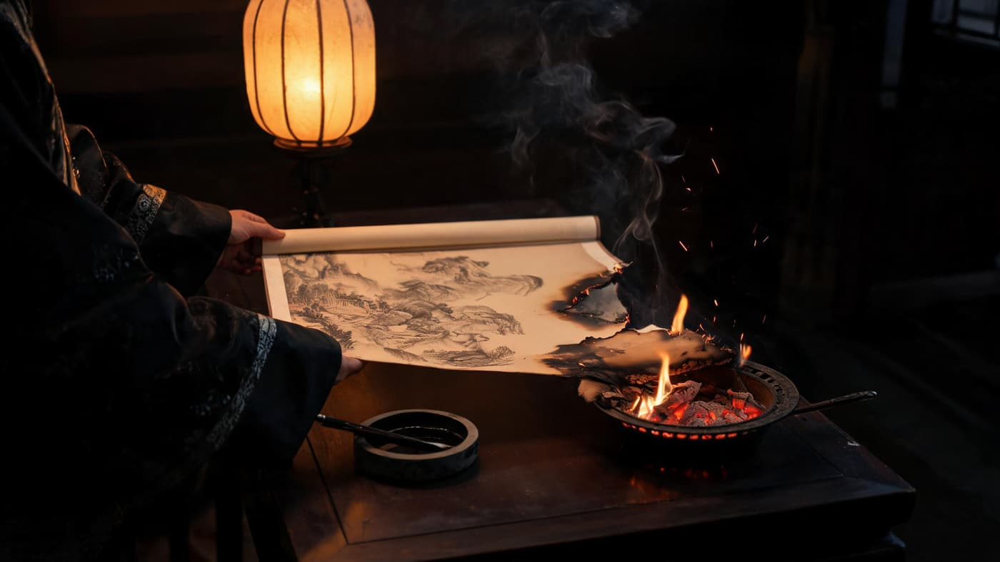
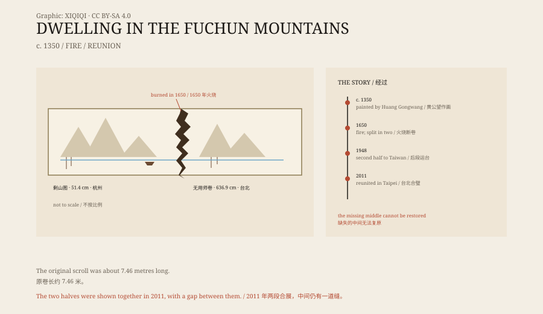

## 1. A long scroll

Dwelling in the Fuchun Mountains is a work by the Yuan-dynasty painter Huang Gongwang.

It shows the landscape along the Fuchun River in Zhejiang. It is ink on paper, originally about seven and a half metres long; unrolled, it presents a long stretch of riverbank: peaks, slopes, woods, fishing boats, and large areas of empty paper.

Huang was around eighty when he painted it. He was not making a sketch from nature; he was painting the memory of a river. He worked on it for several years, on and off, and finally gave it to a friend, Master Wuyong.

## 2. Huang Gongwang

Huang Gongwang was born in 1269 and died in 1354.

He held a minor official post when he was young, then joined the Quanzhen Daoist sect and travelled widely, supporting himself by divination and painting. He came to painting late, but soon became the leading figure of the “Four Masters of the Yuan”.

Dwelling in the Fuchun Mountains is a late work. Huang himself said that he had been at it for three or four years and still had not finished. He was in no hurry: he painted a section, stopped, and waited until his mood and brush were right before continuing.

## 3. The fire

The painting passed through many hands. In the early Qing dynasty it belonged to the collector Wu Hongyu.

Wu loved it so much that, on his deathbed, he asked for it to be burned so that it could accompany him to the next world. He lay in bed and watched as the scroll was put into the fire.

The brazier stood by the bed. As soon as the paper met the charcoal its edge curled, blackened, and the fire began to crawl inward across the painting. No one in the room moved. Wu Jing'an stood by, watched the middle of the scroll disappear, and finally reached in and pulled out what was left.

*Reconstruction: a Qing study at night, the handscroll already burning at one end as it is pulled from the brazier. Not a historical painting. Oddity Archive, CC BY-SA 4.0.*

His nephew, Wu Jing'an, could not bear it. While no one was looking, he pulled the painting out of the flames. It was already burning; he put out the fire and unrolled it. The long scroll had broken into two pieces.

*Original schematic: the original scroll, the burned break, the two collections, and the 2011 reunion. Not a reproduction of the painting. Oddity Archive, CC BY-SA 4.0.*

## 4. The two halves

The first part is shorter. It is called Remaining Mountain, and measures about 31.8 by 51.4 centimetres. It later entered the Zhejiang Provincial Museum.

The second part is longer. It is called the Master Wuyong Scroll, and measures about 33 by 636.9 centimetres. At the end of 1948 it was shipped to Taiwan and later kept at the National Palace Museum in Taipei.

Between the two halves there was once another section of the painting. It was destroyed in the fire. The two pieces can never be joined: the missing middle no longer exists.

## 5. The reunion

In June 2011, the two halves were shown together for the first time at the National Palace Museum in Taipei.

More than 360 years had passed since they were separated. The exhibition was called “A Reunion of Mountains and Rivers”. Remaining Mountain was lent from Hangzhou, and the Master Wuyong Scroll was brought out of storage. They were placed side by side in one long case.

There is still a gap between them. There is no painting in the gap, only the torn edge of the paper. Visitors standing in front of the case can see it clearly.

At the time, someone remarked: “If a painting can be like this, how can people bear it?”

## 6. Now

Dwelling in the Fuchun Mountains is still divided between the two sides of the strait.

Remaining Mountain in Hangzhou is not often displayed, and the Master Wuyong Scroll in Taipei is a restricted exhibit. Both have reproductions and digital images, but no reproduction, however complete, can close the burn.

A painting was cut by fire and then preserved by two different people. It was not restored to its original state, but it survived.

---

**Sources and licenses**: the factual sources are listed in the source ledger S1–S3 at the bottom of this entry. Text and original diagrams are licensed under CC BY-SA 4.0. This article separates Huang Gongwang's work, Wu Hongyu's fire, the two collections, and the 2011 reunion; the original length, the dimensions of the two halves, and their locations are recorded in the sources, and the section lost in the fire cannot be recovered.
