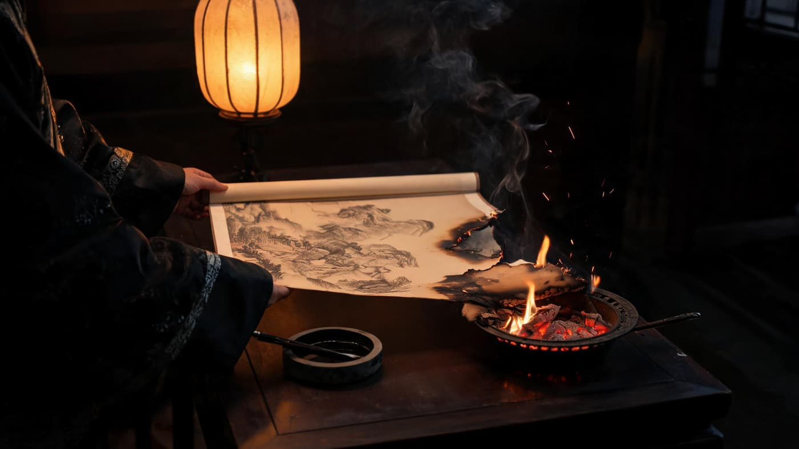
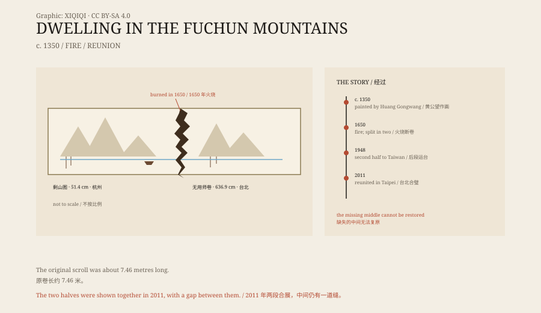

## 一、一幅长卷

《富春山居图》是元代画家黄公望的作品。

画的是浙江富春江一带的山水。纸本水墨，原长约七米半，展开来是一段很长的江岸：山峰、坡地、树林、渔舟，还有大片的留白。

黄公望画它的时候，已经八十岁左右。他不是在画一张写生，而是在画一条江的记忆。画了好几年，断断续续，最后送给了朋友“无用师”。

## 二、黄公望

黄公望生于 1269 年，死于 1354 年。

他年轻时做过小官，后来入了全真教，云游各地，靠占卜和画画为生。他学画很晚，但很快成了“元四家”之首。

《富春山居图》是他晚年的作品。他自己说，这幅画“阅三四载未得完备”，意思是画了三四年还没画完。他不着急，画一段，停一段，等心情和笔墨都对了再继续。

## 三、火

画传了几百年，到了清代初年，落到收藏家吴洪裕手里。

吴洪裕非常喜欢这幅画，喜欢到临终前要把它烧掉，带到另一个世界去。他躺在床上，看着画被投进火里。

火盆就放在床前。纸一碰到炭火，边缘立刻卷起来，变黑，火沿着纸面往里爬。屋子里的人都没有动。吴静庵站在旁边，看着画心一段段消失，终于伸手，把还没烧完的部分从火里拽了出来。

*场景复原：清初书房中，长卷一端已落入火盆、被抢出的瞬间。不是历史画作。稀奇奇编辑部，CC BY-SA 4.0。*

他的侄子吴静庵在旁边，实在看不下去，趁人不注意，把画从火里抢了出来。画已经烧着了，他扔掉了火，展开一看，长卷断成了两段。

*原创示意图：原卷、火烧断口、两段收藏地与 2011 年合璧。不是原作复制。稀奇奇编辑部，CC BY-SA 4.0。*

## 四、两段

前段比较短，叫《剩山图》，尺寸约 31.8 × 51.4 厘米。它后来进入浙江省博物馆。

后段比较长，叫《无用师卷》，尺寸约 33 × 636.9 厘米。它在 1948 年底被运到台湾，后来藏在台北故宫博物院。

两段之间，原本还有一段画心，被火烧掉了。所以它们永远接不上：中间缺的那一块，已经不存在了。

## 五、合璧

2011 年 6 月，两段在台北故宫博物院第一次合在一起展出。

距离上次分开，已经过了三百六十多年。展览叫“山水合璧”，《剩山图》从杭州借到台北，《无用师卷》从库房里拿出来，并排放在一个长柜里。

两段之间还是有一道缝。缝里没有画，只有纸的断口。观众站在柜子前，能清楚地看到那道缝。

当时有人感叹：“画是如此，人何以堪。”

## 六、现在

《富春山居图》现在仍然分藏两岸。

杭州的《剩山图》不常展出，台北的《无用师卷》也是限展文物。两段都有复制品，也都有数字影像，但复制品接得再完整，也接不上那道烧痕。

一幅画被火烧断，又被两个人分别保存下来。它没有恢复原样，但它活了下来。

---

**来源与许可**：本文的事实来源见条目底部来源台账 S1–S3。文字与原创示意图采用 CC BY-SA 4.0。文中把黄公望的创作、吴洪裕焚烧、两段收藏与 2011 年合璧分开叙述；原卷长度、两段尺寸与收藏地见来源记录，火烧后缺失的画心无法复原。
