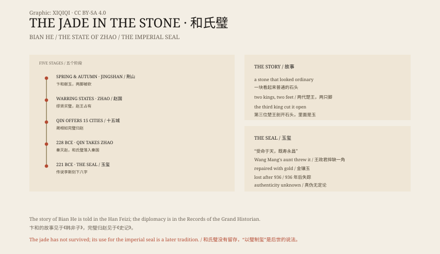

## 1. Jingshan

Jingshan lies in western Hubei, a low range of hills that produces stone.

In the Spring and Autumn period a man of Chu named Bian He found a jade-bearing stone there. It was a raw piece of jade still wrapped in rock; from the outside it looked like any other stone.

Bian He was certain there was jade inside. He took the stone to King Li of Chu.

## 2. Two feet

King Li ordered a jade craftsman to examine it. The craftsman said it was a stone.

The king was furious. He decided that Bian He had tried to deceive him, and ordered his left foot cut off.

When King Li died, King Wu came to the throne. Bian He took the stone to him. The craftsman looked again and said it was a stone. Bian He's right foot was cut off.

## 3. King Wen

After King Wu died, King Wen of Chu came to the throne.

Bian He did not go to the palace again. He sat at the foot of Jingshan and wept for three days and three nights, until his tears ran dry and he was weeping blood.

King Wen sent a man to ask him why. Many people in the world had lost feet, the messenger said. Why was he crying so bitterly?

Bian He said he was not crying for his feet. He was crying because a piece of precious jade had been called a stone, and an honest man had been called a liar.

The king had the stone cut open. Inside was jade. He named it the He Shi Bi, the Jade of Master He.

## 4. Zhao

The jade stayed in Chu for centuries.

In the late Warring States period it appeared in the state of Zhao. A eunuch at the court of King Huiwen of Zhao, a man named Miao Xian, is said to have bought it for five hundred pieces of gold. The king heard about it and took the jade for himself.

## 5. Fifteen cities

King Zhaoxiang of Qin sent an envoy to Zhao. Qin, he said, would give fifteen cities in exchange for the jade.

The king of Zhao did not dare refuse, and did not trust Qin to hand over the cities.

Lin Xiangru carried the jade to Qin. The king of Qin took it, passed it around for his courtiers to admire, and said nothing about fifteen cities.

Lin Xiangru said there was a small flaw in the jade and offered to point it out. The king handed it back. Lin Xiangru retreated to a pillar, held the jade against his chest and said that if the king tried to seize it, his head and the jade would be smashed against the pillar together.

The king, afraid of breaking the jade, apologised and agreed to fast for five days. During those days Lin Xiangru had the jade smuggled back to Zhao.

This is the origin of the phrase “returning the jade intact to Zhao”.

## 6. The imperial seal

In 228 BCE Qin captured Zhao, and the jade passed to Qin.

In 221 BCE Ying Zheng unified China and took the title of First Emperor, Qin Shi Huang. Legend says he ordered Li Si to inscribe eight characters on the jade: “Receiving the mandate from Heaven, may he enjoy long life and eternal prosperity.” The jade became the Imperial Seal.

The story is widely repeated, but early sources do not clearly say that the seal was made from the He Shi Bi. Some scholars believe the seal was made from a different piece of jade. Between the He Shi Bi and the Imperial Seal there is a layer of legend.

## 7. Gold and jade

In the Han dynasty the seal became a symbol of imperial legitimacy. Whoever held it could claim the mandate.

At the end of the Western Han, Wang Mang seized power and sent men to demand the seal from his aunt, Empress Dowager Wang Zhengjun. She was furious. She threw the seal to the ground and said that she was old and near death, and that the Wang brothers would be wiped out.

The seal lost a corner. Wang Mang had it repaired with gold. This is the origin of the phrase “gold inlaid in jade”.

## 8. Lost

For more than a thousand years the seal changed hands with each dynasty.

One story says Sun Jian found it in a well after his troops entered Luoyang. Another says that Emperor Taizong of Tang, lacking the seal, had several “mandate seals” of his own made. Another says that Li Congke, the last emperor of the Later Tang, burned himself and the seal in 936.

After that, the seal does not appear again. The Song, Yuan, Ming and Qing courts all received “imperial seals”, and every one was suspected of being a forgery.

## 9. The stone

The He Shi Bi itself has not survived.

What we have is the story in the Han Feizi, the diplomatic drama in the Records of the Grand Historian, and more than a thousand years of legend about the seal. Between them are gaps, and later additions.

One stone became a symbol of the state because one man kept insisting there was jade inside. In the end it became a thing no one can find.

*Original schematic: Bian He's presentation of the jade, the return of the jade to Zhao, and the later legend of the imperial seal. Not a photograph of the object. Oddity Archive, CC BY-SA 4.0.*

---

**Sources and licenses**: the factual sources are listed in the source ledger S1–S4 at the bottom of this entry. Text and original diagrams are licensed under CC BY-SA 4.0. This article separates the Han Feizi story of the presentation, the Records of the Grand Historian account of the return to Zhao, and the later legend of the imperial seal; the He Shi Bi itself has not survived, and the claim that the seal was made from it is a widespread tradition, not something stated clearly in the earliest sources. The illustration is a scene reconstruction, not a photograph of the object.
