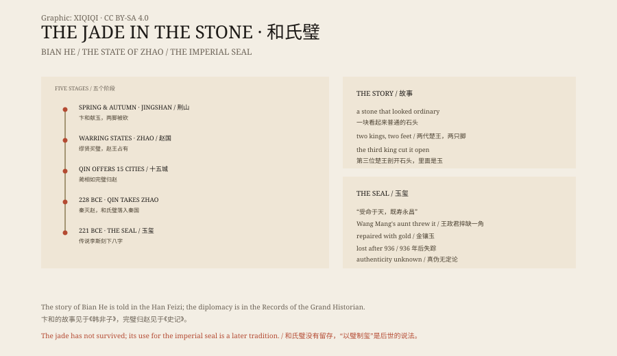

## 一、荆山

荆山在今天的湖北西部，山不高，出石头。《韩非子》写的是“楚山”，后世多认为就在荆山一带。

春秋时期，一个叫卞和的楚国人在这里找到一块玉璞。玉璞是包着石皮的玉料，从外面看，和普通石头差不多。

卞和认定里面有玉。他带着这块石头，去见楚厉王。

## 二、两只脚

楚厉王让玉工来看。玉工说，是块石头。

厉王大怒，认为卞和骗他，下令砍掉他的左脚。

厉王死后，楚武王即位。卞和又抱着石头去献。武王又让玉工看，玉工还说石头。卞和的右脚也被砍掉。

## 三、文王

武王死后，楚文王即位。

卞和没有再进宫。他抱着石头，在荆山脚下哭了三天三夜，眼泪哭干，哭出血来。

文王听说，派人去问他：天下被砍脚的人那么多，你为什么哭得这么伤心？

卞和说：我不是为脚哭。我哭的是一块宝玉被叫作石头，一个老实人被称为骗子。

文王让人剖开石头。里面是一块玉。他把它命名为“和氏之璧”。

## 四、赵国

和氏璧在楚国传了几百年。

到了战国后期，它出现在赵国。赵惠文王身边有个宦官叫缪贤，据说花五百金买下了这块璧。赵王听说，把璧要了过去。

秦昭王派使者到赵国，说愿意用十五座城换这块璧。

## 五、十五座城

赵王不敢拒绝，又怕秦国拿了璧不给城。

蔺相如带着璧去了秦国。秦王拿到璧，传给左右看，很高兴，却不提十五座城。

蔺相如说，璧上有一点瑕疵，请让我指给大王看。秦王把璧递还给他。蔺相如抱着璧退到柱子边，说：如果大王要抢，我的头就和这块璧一起撞碎在柱子上。

秦王怕璧碎了，只好道歉，答应斋戒五天。蔺相如趁这几天，让人把璧偷偷送回了赵国。

这就是“完璧归赵”。

## 六、传国玉玺

公元前 228 年，秦国攻破赵国，和氏璧落入秦国。

公元前 221 年，嬴政统一六国，称始皇帝。传说他命李斯在和氏璧上刻了八个字：“受命于天，既寿永昌”。这块璧从此变成了传国玉玺。

这个说法流传很广，但早期的史料并没有明确写“以和氏璧为玺”。也有人认为，玉玺是另一块玉做的。和氏璧和传国玉玺之间，隔着一层传说。

## 七、金镶玉

玉玺在汉朝成为皇权的象征。谁拿到它，谁就自称正统。

西汉末年，王莽篡位，派人向姑母王政君索要玉玺。王政君是汉元帝的皇后，她大怒，把玉玺扔在地上，说：我老了，快要死了，你们兄弟等着灭族吧。

玉玺摔掉了一个角。王莽让人用黄金把缺角补上。这就是“金镶玉”的来历。

## 八、失踪

此后一千多年，传国玉玺在朝代更替中反复易手。

有人说，孙坚攻入洛阳时，从井里捞出了它。有人说，唐太宗因为没有玉玺，自己刻了几方“受命玺”。也有人说，后唐末帝李从珂在 936 年自焚时，带着玉玺一起烧了。

从那以后，玉玺没有再出现。宋、元、明、清都有人献“传国玺”，但每一方都被怀疑是伪造的。

## 九、石头

和氏璧的实物没有留下来。

我们知道的，是《韩非子》里的故事、《史记》里的外交戏，和后来一千多年的玉玺传说。三者之间，有空白，也有后人添上去的东西。

一块石头，因为有人坚持说里面有玉，变成了一个国家的象征。最后，它又变回了一个找不到的东西。

*原创示意图：卞和献玉、完璧归赵与传国玉玺的流传路径。不是文物照片。稀奇奇编辑部，CC BY-SA 4.0。*

---

**来源与许可**：本文的事实来源见条目底部来源台账 S1–S4。文字与原创示意图采用 CC BY-SA 4.0。文中把《韩非子》的献玉故事、《史记》的完璧归赵与后世传国玉玺的传说分开叙述；和氏璧的实物没有留存，“以和氏璧制传国玉玺”是流传广泛的说法，早期史料没有明确记载。插图是场景复原，不是文物照片。
